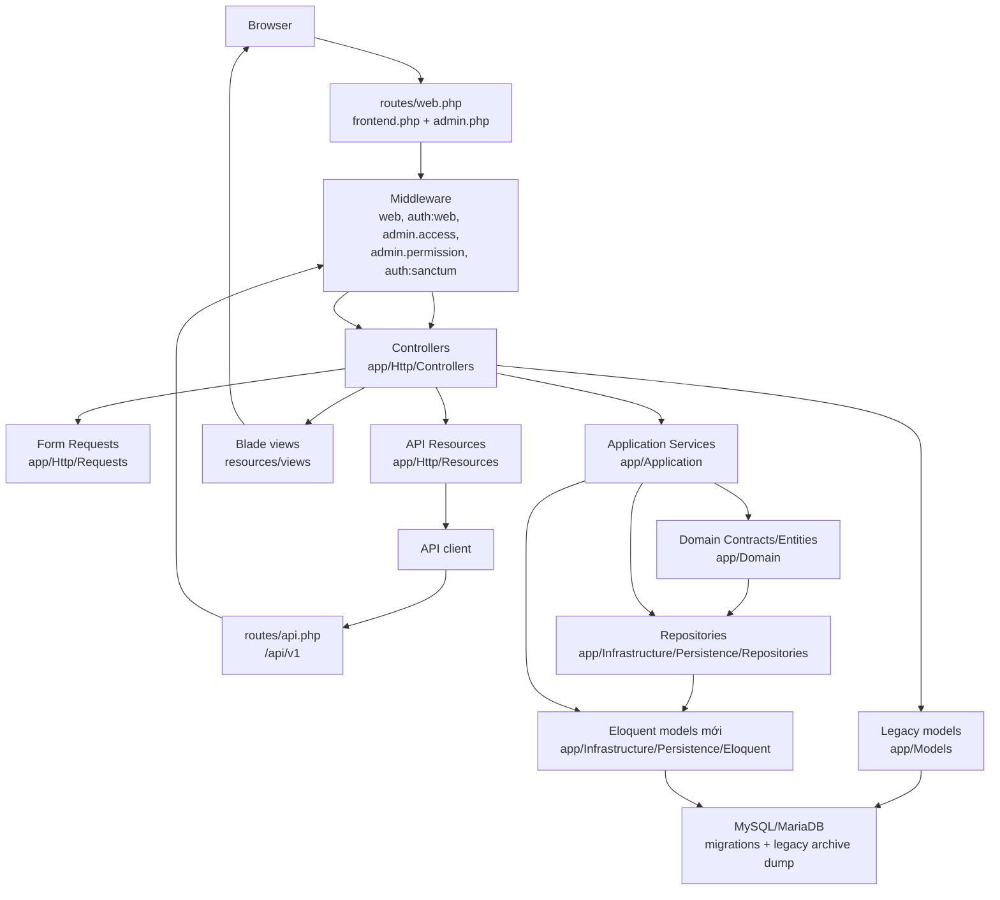
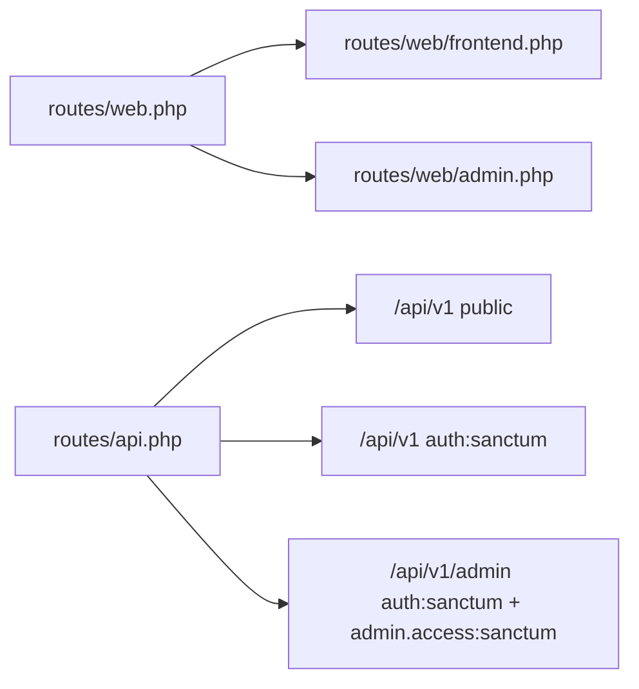

# Architecture

Tài liệu này mô tả kiến trúc hiện tại của repo để developer mới biết nên đọc và sửa code ở đâu. Đây không phải định hướng lý tưởng hóa; nội dung bám vào code đang có.

## Tổng Quan

Project là Laravel 11 với 3 bề mặt chính:

- Storefront Blade cho khách hàng.
- Admin Blade và một số JSON endpoint cho quản trị.
- API `/api/v1` dùng Sanctum cho client/API admin.

Codebase đang ở trạng thái chuyển tiếp:

- Nhiều màn legacy vẫn dùng controller trong `app/Http/Controllers` và model trong `app/Models`.
- Các module mới hơn dùng service trong `app/Application`, contract trong `app/Domain`, Eloquent model/repository trong `app/Infrastructure`.
- Một số model mới thêm accessor tương thích key legacy, ví dụ `Infrastructure\Persistence\Eloquent\Catalog\Product` append `product_id`, `product_name`, `product_price`.

## Sơ Đồ Tổng Quan



## Module Chính

| Module | Route chính | Controller | Service/model chính | View/API |
| --- | --- | --- | --- | --- |
| Home/search | `/`, `/trang-chu`, `/tim-kiem`, `/san-pham` | `HomeController` | `ProductService`, `ProductSearchService`, `CategoryService`, `BrandService` | `home`, `pages/sanpham/catalog`, `pages/sanpham/search` |
| Product detail | `/chi-tiet/{product_slug}` | `ProductController@details_product` | `ProductService`, `ProductReviewService`, `Product`, `ProductCategory`, `Brand` | `pages/sanpham/show_details` |
| Category/brand listing | `/danh-muc/{slug}`, `/thuong-hieu/{slug}` | `CategoryProduct`, `BrandProduct` | `CategoryService`, `BrandService`, `ProductService` | `pages/category/show_category`, `pages/brand/show_brand` |
| Cart | `/gio-hang`, `/add-cart-ajax`, `/update-cart`, `/remove-item` | `CartController` | `CartService`, `CouponService`, `ShippingService` | `pages/cart/cart_ajax`, cart partials |
| Checkout | `/dang-nhap`, `/checkout`, `/payment`, `/confirm-order` | `CheckoutController` | `CheckoutService`, `CartService`, `ShippingService`, `CouponService`, `Customer`, `Order` | `pages/checkout/*` |
| Customer account/order history | `/account`, `/history`, `/view-history-order/{code}` | `CustomerAccountController`, `OrderController` | `StorefrontCustomerAuth`, `StorefrontOrder`, legacy `Order` | `pages/account/manager`, `pages/history/*` |
| Admin auth/dashboard | `/admin`, `/auth-login`, `/dashboard` | `AuthController`, `AdminController` | `AdminAuthenticator`, `AdminAccess`, `AdminPermissions`, Spatie Permission | `admin/custom_auth/*`, `admin/dashboard` |
| Admin product | `/admin/products-management`, `/add-product`, `/edit-product/{id}` (`/all-product` redirects for compatibility) | `Admin\AdminWorkspaceController`, `ProductController` | `products`, `brands`, `product_categories`, `ProductService`, category/brand repositories | `admin.product.admin_index`, `admin.add_product`, `admin.edit_product` |
| Admin category/brand JSON | `/catalog/categories`, `/catalog/brands` | `Admin\Catalog\CategoryController`, `Admin\Catalog\BrandController` | `CategoryService`, `BrandService` | JSON |
| Admin order | `/admin/orders-management`, `/view-order/{code}`, `/update-order-qty` (`/manage-order` redirects for compatibility) | `Admin\AdminWorkspaceController`, `OrderController` | `orders`, `order_items`, `customers`, `payments`, `LegacyOrderWorkflowService` | `admin.order.index`, `admin.view_order` |
| CMS/content | `/bai-viet/{slug}`, `/add-post`, `/manage-slider`, `/video-shop` | `PostController`, `CategoryPost`, `SliderController`, `VideoController` | `BlogPostService`, legacy CMS models | `pages/baiviet/*`, `admin/post/*` |
| Chatbot | `/chatbot/*`, `/chat-inbox/*`, `/api/v1/chatbot/*` | `ChatController`, `Api\ChatController`, `Admin\ChatInboxController` | `Application/AI`, `ChatConversation`, `ChatMessage` | widget/admin/API |

## Route Structure



`routes/web.php` chỉ include hai file con. Khi thêm route web, thêm vào đúng file:

- Storefront: `routes/web/frontend.php`
- Admin: `routes/web/admin.php`
- API: `routes/api.php`

## Quyền Admin

Admin web dùng guard `web`, không dùng guard admin riêng:

- Login: `guest:web`
- Khu admin: `auth:web`, `admin.access`
- Từng module: `admin.permission:<permission>`

Permission canonical nằm trong `app/Support/AdminPermissions.php`:

- `manage users`
- `manage roles`
- `manage documents`
- `manage products`
- `manage content`
- `manage orders`
- `manage coupons`
- `manage system`

Vai trò mặc định: `Super Admin` và `Admin` có toàn quyền; `Editor` có sản phẩm/nội dung; `Manager` có sản phẩm/đơn hàng/coupon/tài liệu; `Staff` rỗng.

## Model Và Repository

### Model mới

Nằm trong `app/Infrastructure/Persistence/Eloquent`, ví dụ:

- `Catalog\Product`, `Brand`, `ProductCategory`, `ProductMedia`, `ProductVariant`
- `Customer\Customer`, `Customer\Address`
- `Order\Order`, `OrderItem`, `OrderShipping`, `Payment`
- `Marketing\Coupon`, `CouponRedemption`
- `Cms\BlogPost`, `BlogCategory`

### Model legacy / compatibility

Một số class trong `app/Models` còn tồn tại để tương thích hoặc phục vụ dữ liệu archive cũ. Runtime storefront/admin mới nên ưu tiên model trong `app/Infrastructure/Persistence\Eloquent`.

Ví dụ các model legacy không nên dùng cho feature mới:

- `Product` dùng bảng `tbl_product`, primary key `product_id`
- `CategoryProductModel` dùng danh mục legacy
- `Order`, `OrderDetails` dùng order legacy
- `Coupon`, `Customer`, `Slider`, `Video`, `Gallery`

Một số class trong `app/Models` không còn trỏ trực tiếp vào bảng legacy, ví dụ `Post` là wrapper quanh `Cms\BlogPost`, `News` dùng bảng `news`, `User` là model auth chuẩn.

Không thêm code runtime mới phụ thuộc `tbl_*`. Nếu cần kiểm tra regression legacy, chạy:

```bash
php artisan legacy:audit-runtime --fail-on-issues
```

## View Structure

| Khu vực | Vị trí |
| --- | --- |
| Storefront layout | `resources/views/layout.blade.php`, `resources/views/layouts/home-tech.blade.php` |
| Storefront partial | `resources/views/partials/storefront` |
| Home partial | `resources/views/pages/home/partials` |
| Catalog/product | `resources/views/pages/sanpham`, `pages/category`, `pages/brand` |
| Cart | `resources/views/pages/cart` |
| Checkout | `resources/views/pages/checkout` |
| History/account | `resources/views/pages/history`, `pages/account` |
| Admin layout | `resources/views/admin_layout.blade.php` |
| Admin partial | `resources/views/partials/admin` |
| Admin modules | `resources/views/admin` |

## Quy Ước Code Trong Repo

- Bắt đầu từ route, không đoán service.
- Nếu controller đã inject service, giữ logic nghiệp vụ trong service.
- Nếu màn legacy đang dùng `app/Models`, sửa nhỏ theo pattern hiện tại trước khi refactor lớn.
- Dùng Form Request nếu module đã có request tương ứng trong `app/Http/Requests`.
- Với thay đổi DB, tạo migration mới; không sửa migration cũ nếu không được yêu cầu.
- Với admin route, đặt đúng permission group.
- Với API, trả response qua Resource nếu endpoint cùng nhóm đang dùng Resource.
- Với UI storefront, không đổi header/search/cart/auth behavior nếu task không yêu cầu.
- Với sản phẩm, chú ý `ProductService` ghi file vào `public/uploads/product`, document vào `public/uploads/document`, đồng thời copy ảnh sang `public/uploads/gallery` để tương thích legacy.
- Với cart/checkout, nhớ web cart nằm trong session key `cart`, không phải bảng `carts`.
