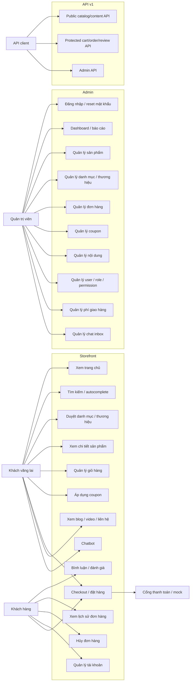
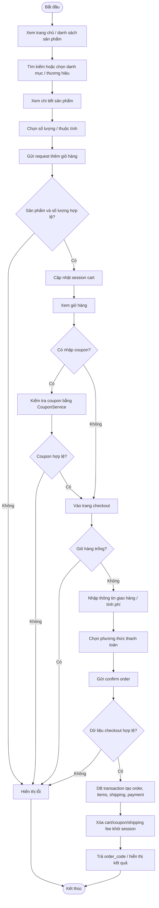
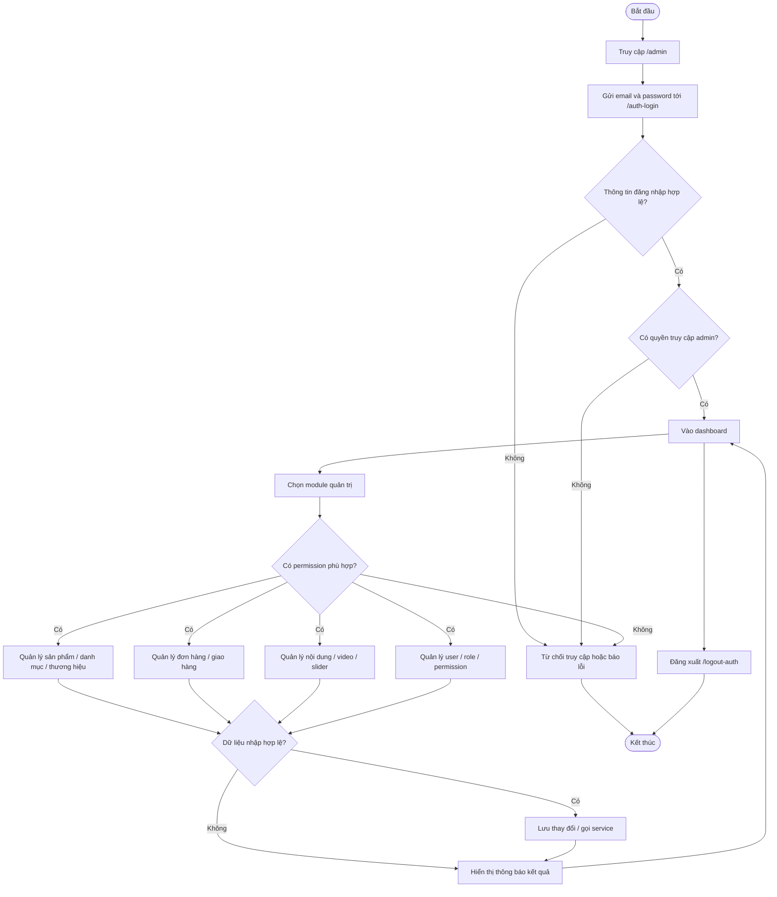
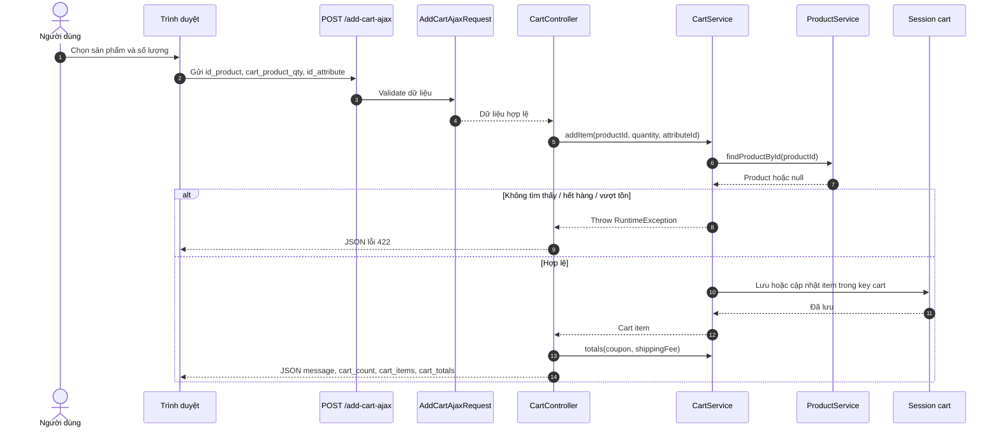
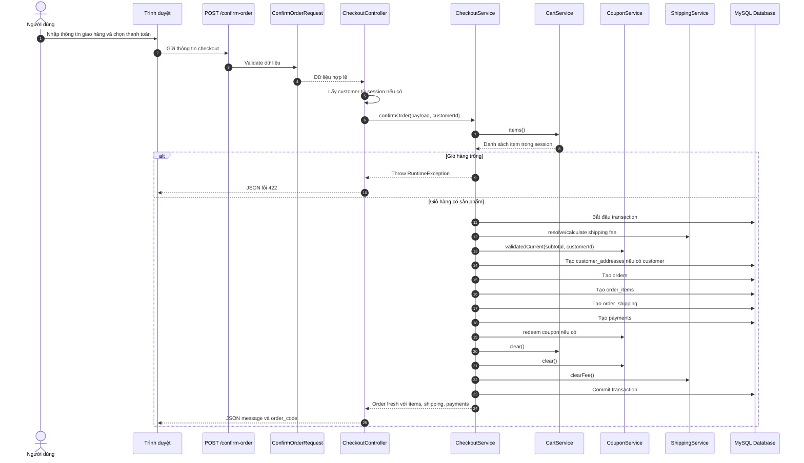
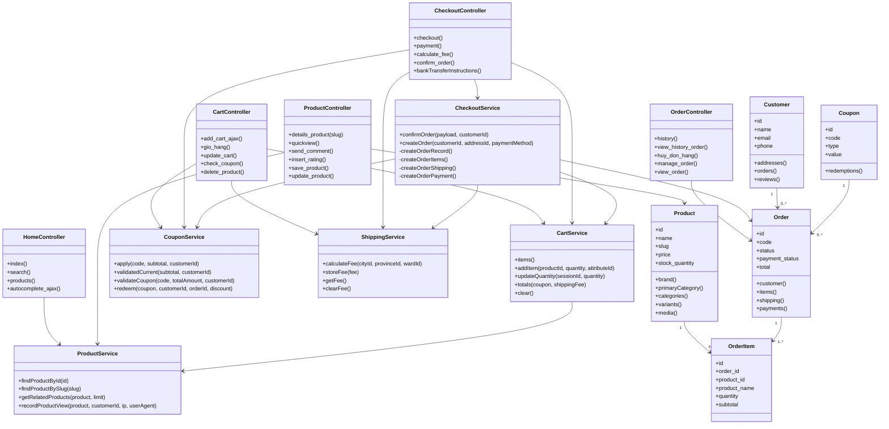
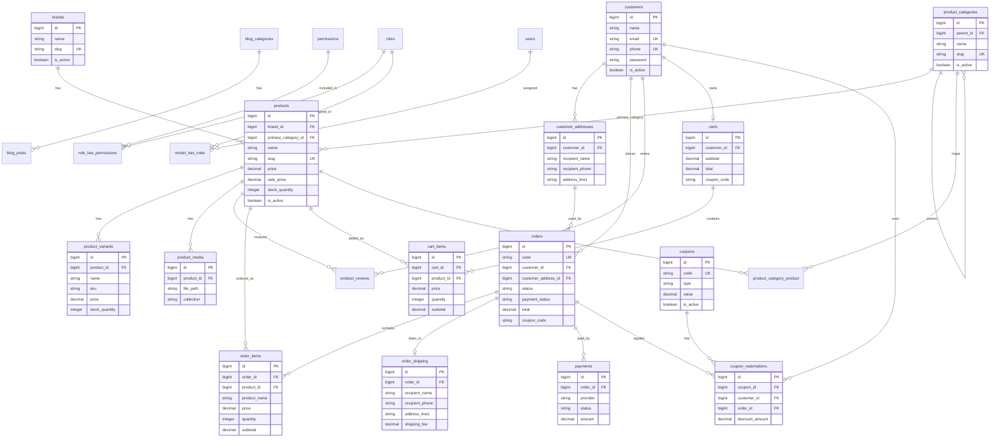

# CHƯƠNG 2. PHÂN TÍCH VÀ THIẾT KẾ HỆ THỐNG

## 2.1. Mở đầu chương

Chương này trình bày quá trình phân tích và thiết kế hệ thống cho đề tài xây dựng website bán hàng thiết bị công nghệ bằng `Laravel 11`. Nội dung được xây dựng theo định hướng của mục `Graduation Thesis Report Guide` trong `DOCUMENTATION_TEMPLATE.md`, phần Chương 2 dành cho đề tài lập trình theo hướng phân tích thiết kế hệ thống hướng đối tượng.

Phạm vi của chương bao gồm khảo sát hệ thống hiện tại, phân tích yêu cầu, xác định actor, xác định phạm vi chức năng, mô hình hóa bằng use case, activity diagram, sequence diagram, class diagram mức phân tích, ERD, thiết kế cơ sở dữ liệu và thiết kế giao diện người dùng. Các sơ đồ được viết bằng Mermaid để có thể chuyển đổi thành hình trong báo cáo hoặc tài liệu kỹ thuật.

Trước khi viết chương này, dự án đã được kiểm tra qua các file và thư mục chính: `DOCUMENTATION_TEMPLATE.md`, `composer.json`, `package.json`, `routes/web.php`, `routes/web/frontend.php`, `routes/web/admin.php`, `routes/api.php`, `app/Http/Controllers`, `app/Models`, `app/Infrastructure/Persistence/Eloquent`, `app/Application`, `app/Domain`, `database/migrations` và `resources/views`. Vì vậy, các chức năng được mô tả trong chương này chỉ dựa trên chức năng có cơ sở trong code hiện tại. Những phần chưa xác định được từ code sẽ được ghi rõ là "chưa xác định từ code".

Về công nghệ, dự án sử dụng `Laravel 11`, `PHP 8.2`, `Blade`, `MySQL`, `HTML`, `CSS`, `JavaScript` và `Vite`. Ngoài ra, dự án có sử dụng một số thư viện hỗ trợ như `laravel/sanctum`, `laravel/ui`, `laravel/socialite`, `spatie/laravel-permission`, `barryvdh/laravel-dompdf`, `darkaonline/l5-swagger`, `Bootstrap`, `Tailwind CSS`, `Vue`, `Pinia` và `Axios`. Tuy nhiên, phần phân tích thiết kế tập trung vào website bán hàng và các luồng nghiệp vụ chính, không đi sâu vào chi tiết triển khai từng thư viện.

## 2.2. Khảo sát hệ thống và bối cảnh bài toán

### 2.2.1. Bối cảnh đề tài

Đề tài hướng tới xây dựng website bán hàng thiết bị công nghệ bằng Laravel. Nhóm sản phẩm thiết bị công nghệ thường bao gồm laptop, điện thoại, phụ kiện và các sản phẩm liên quan. Đặc điểm của nhóm sản phẩm này là người dùng thường cần xem nhiều thông tin trước khi mua: thương hiệu, danh mục, hình ảnh, giá bán, giá khuyến mãi, thuộc tính sản phẩm, đánh giá, sản phẩm liên quan và chính sách giao hàng.

Từ góc độ vận hành, website không chỉ cần giao diện bán hàng cho khách mà còn cần khu vực quản trị để quản lý sản phẩm, danh mục, thương hiệu, nội dung, đơn hàng, mã giảm giá, người dùng nội bộ, quyền truy cập và một số báo cáo. Dự án hiện tại phản ánh đúng mô hình này thông qua hai nhóm route chính: storefront trong `routes/web/frontend.php` và admin trong `routes/web/admin.php`.

### 2.2.2. Khảo sát hệ thống hiện tại từ mã nguồn

Qua kiểm tra `routes/web.php`, file này không khai báo route trực tiếp mà require hai file con:

- `routes/web/frontend.php`: chứa route cho khách hàng và storefront.
- `routes/web/admin.php`: chứa route cho quản trị viên và khu vực admin.

Qua kiểm tra `routes/api.php`, hệ thống có thêm API theo prefix `v1`. API được chia thành ba nhóm:

- Public API: sản phẩm, danh mục, thương hiệu, blog, coupon, settings, chatbot, health check.
- Protected API dùng `auth:sanctum`: user profile, cart, order, review.
- Admin API dùng `auth:sanctum` và `admin.access:sanctum`: quản lý product, category, brand, order và statistics.

Qua kiểm tra `app/Http/Controllers`, hệ thống có các controller chính phục vụ storefront như `HomeController`, `ProductController`, `CategoryProduct`, `BrandProduct`, `CartController`, `CheckoutController`, `OrderController`, `CustomerAccountController`, `CompareController`, `PostController`, `ContactController`, `VideoController`, `ChatController` và `MailController`. Khu vực admin có các controller như `AuthController`, `AdminController`, `ProductController`, `CategoryProductAdminController`, `BrandProduct`, `OrderController`, `CouponController`, `DeliveryController`, `UserController`, `UserRolesController`, `SliderController`, `PostController`, `VideoController`, `DocumentController`, `ContactController`, `Admin\Catalog\CategoryController`, `Admin\Catalog\BrandController`, `Admin\ProductProfitController` và `Admin\ProductDiscoveryReportController`.

Qua kiểm tra `database/migrations`, hệ thống có các bảng chuẩn hóa cho catalog, khách hàng, giỏ hàng, đơn hàng, thanh toán, coupon, blog, video, review, analytics, chatbot, settings và phân quyền. Một số bảng chính gồm `products`, `brands`, `product_categories`, `product_variants`, `product_media`, `product_category_product`, `customers`, `customer_addresses`, `carts`, `cart_items`, `orders`, `order_items`, `order_shipping`, `payments`, `coupons`, `coupon_redemptions`, `users`, `roles`, `permissions`, `blog_posts`, `videos` và `product_reviews`.

Qua kiểm tra `resources/views`, hệ thống sử dụng `Blade` cho nhiều nhóm giao diện: trang chủ, danh sách sản phẩm, chi tiết sản phẩm, giỏ hàng, checkout, lịch sử đơn hàng, tài khoản khách hàng, blog, video, compare, admin dashboard, quản lý sản phẩm, quản lý đơn hàng, coupon, giao hàng, user, role, media và authentication.

### 2.2.3. Nhận xét về hiện trạng kiến trúc

Hệ thống hiện tại có đặc điểm lai giữa mã nguồn legacy và lớp kiến trúc chuẩn hóa mới. Một số controller storefront/admin vẫn sử dụng tên phương thức và route theo phong cách legacy, ví dụ `add_cart_ajax`, `save_product`, `all_product`, `manage_order`. Đồng thời, hệ thống cũng có các lớp service và Eloquent chuẩn hóa trong `app/Application`, `app/Domain` và `app/Infrastructure/Persistence/Eloquent`.

Ví dụ, luồng giỏ hàng storefront sử dụng `CartController` nhưng nghiệp vụ được đẩy sang `App\Application\Checkout\Services\CartService`. Luồng đặt hàng dùng `CheckoutController` và `CheckoutService`. Dữ liệu sản phẩm có model chuẩn hóa `App\Infrastructure\Persistence\Eloquent\Catalog\Product`, đồng thời vẫn có model legacy `App\Models\Product`. Điều này cho thấy hệ thống đang trong quá trình chuyển đổi hoặc đồng tồn tại giữa lớp legacy và lớp thiết kế mới.

Trong báo cáo, việc mô tả hệ thống cần phản ánh đúng đặc điểm này: hệ thống không phải một Laravel CRUD thuần đơn giản, mà là một website bán hàng có storefront, admin, API, service layer, Eloquent model chuẩn hóa và một số phần legacy để giữ tương thích.

### 2.2.4. Khảo sát website tương tự

Trong phạm vi đọc code hiện tại, chưa có tài liệu khảo sát URL cụ thể của các website tương tự được lưu trong repo. Vì vậy, phần khảo sát website tương tự ở đây chỉ được trình bày ở mức tiêu chí chức năng phổ biến của website bán lẻ thiết bị công nghệ, không đánh giá chi tiết từng URL.

Các website bán lẻ thiết bị công nghệ thường có các nhóm chức năng sau:

- Hiển thị trang chủ với banner, danh mục, sản phẩm nổi bật, sản phẩm khuyến mãi và tin tức.
- Cho phép người dùng tìm kiếm sản phẩm theo từ khóa và duyệt sản phẩm theo danh mục hoặc thương hiệu.
- Cung cấp trang chi tiết sản phẩm gồm hình ảnh, giá, mô tả, đánh giá, sản phẩm liên quan và nút thêm vào giỏ hàng.
- Cung cấp giỏ hàng, mã giảm giá, phí vận chuyển và luồng checkout.
- Cho phép khách hàng đăng ký, đăng nhập, xem lịch sử đơn hàng và hủy đơn khi còn trong trạng thái cho phép.
- Cung cấp khu vực quản trị để quản lý sản phẩm, danh mục, thương hiệu, đơn hàng, nội dung, tài khoản quản trị và quyền truy cập.

Đối chiếu với mã nguồn dự án, các nhóm chức năng trên phần lớn đều có cơ sở trong route, controller, view và migration hiện tại.

## 2.3. Phân tích yêu cầu hệ thống

### 2.3.1. Mục tiêu hệ thống

Mục tiêu của hệ thống là xây dựng một website bán hàng thiết bị công nghệ có khả năng phục vụ người dùng ở phía storefront và hỗ trợ quản trị viên vận hành ở phía admin. Hệ thống cần cho phép khách hàng duyệt sản phẩm, tìm kiếm, xem chi tiết, thêm sản phẩm vào giỏ hàng, áp dụng mã giảm giá, nhập thông tin giao hàng, đặt hàng, xem lịch sử đơn hàng và tương tác với một số nội dung hỗ trợ như blog, video, liên hệ hoặc chatbot.

Ở phía quản trị, hệ thống cần hỗ trợ đăng nhập admin, phân quyền, quản lý sản phẩm, danh mục, thương hiệu, thuộc tính, gallery, bình luận, đơn hàng, coupon, vận chuyển, người dùng, role, permission, nội dung, video, slider, tài liệu và báo cáo. Các chức năng này được xác định từ `routes/web/admin.php` và các controller tương ứng trong `app/Http/Controllers`.

### 2.3.2. Đối tượng người dùng

Hệ thống có ba nhóm người dùng chính:

- Khách vãng lai: người truy cập chưa đăng nhập, có thể xem trang chủ, xem sản phẩm, tìm kiếm, xem chi tiết, thêm giỏ hàng, xem giỏ hàng, checkout theo luồng cho phép guest và xem hướng dẫn thanh toán nếu vừa đặt đơn guest.
- Khách hàng: người dùng có tài khoản trong bảng `customers`, có thể đăng nhập qua form checkout hoặc social login, đặt hàng, xem lịch sử đơn hàng, xem chi tiết đơn hàng, hủy đơn khi điều kiện cho phép và quản lý tài khoản.
- Quản trị viên: người dùng trong bảng `users`, đăng nhập khu vực admin và được kiểm soát bằng role/permission qua `spatie/laravel-permission`.

Ngoài ba nhóm trên, hệ thống còn có API client dùng `auth:sanctum` đối với các API bảo vệ. Tuy nhiên, trong phạm vi báo cáo ĐATN về website bán hàng, API client được xem là tác nhân kỹ thuật hỗ trợ tích hợp, không phải người dùng cuối chính.

### 2.3.3. Phạm vi chức năng

Phạm vi trong chương này gồm các chức năng đã xác định từ code:

- Storefront: trang chủ, danh sách sản phẩm, tìm kiếm, autocomplete, danh mục, thương hiệu, chi tiết sản phẩm, quickview, đánh giá, bình luận, sản phẩm liên quan, gợi ý sản phẩm, so sánh, yêu thích, giỏ hàng, coupon, checkout, phí vận chuyển, thanh toán, hướng dẫn chuyển khoản, lịch sử đơn hàng, hủy đơn, tài khoản khách hàng, blog, video, liên hệ, chatbot.
- Admin: đăng nhập, đăng ký admin theo điều kiện, quên mật khẩu, dashboard, quick search, profile, settings, quản lý sản phẩm, danh mục, thương hiệu, thuộc tính, gallery, bình luận, đơn hàng, in đơn PDF, coupon, vận chuyển, người dùng, role/permission, bài viết, slider, video, contact/site information, document, báo cáo lợi nhuận sản phẩm, báo cáo product discovery, chat inbox.
- API: sản phẩm, danh mục, thương hiệu, cart, order, auth, review, coupon, blog, settings, chatbot, admin API và statistics.

Các chức năng chưa xác định từ code hoặc chỉ thấy route bị comment/tạm tắt:

- Tích hợp thanh toán thật với `MoMo` và `VNPAY`: chưa xác định từ code; trong `CheckoutController`, `momo_payment` và `vnpay_payment` trả thông báo cổng đang tạm tắt, còn `VnPayMockController` chỉ là mock.
- Tự động xác nhận giao dịch ngân hàng: chưa xác định từ code.
- Trừ tồn kho sau khi checkout: chưa xác định rõ từ code trong `CheckoutService`; có kiểm tra tồn khi thêm giỏ qua `CartService`, nhưng không thấy luồng trừ tồn kho trong đoạn code đã inspect.
- Quản lý giao vận thực tế với đơn vị vận chuyển bên ngoài: chưa xác định từ code.

## 2.4. Yêu cầu chức năng

### 2.4.1. Nhóm chức năng storefront

| Mã yêu cầu | Tên chức năng | Mô tả | Cơ sở trong code |
|---|---|---|---|
| SF-01 | Xem trang chủ | Người dùng xem banner, danh mục, thương hiệu, sản phẩm nổi bật, flash sale, tin tức và chính sách. | `GET /`, `GET /trang-chu`, `HomeController@index`, `resources/views/home.blade.php` |
| SF-02 | Xem danh sách sản phẩm | Người dùng xem toàn bộ sản phẩm hoặc sản phẩm bán chạy. | `GET/POST /san-pham`, `GET /san-pham-ban-chay`, `HomeController@products`, `HomeController@best_selling` |
| SF-03 | Tìm kiếm sản phẩm | Người dùng tìm kiếm theo từ khóa và nhận gợi ý autocomplete. | `GET/POST /tim-kiem`, `POST /autocomplete-ajax`, `HomeController@search`, `HomeController@autocomplete_ajax` |
| SF-04 | Xem sản phẩm theo danh mục | Người dùng xem sản phẩm thuộc một danh mục. | `GET /danh-muc/{slug_category_product}`, `CategoryProduct@show_category_home` |
| SF-05 | Xem sản phẩm theo thương hiệu | Người dùng xem sản phẩm thuộc một thương hiệu. | `GET /thuong-hieu/{brandSlug}`, `BrandProduct@show_brand_home` |
| SF-06 | Xem chi tiết sản phẩm | Người dùng xem mô tả, hình ảnh, gallery, thuộc tính, đánh giá, sản phẩm liên quan và gợi ý. | `GET /chi-tiet/{product_slug}`, `ProductController@details_product` |
| SF-07 | Quick view sản phẩm | Người dùng xem nhanh thông tin sản phẩm qua AJAX. | `POST /quickview`, `ProductController@quickview` |
| SF-08 | Bình luận và đánh giá | Người dùng gửi bình luận, tải bình luận, gửi rating. | `POST /send-comment`, `POST /load-comment`, `POST /insert-rating`, `ProductController` |
| SF-09 | So sánh sản phẩm | Người dùng truy cập trang so sánh. | `GET /so-sanh`, `CompareController@index` |
| SF-10 | Yêu thích | Người dùng truy cập trang yêu thích. | `GET /yeu-thich`, `HomeController@yeu_thich` |
| SF-11 | Giỏ hàng | Khách vãng lai và khách hàng có thể thêm, cập nhật, xóa sản phẩm trong giỏ hàng. Luồng storefront web lưu giỏ hàng trong session. | `CartController`, `CartService`, các route `/add-cart-ajax`, `/gio-hang`, `/update-cart`, `/remove-item` |
| SF-12 | Áp dụng coupon | Người dùng nhập mã giảm giá và hệ thống kiểm tra điều kiện. | `POST /check-coupon`, `DELETE /unset-coupon`, `CouponService` |
| SF-13 | Checkout | Khách vãng lai có thể checkout theo luồng guest nếu có giỏ hàng và thông tin giao hàng hợp lệ; khách hàng đăng nhập có thể checkout gắn với tài khoản. | `GET /checkout`, `GET /payment`, `POST /confirm-order`, `CheckoutController`, `CheckoutService` |
| SF-14 | Tính phí giao hàng | Người dùng chọn địa chỉ để tính phí vận chuyển. | `POST /calculate-fee`, `POST /select-delivery-home`, `ShippingService`, `locations`, `shipping_fees` |
| SF-15 | Lịch sử đơn hàng | Khách hàng đăng nhập xem danh sách và chi tiết đơn hàng; khách vãng lai chỉ có thể xem hướng dẫn/đơn vừa đặt nếu session còn lưu `guest_order_code`. | `GET /history`, `GET /view-history-order/{order_code}`, `OrderController` |
| SF-16 | Hủy đơn hàng | Khách hàng gửi lý do hủy đơn nếu trạng thái cho phép. Khả năng hủy đơn của khách vãng lai ngoài phiên đặt hàng chưa xác định từ code. | `POST /huy-don-hang`, `OrderController@huy_don_hang` |
| SF-17 | Đăng ký/đăng nhập khách hàng | Khách đăng ký, đăng nhập, đăng xuất trong luồng checkout. | `GET /dang-nhap`, `GET /dang-ky`, `POST /add-customer`, `POST /login-customer`, `CheckoutController` |
| SF-18 | Tài khoản khách hàng | Khách hàng xem/cập nhật hồ sơ, đổi mật khẩu, gửi review. | `GET /account`, `POST /account/update`, `POST /account/change-password`, `CustomerAccountController` |
| SF-19 | Blog, video, liên hệ | Người dùng xem bài viết, danh mục bài viết, video và trang liên hệ. | `PostController`, `VideoController`, `ContactController` |
| SF-20 | Chatbot | Người dùng gửi tin nhắn và xem hội thoại chatbot. | `GET /chatbot/conversation`, `POST /chatbot/messages`, `ChatController` |

### 2.4.2. Nhóm chức năng admin

| Mã yêu cầu | Tên chức năng | Mô tả | Cơ sở trong code |
|---|---|---|---|
| AD-01 | Đăng nhập admin | Quản trị viên đăng nhập vào khu vực quản trị. | `GET /admin`, `POST /auth-login`, `AuthController@login_auth`, `AuthController@login` |
| AD-02 | Đăng ký admin | Tạo tài khoản quản trị theo bootstrap mode hoặc invite code. | `GET /admin/register`, `POST /admin/register`, `AuthController@register` |
| AD-03 | Quên/đặt lại mật khẩu admin | Gửi link reset và đặt lại mật khẩu admin. | `AuthController@sendResetLink`, `AuthController@resetPassword` |
| AD-04 | Dashboard | Quản trị viên xem dashboard và thống kê theo ngày. | `GET /dashboard`, `POST /dashboard-filter`, `AdminController` |
| AD-05 | Quản lý sản phẩm | Thêm, sửa, xóa, kích hoạt, tắt kích hoạt sản phẩm. | `ProductController@add_product`, `save_product`, `all_product`, `edit_product`, `update_product` |
| AD-06 | Quản lý danh mục | Quản lý danh mục legacy và API admin catalog categories. | `CategoryProductAdminController`, `Admin\Catalog\CategoryController` |
| AD-07 | Quản lý thương hiệu | Thêm, sửa, xóa, bật/tắt thương hiệu. | `BrandProduct`, `Admin\Catalog\BrandController` |
| AD-08 | Quản lý thuộc tính và gallery | Quản lý attribute, product attribute, gallery sản phẩm. | `AttributeController`, `ProductAttributeController`, `GalleryController` |
| AD-09 | Quản lý bình luận | Duyệt và phản hồi bình luận sản phẩm. | `GET /comment`, `POST /allow-comment`, `POST /reply-comment` |
| AD-10 | Quản lý đơn hàng | Xem, cập nhật trạng thái, cập nhật số lượng, xóa/in đơn hàng. | `OrderController@manage_order`, `view_order`, `update_order_qty`, `print_order` |
| AD-11 | Quản lý coupon | Thêm, xem danh sách, xóa coupon. | `CouponController@insert_coupon`, `list_coupon`, `insert_coupon_code`, `delete_coupon` |
| AD-12 | Quản lý giao hàng | Cấu hình địa bàn và phí vận chuyển. | `DeliveryController`, route `/delivery`, `/insert-delivery`, `/update-delivery` |
| AD-13 | Quản lý nội dung | Quản lý bài viết, danh mục bài viết, slider, video, thông tin liên hệ. | `PostController`, `CategoryPost`, `SliderController`, `VideoController`, `ContactController` |
| AD-14 | Quản lý user, role, permission | Tạo user admin, gán role, gán permission. | `UserController`, `UserRolesController`, `spatie/laravel-permission` |
| AD-15 | Quản lý tài liệu | Đọc, tải xuống, xóa tài liệu. | `DocumentController` |
| AD-16 | Báo cáo | Xem báo cáo lợi nhuận sản phẩm và product discovery. | `ProductProfitController`, `ProductDiscoveryReportController` |
| AD-17 | Chat inbox | Admin xem, phản hồi, gán và đổi trạng thái hội thoại chat. | `Admin\ChatInboxController` |

### 2.4.3. Nhóm chức năng API

API không phải giao diện chính của báo cáo nhưng có tồn tại trong repo. Các chức năng API được xác định từ `routes/api.php` gồm:

- API sản phẩm: `/api/v1/products`, `/api/v1/products/latest`, `/api/v1/products/featured`, `/api/v1/products/search`, `/api/v1/products/recommendations`, `/api/v1/products/{slug}`.
- API danh mục và thương hiệu: `/api/v1/categories`, `/api/v1/categories/tree`, `/api/v1/brands`.
- API authentication: `/api/v1/auth/login`, `/api/v1/auth/register`, `/api/v1/auth/refresh`, `/api/v1/auth/logout`.
- API cart và order yêu cầu `auth:sanctum`: `/api/v1/cart`, `/api/v1/orders`.
- API review, coupon, blog, settings và chatbot.
- Admin API cho products, categories, brands, orders và statistics dưới `/api/v1/admin`.

## 2.5. Yêu cầu phi chức năng

| Nhóm yêu cầu | Mô tả | Cơ sở/ghi chú |
|---|---|---|
| Bảo mật | Hệ thống cần kiểm soát đăng nhập, phân quyền, CSRF, validation và bảo vệ route admin. | `auth:web`, `admin.access`, `admin.permission`, `auth:sanctum`, Form Request trong `app/Http/Requests` |
| Phân quyền | Admin được phân quyền theo nhóm chức năng. | `AdminPermissions`, `spatie/laravel-permission`, bảng `roles`, `permissions` |
| Tính đúng đắn dữ liệu | Checkout cần tạo đơn hàng, chi tiết đơn, giao hàng và thanh toán nhất quán. | `CheckoutService@confirmOrder` dùng `DB::transaction` |
| Khả năng mở rộng | Hệ thống tách route, controller, service, domain và persistence layer. | `app/Application`, `app/Domain`, `app/Infrastructure/Persistence/Eloquent` |
| Hiệu năng | Danh sách sản phẩm, tìm kiếm, trang chủ và admin cần phân trang/tối ưu truy vấn. | Có paginate trong nhiều service/controller; có migration index; có service tối ưu database/performance |
| Khả dụng | Trang chủ có fallback demo data khi bảng chưa sẵn sàng trong một số đoạn code. | `HomeController` có các fallback nếu thiếu dữ liệu |
| Giao diện | Giao diện cần responsive, có storefront và admin layout riêng. | `resources/views/partials/storefront`, `resources/views/partials/admin`, `resources/css`, `package.json` |
| Bảo trì | Mã nguồn cần dễ theo dõi theo module. | Tách route `frontend.php`, `admin.php`, có service layer |
| Tương thích dữ liệu legacy | Một số luồng cần tương thích bảng legacy nếu còn tồn tại. | Nhiều controller kiểm tra `Schema::hasTable` cho bảng legacy |

Một số yêu cầu phi chức năng chưa xác định từ code:

- SLA, thời gian phản hồi mục tiêu cụ thể: chưa xác định từ code.
- Số lượng người dùng đồng thời mục tiêu: chưa xác định từ code.
- Quy trình backup production: chưa xác định từ code trong phạm vi đã inspect.
- Cấu hình hạ tầng triển khai thực tế: chưa xác định từ code.

## 2.6. Actor và phạm vi hệ thống

### 2.6.1. Actor

| Actor | Mô tả | Quyền/chức năng chính |
|---|---|---|
| Khách vãng lai | Người dùng chưa đăng nhập, truy cập storefront qua các route public. | Xem trang chủ, tìm kiếm, xem sản phẩm, thêm giỏ hàng bằng session, áp dụng coupon, checkout guest, xem hướng dẫn thanh toán nếu vừa đặt đơn guest. |
| Khách hàng | Người dùng có tài khoản trong `customers`. | Đăng nhập, đặt hàng, xem lịch sử đơn hàng, hủy đơn, quản lý tài khoản, gửi review. |
| Quản trị viên | Người dùng admin trong `users`. | Truy cập admin sau khi qua `auth:web` và `admin.access`. |
| Quản trị sản phẩm/nội dung/đơn hàng | Các vai trò admin theo permission. | Quyền cụ thể phụ thuộc `admin.permission` như `manage products`, `manage content`, `manage orders`. |
| API client | Client kỹ thuật gọi `routes/api.php`. | Truy cập public API hoặc protected API qua `auth:sanctum`. |
| Cổng thanh toán bên ngoài | Dịch vụ thanh toán như PayPal hoặc mock VNPay. | Có route PayPal và VNPay mock; tích hợp thật với MoMo/VNPay chưa xác định từ code. |

### 2.6.2. Phân tích actor Khách vãng lai

`Khách vãng lai` là actor đại diện cho người truy cập chưa đăng nhập vào hệ thống. Trong mã nguồn hiện tại, nhiều route storefront trong `routes/web/frontend.php` không bị bao bởi middleware đăng nhập khách hàng, vì vậy người dùng chưa đăng nhập vẫn có thể thực hiện các thao tác đọc dữ liệu và một phần thao tác mua hàng. Đây là actor quan trọng đối với website thương mại điện tử vì phần lớn hành vi ban đầu của người mua thường bắt đầu từ việc duyệt sản phẩm, tìm kiếm, so sánh giá và thêm sản phẩm vào giỏ trước khi quyết định đăng nhập hoặc đặt hàng.

Các chức năng chính của `Khách vãng lai` gồm:

- Xem trang chủ qua `GET /` hoặc `GET /trang-chu`.
- Tìm kiếm sản phẩm qua `GET/POST /tim-kiem` và gợi ý qua `POST /autocomplete-ajax`.
- Xem danh sách sản phẩm qua `GET/POST /san-pham`, xem sản phẩm theo danh mục qua `GET /danh-muc/{slug_category_product}` và theo thương hiệu qua `GET /thuong-hieu/{brandSlug}`.
- Xem chi tiết sản phẩm qua `GET /chi-tiet/{product_slug}` và xem nhanh sản phẩm qua `POST /quickview`.
- Thêm, cập nhật hoặc xóa sản phẩm trong giỏ hàng thông qua các route như `POST /add-cart-ajax`, `GET /gio-hang`, `POST /update-cart` và `POST/DELETE /remove-item`.
- Áp dụng hoặc bỏ mã giảm giá qua `POST /check-coupon` và `DELETE /unset-coupon`.
- Truy cập luồng checkout qua `GET /checkout`, nhập thông tin giao hàng, tính phí vận chuyển và gửi xác nhận đơn qua `POST /confirm-order` nếu giỏ hàng hợp lệ.
- Xem blog, video, liên hệ và chatbot qua các route public tương ứng.

Về mặt dữ liệu, giỏ hàng storefront của `Khách vãng lai` được xử lý chủ yếu bằng session thông qua `CartService::SESSION_KEY`. Khi checkout, `CheckoutService@confirmOrder` có xử lý thông tin customer, địa chỉ giao hàng, đơn hàng, chi tiết đơn, giao hàng và thanh toán trong transaction. Đối với khách chưa đăng nhập, hệ thống có thể lưu thông tin đơn vừa đặt trong session, ví dụ `guest_order_code`, để phục vụ trang hướng dẫn thanh toán hoặc truy cập ngắn hạn sau khi đặt hàng.

Giới hạn của `Khách vãng lai` là không có đầy đủ quyền quản lý tài khoản và lịch sử mua hàng dài hạn như `Khách hàng` đã đăng nhập. Các chức năng như xem lịch sử toàn bộ đơn hàng, quản lý hồ sơ tài khoản, đổi mật khẩu và quản lý địa chỉ gắn với tài khoản thuộc phạm vi của actor `Khách hàng`. Khả năng hủy đơn của khách vãng lai sau khi phiên đặt hàng hết hiệu lực chưa xác định từ code, do đó trong báo cáo không coi đây là chức năng đầy đủ của actor này.

### 2.6.3. Phạm vi hệ thống

Trong phạm vi:

- Storefront bán thiết bị công nghệ.
- Catalog sản phẩm, danh mục, thương hiệu, media, biến thể, review.
- Giỏ hàng dùng session và có bảng `carts`, `cart_items` cho API/customer cart.
- Checkout tạo đơn hàng, giao hàng và thanh toán.
- Quản trị sản phẩm, đơn hàng, nội dung, coupon, user, role, permission.
- API phục vụ catalog, cart, order, review, coupon, blog, settings và admin.

Ngoài phạm vi hoặc chưa xác định từ code:

- Tích hợp vận chuyển với hãng giao hàng bên ngoài.
- Tự động đồng bộ thanh toán ngân hàng.
- Tích hợp thanh toán thật với `MoMo`/`VNPAY`.
- Quản lý kho nâng cao như nhập kho, xuất kho, kiểm kê.
- Ứng dụng mobile độc lập.

## 2.7. Use Case Diagram tổng quát

### 2.7.1. Tiêu đề sơ đồ

Use Case Diagram tổng quát cho website bán hàng thiết bị công nghệ.

### 2.7.2. Mô tả sơ đồ

Sơ đồ mô tả các tác nhân chính và nhóm chức năng chính của hệ thống. Các use case được rút ra từ `routes/web/frontend.php`, `routes/web/admin.php` và `routes/api.php`.

### 2.7.3. Code sơ đồ

### 2.7.4. Giải thích thành phần chính

`Khách vãng lai` có thể thực hiện các chức năng đọc dữ liệu, tìm kiếm, thêm giỏ hàng và checkout theo luồng guest. `Khách hàng` là người đã có session `customer_id` hoặc tài khoản trong `customers`, có thêm quyền xem lịch sử đơn hàng, hủy đơn và quản lý tài khoản. `Quản trị viên` truy cập khu vực admin qua `AuthController` và các middleware trong `routes/web/admin.php`. `API client` đại diện cho các client gọi `routes/api.php`. `Cổng thanh toán / mock` được đưa vào sơ đồ vì trong code có route PayPal và VNPay mock, tuy nhiên tích hợp thanh toán thật với `MoMo`/`VNPAY` chưa xác định từ code.

## 2.8. Đặc tả các use case chính

### 2.8.1. UC-01: Xem và tìm kiếm sản phẩm

| Thuộc tính | Nội dung |
|---|---|
| Actor | Khách vãng lai, khách hàng |
| Mục tiêu | Tìm sản phẩm phù hợp theo từ khóa, danh mục, thương hiệu hoặc trang danh sách. |
| Route liên quan | `GET/POST /tim-kiem`, `GET/POST /san-pham`, `GET /danh-muc/{slug_category_product}`, `GET /thuong-hieu/{brandSlug}`, `POST /autocomplete-ajax` |
| Controller | `HomeController`, `CategoryProduct`, `BrandProduct` |
| View | `resources/views/pages/sanpham/search.blade.php`, `resources/views/pages/sanpham/catalog.blade.php`, `resources/views/pages/category/show_category.blade.php`, `resources/views/pages/brand/show_brand.blade.php` |
| Tiền điều kiện | Hệ thống có dữ liệu sản phẩm, danh mục hoặc thương hiệu. |
| Luồng chính | Người dùng nhập từ khóa hoặc chọn danh mục/thương hiệu; hệ thống nhận request; controller gọi service/model để lấy dữ liệu; view hiển thị danh sách sản phẩm. |
| Luồng thay thế | Nếu không có kết quả, hệ thống hiển thị trạng thái rỗng hoặc danh sách trống. |
| Hậu điều kiện | Người dùng có thể xem danh sách sản phẩm và chọn sản phẩm để xem chi tiết. |
| Ghi chú | `HomeController` có tracking product discovery và fallback dữ liệu ở một số phần trang chủ. |

### 2.8.2. UC-02: Xem chi tiết sản phẩm

| Thuộc tính | Nội dung |
|---|---|
| Actor | Khách vãng lai, khách hàng |
| Mục tiêu | Xem thông tin đầy đủ của sản phẩm trước khi mua. |
| Route liên quan | `GET /chi-tiet/{product_slug}`, `POST /quickview`, `POST /load-comment` |
| Controller | `ProductController` |
| Model/service | `ProductService`, `ProductReviewService`, `App\Infrastructure\Persistence\Eloquent\Catalog\Product` |
| View | `resources/views/pages/sanpham/show_details.blade.php`, `resources/views/pages/sanpham/partials/quickview_modal_body.blade.php` |
| Tiền điều kiện | Sản phẩm tồn tại và có slug hợp lệ. |
| Luồng chính | Người dùng mở trang chi tiết; hệ thống tìm sản phẩm theo slug; ghi nhận lượt xem; tải gallery, thuộc tính, sản phẩm liên quan, gợi ý và rating; trả về view. |
| Luồng lỗi | Nếu không tìm thấy sản phẩm, hệ thống trả `404`. |
| Hậu điều kiện | Người dùng có thể thêm sản phẩm vào giỏ hàng hoặc gửi bình luận/đánh giá. |

### 2.8.3. UC-03: Thêm sản phẩm vào giỏ hàng

| Thuộc tính | Nội dung |
|---|---|
| Actor | Khách vãng lai, khách hàng |
| Mục tiêu | Lưu sản phẩm người dùng muốn mua vào giỏ hàng. |
| Route liên quan | `POST /add-cart-ajax`, `POST /save-cart` |
| Controller | `CartController` |
| Service | `CartService` |
| Request validation | `AddCartAjaxRequest`, `SaveCartRequest` |
| Tiền điều kiện | Sản phẩm tồn tại; số lượng yêu cầu hợp lệ; nếu có thuộc tính thì thuộc tính tồn tại. |
| Luồng chính | Client gửi product id, quantity và optional attribute id; `CartController` validate request; `CartService` tìm sản phẩm, kiểm tra tồn, tính giá snapshot, thêm hoặc cập nhật item trong session `cart`; response trả số lượng giỏ và tổng tiền. |
| Luồng lỗi | Nếu không tìm thấy sản phẩm, hết hàng hoặc vượt tồn kho, hệ thống trả lỗi `422` hoặc redirect kèm thông báo. |
| Hậu điều kiện | Session `cart` được cập nhật. |
| Ghi chú | Bảng `carts` và `cart_items` có trong migration, nhưng luồng storefront web đang dùng session qua `CartService::SESSION_KEY`. |

### 2.8.4. UC-04: Áp dụng mã giảm giá

| Thuộc tính | Nội dung |
|---|---|
| Actor | Khách vãng lai, khách hàng |
| Mục tiêu | Giảm tổng tiền đơn hàng theo coupon hợp lệ. |
| Route liên quan | `POST /check-coupon`, `DELETE /unset-coupon`, `/api/v1/coupons/validate` |
| Controller/service | `CartController@check_coupon`, `CouponController@unset_coupon`, `CouponService` |
| Bảng dữ liệu | `coupons`, `coupon_redemptions` |
| Tiền điều kiện | Giỏ hàng có subtotal; mã coupon tồn tại và còn hiệu lực. |
| Luồng chính | Người dùng nhập coupon; hệ thống tìm coupon active; kiểm tra điều kiện tổng đơn tối thiểu, giới hạn sử dụng và giới hạn theo khách; tính discount; lưu coupon vào session. |
| Luồng lỗi | Coupon không tồn tại, chưa đủ điều kiện, hết lượt dùng hoặc vượt giới hạn khách hàng. |
| Hậu điều kiện | Tổng tiền giỏ hàng được tính lại với discount. |

### 2.8.5. UC-05: Checkout và đặt hàng

| Thuộc tính | Nội dung |
|---|---|
| Actor | Khách vãng lai, khách hàng |
| Mục tiêu | Chuyển giỏ hàng thành đơn hàng. |
| Route liên quan | `GET /checkout`, `GET /payment`, `POST /calculate-fee`, `POST /select-delivery-home`, `POST /confirm-order`, `GET /payment/bank-transfer/{order_code}` |
| Controller | `CheckoutController` |
| Service | `CheckoutService`, `CartService`, `CouponService`, `ShippingService` |
| Bảng dữ liệu | `customers`, `customer_addresses`, `orders`, `order_items`, `order_shipping`, `payments`, `coupon_redemptions` |
| Tiền điều kiện | Giỏ hàng không trống; thông tin giao hàng hợp lệ. |
| Luồng chính | Người dùng vào checkout; chọn địa chỉ và tính phí; chọn phương thức thanh toán; gửi confirm order; `CheckoutService` mở transaction, tính totals, lưu địa chỉ nếu có customer, tạo order, order items, order shipping, payment, redeem coupon nếu có; xóa cart/coupon/shipping fee khỏi session; trả `order_code`. |
| Luồng lỗi | Giỏ hàng trống, thông tin không hợp lệ, coupon không hợp lệ hoặc lỗi transaction. |
| Hậu điều kiện | Đơn hàng mới được tạo với trạng thái `pending`; payment được tạo với trạng thái tùy provider. |
| Ghi chú | Chưa xác định từ code việc trừ tồn kho sau khi tạo đơn. |

### 2.8.6. UC-06: Xem lịch sử và hủy đơn hàng

| Thuộc tính | Nội dung |
|---|---|
| Actor | Khách hàng; khách vãng lai chỉ có thể truy cập giới hạn đối với đơn vừa đặt nếu session còn hợp lệ. |
| Mục tiêu | Theo dõi đơn đã đặt và hủy đơn nếu còn được phép. |
| Route liên quan | `GET /history`, `GET /view-history-order/{order_code}`, `POST /huy-don-hang` |
| Controller | `OrderController` |
| Bảng dữ liệu | `orders`, `order_items`, `order_shipping`, `payments`; có hỗ trợ legacy order nếu bảng legacy tồn tại. |
| Tiền điều kiện | Khách hàng đã đăng nhập hoặc khách vãng lai vừa đặt đơn có `guest_order_code` trong session. |
| Luồng chính | Khách hàng mở lịch sử; hệ thống xác định customer; tải đơn hàng; hiển thị danh sách hoặc chi tiết; nếu hủy đơn, hệ thống kiểm tra trạng thái và cập nhật `status=cancelled`. Với khách vãng lai, hệ thống chỉ có cơ sở xử lý trong phạm vi session đơn vừa đặt nếu còn `guest_order_code`. |
| Luồng lỗi | Chưa đăng nhập, session guest không còn hợp lệ, không tìm thấy đơn hoặc đơn không thể hủy. |
| Hậu điều kiện | Đơn hàng có thể chuyển sang trạng thái `cancelled` nếu hợp lệ. |

### 2.8.7. UC-07: Quản lý sản phẩm

| Thuộc tính | Nội dung |
|---|---|
| Actor | Quản trị viên có quyền `manage products` |
| Mục tiêu | Quản lý catalog sản phẩm. |
| Route liên quan | `GET /admin/products-management`, `GET /add-product`, `POST /save-product`, `GET /edit-product/{product_id}`, `POST /update-product/{product_id}`, `DELETE /delete-product/{product_id}`, `PATCH /active-product/{product_id}`, `PATCH /unactive-product/{product_id}` |
| Controller | `ProductController` |
| Service/model | `ProductService`, `ProductPricingService`, `Product`, `Brand`, `ProductCategory` |
| Tiền điều kiện | Admin đã đăng nhập và có quyền phù hợp. |
| Luồng chính | Admin nhập thông tin sản phẩm; hệ thống validate; map dữ liệu sang schema chuẩn; tạo/cập nhật sản phẩm; lưu ảnh/tài liệu nếu có; hiển thị danh sách quản lý. |
| Luồng lỗi | Dữ liệu không hợp lệ, slug trùng, danh mục không tồn tại, file không đúng định dạng. |
| Hậu điều kiện | Catalog sản phẩm được cập nhật. |

### 2.8.8. UC-08: Quản lý đơn hàng admin

| Thuộc tính | Nội dung |
|---|---|
| Actor | Quản trị viên có quyền `manage orders` |
| Mục tiêu | Theo dõi và xử lý đơn hàng. |
| Route liên quan | `GET /admin/orders-management`, `GET /view-order/{order_code}`, `POST /update-order-qty`, `POST /update-qty`, `GET /print-order/{checkout_code}`, `DELETE /delete-order/{order_code}` |
| Controller | `OrderController` |
| Service | `LegacyOrderWorkflowService`, `LegacyOrderPresentationService` |
| Tiền điều kiện | Admin đã đăng nhập và có quyền phù hợp. |
| Luồng chính | Admin xem danh sách đơn, mở chi tiết, cập nhật trạng thái/số lượng, in đơn PDF hoặc xóa đơn theo route. |
| Luồng lỗi | Không tìm thấy đơn, dữ liệu cập nhật không hợp lệ. |
| Ghi chú | Phần admin order hiện còn dùng nhiều service legacy; mapping đầy đủ sang bảng chuẩn hóa mới chưa xác định từ code. |

### 2.8.9. UC-09: Quản lý role và permission

| Thuộc tính | Nội dung |
|---|---|
| Actor | Quản trị viên có quyền `manage roles` |
| Mục tiêu | Gán role và permission cho tài khoản admin. |
| Route liên quan | `GET /index-spatie`, `GET /create-spatie/{admin_id}`, `GET /create-permission/{admin_id}`, `POST /assign-role/{admin_id}`, `POST /assign-permission/{admin_id}` |
| Controller | `UserRolesController` |
| Bảng dữ liệu | `roles`, `permissions`, `model_has_roles`, `model_has_permissions`, `role_has_permissions` |
| Tiền điều kiện | Admin đã đăng nhập và có quyền `manage roles`. |
| Luồng chính | Admin chọn user, chọn role/permission, hệ thống lưu phân quyền qua Spatie Permission. |
| Hậu điều kiện | Quyền truy cập admin được cập nhật. |

## 2.9. Activity Diagram cho luồng mua hàng

### 2.9.1. Tiêu đề sơ đồ

Activity Diagram luồng mua hàng từ xem sản phẩm đến tạo đơn.

### 2.9.2. Mô tả sơ đồ

Sơ đồ mô tả hành vi của khách hàng khi tìm sản phẩm, thêm vào giỏ hàng, áp dụng coupon, checkout và xác nhận đơn hàng. Luồng dựa trên `HomeController`, `ProductController`, `CartController`, `CheckoutController`, `CartService`, `CouponService` và `CheckoutService`.

### 2.9.3. Code sơ đồ

### 2.9.4. Giải thích thành phần chính

Các bước từ xem sản phẩm đến thêm giỏ hàng tương ứng với `HomeController`, `ProductController` và `CartController`. Điều kiện "Sản phẩm và số lượng hợp lệ" phản ánh logic trong `CartService@addItem`, bao gồm tìm sản phẩm, kiểm tra thuộc tính và kiểm tra tồn kho. Phần checkout phản ánh `CheckoutController@confirm_order` và `CheckoutService@confirmOrder`, trong đó transaction tạo dữ liệu vào các bảng `orders`, `order_items`, `order_shipping` và `payments`.

## 2.10. Activity Diagram cho luồng quản trị

### 2.10.1. Tiêu đề sơ đồ

Activity Diagram luồng quản trị sản phẩm và đơn hàng.

### 2.10.2. Mô tả sơ đồ

Sơ đồ mô tả luồng quản trị tổng quát: đăng nhập admin, kiểm tra quyền, truy cập dashboard, chọn module, thực hiện thao tác và lưu kết quả. Luồng dựa trên `routes/web/admin.php`, `AuthController`, `AdminPermissions` và các controller admin.

### 2.10.3. Code sơ đồ

### 2.10.4. Giải thích thành phần chính

`AuthController@login` xử lý đăng nhập admin, sau đó kiểm tra quyền truy cập thông qua `AdminAccess`. Các route admin nằm trong middleware `auth:web` và `admin.access`. Từng nhóm chức năng tiếp tục được bảo vệ bằng `admin.permission` với các quyền như `manage products`, `manage orders`, `manage content`, `manage users`, `manage roles`, `manage coupons`, `manage documents` và `manage system`.

## 2.11. Sequence Diagram cho luồng thêm vào giỏ hàng và đặt hàng

### 2.11.1. Tiêu đề sơ đồ

Sequence Diagram luồng thêm sản phẩm vào giỏ hàng.

### 2.11.2. Mô tả sơ đồ

Sơ đồ mô tả tương tác giữa trình duyệt, route, `CartController`, `AddCartAjaxRequest`, `CartService`, `ProductService`, session và response JSON khi người dùng thêm sản phẩm vào giỏ hàng.

### 2.11.3. Code sơ đồ thêm vào giỏ hàng

### 2.11.4. Giải thích thành phần chính

`CartController@add_cart_ajax` nhận request từ route `POST /add-cart-ajax`. `AddCartAjaxRequest` kiểm tra dữ liệu đầu vào. `CartService@addItem` tìm sản phẩm, kiểm tra tồn kho, tạo snapshot giá và lưu item vào session `cart`. Response trả về JSON để frontend cập nhật số lượng và tổng tiền mà không cần reload toàn bộ trang.

### 2.11.5. Tiêu đề sơ đồ

Sequence Diagram luồng xác nhận đơn hàng.

### 2.11.6. Mô tả sơ đồ

Sơ đồ mô tả tương tác giữa trình duyệt, `CheckoutController`, `ConfirmOrderRequest`, `CheckoutService`, các service phụ trợ và database khi người dùng đặt hàng.

### 2.11.7. Code sơ đồ đặt hàng

### 2.11.8. Giải thích thành phần chính

`CheckoutController@confirm_order` sử dụng `ConfirmOrderRequest` để validate dữ liệu. `CheckoutService@confirmOrder` dùng transaction để bảo đảm tạo đơn hàng và các dữ liệu liên quan một cách nhất quán. Các bảng chính được ghi gồm `orders`, `order_items`, `order_shipping`, `payments` và có thể `customer_addresses`, `coupon_redemptions`. Sau khi thành công, giỏ hàng, coupon và phí vận chuyển trong session được xóa.

## 2.12. Class Diagram mức phân tích

### 2.12.1. Tiêu đề sơ đồ

Class Diagram mức phân tích cho các module chính.

### 2.12.2. Mô tả sơ đồ

Sơ đồ mô tả các lớp phân tích chính theo hướng đối tượng, gồm controller, service, entity/model và các quan hệ nghiệp vụ chính. Sơ đồ không liệt kê toàn bộ class trong repo mà tập trung vào luồng catalog, cart, checkout, order và admin.

### 2.12.3. Code sơ đồ

### 2.12.4. Giải thích thành phần chính

Các controller giữ vai trò tiếp nhận request và trả response. Các service như `CartService`, `CheckoutService`, `CouponService`, `ShippingService` và `ProductService` chứa nghiệp vụ chính. Các entity/model như `Product`, `Customer`, `Order`, `OrderItem`, `Coupon` đại diện dữ liệu nghiệp vụ. Mô hình này phản ánh kiến trúc thực tế trong repo: controller legacy/Blade vẫn tồn tại, nhưng nhiều nghiệp vụ đã được tách sang service và Eloquent model chuẩn hóa.

## 2.13. ERD hoặc mô hình dữ liệu

### 2.13.1. Tiêu đề sơ đồ

ERD tổng quát cho website bán hàng thiết bị công nghệ.

### 2.13.2. Mô tả sơ đồ

Sơ đồ mô tả các bảng dữ liệu chính phục vụ catalog, khách hàng, giỏ hàng, đơn hàng, coupon, nội dung và phân quyền. Các bảng được lấy từ `database/migrations`.

### 2.13.3. Code sơ đồ

### 2.13.4. Giải thích thành phần chính

Nhóm catalog gồm `brands`, `product_categories`, `products`, `product_variants`, `product_media` và `product_category_product`. Nhóm khách hàng gồm `customers` và `customer_addresses`. Nhóm giao dịch gồm `carts`, `cart_items`, `orders`, `order_items`, `order_shipping` và `payments`. Nhóm coupon gồm `coupons` và `coupon_redemptions`. Nhóm nội dung gồm `blog_categories`, `blog_posts`, `videos`, `banners`, `site_links`, `site_contacts` và `documents`, tuy không hiển thị đầy đủ trong sơ đồ để tránh quá rối. Nhóm phân quyền gồm `users`, `roles`, `permissions` và các bảng pivot của Spatie Permission.

## 2.14. Thiết kế cơ sở dữ liệu

### 2.14.1. Nguyên tắc thiết kế

Cơ sở dữ liệu được thiết kế theo mô hình quan hệ trên `MySQL`, quản lý bằng migration trong `database/migrations`. Các bảng chính sử dụng khóa chính dạng `id`, nhiều bảng có `timestamps`, một số bảng có `softDeletes` để hỗ trợ xóa mềm. Các quan hệ quan trọng được khai báo bằng `foreignId`, `constrained`, `cascadeOnDelete` hoặc `nullOnDelete`.

Một số nguyên tắc thể hiện trong migration:

- Catalog được tách thành `brands`, `product_categories`, `products`, `product_variants`, `product_media`.
- Sản phẩm có thể thuộc một danh mục chính qua `primary_category_id` và nhiều danh mục qua bảng pivot `product_category_product`.
- Khách hàng được tách khỏi admin user: khách hàng nằm trong `customers`, admin nằm trong `users`.
- Đơn hàng được tách thành `orders`, `order_items`, `order_shipping`, `payments` để phản ánh đầy đủ vòng đời giao dịch.
- Coupon và lịch sử sử dụng coupon được tách thành `coupons` và `coupon_redemptions`.
- Phân quyền admin dùng bảng của `spatie/laravel-permission`: `roles`, `permissions`, `model_has_roles`, `model_has_permissions`, `role_has_permissions`.

### 2.14.2. Nhóm bảng catalog

| Bảng | Vai trò | Cột chính |
|---|---|---|
| `brands` | Lưu thương hiệu sản phẩm. | `id`, `name`, `slug`, `code`, `logo_path`, `description`, `is_active`, `display_order` |
| `product_categories` | Lưu danh mục sản phẩm, hỗ trợ danh mục cha-con. | `id`, `name`, `slug`, `parent_id`, `thumbnail_path`, `description`, `is_active` |
| `products` | Lưu thông tin sản phẩm. | `id`, `brand_id`, `primary_category_id`, `name`, `slug`, `sku`, `price`, `sale_price`, `cost_price`, `stock_quantity`, `is_active`, `thumbnail_path` |
| `product_variants` | Lưu biến thể sản phẩm. | `id`, `product_id`, `name`, `sku`, `price`, `sale_price`, `stock_quantity`, `attributes` |
| `product_media` | Lưu hình ảnh/tài nguyên media của sản phẩm. | `id`, `product_id`, `file_path`, `disk`, `collection`, `display_order` |
| `product_category_product` | Bảng pivot giữa sản phẩm và danh mục. | `id`, `product_id`, `product_category_id` |
| `product_reviews` | Lưu đánh giá và bình luận sản phẩm. | `id`, `product_id`, `customer_id`, `author_name`, `rating`, `content`, `parent_id`, `status` |

Trong code, `App\Infrastructure\Persistence\Eloquent\Catalog\Product` khai báo quan hệ `brand`, `primaryCategory`, `categories`, `variants`, `media`, `views` và `primaryImage`. Điều này khớp với thiết kế bảng trong migration.

### 2.14.3. Nhóm bảng khách hàng và giỏ hàng

| Bảng | Vai trò | Cột chính |
|---|---|---|
| `customers` | Lưu tài khoản khách hàng. | `id`, `name`, `email`, `phone`, `password`, `avatar_path`, `is_active` |
| `customer_addresses` | Lưu địa chỉ giao hàng của khách hàng. | `id`, `customer_id`, `recipient_name`, `recipient_phone`, `email`, `country`, `location_city_id`, `address_line1` |
| `locations` | Lưu cây địa lý country/city/province/ward. | `id`, `name`, `code`, `type`, `parent_id`, `is_active` |
| `carts` | Lưu giỏ hàng của khách đăng nhập trong lớp API/customer cart. | `id`, `customer_id`, `subtotal`, `discount_amount`, `shipping_fee`, `total`, `items_count`, `coupon_code` |
| `cart_items` | Lưu dòng sản phẩm trong giỏ hàng database. | `id`, `cart_id`, `product_id`, `product_variant_id`, `price`, `quantity`, `subtotal` |

Lưu ý: trong luồng storefront web đã inspect, `CartService` lưu giỏ hàng vào session key `cart`. Các bảng `carts` và `cart_items` vẫn tồn tại trong migration và được dùng trong các service/API liên quan đến customer cart. Vì vậy, báo cáo cần phân biệt giữa giỏ hàng session ở storefront và giỏ hàng database ở lớp API/customer cart.

### 2.14.4. Nhóm bảng đơn hàng và thanh toán

| Bảng | Vai trò | Cột chính |
|---|---|---|
| `orders` | Lưu thông tin tổng quan đơn hàng. | `id`, `code`, `customer_id`, `customer_address_id`, `status`, `payment_status`, `subtotal`, `discount_total`, `shipping_total`, `total`, `coupon_code` |
| `order_items` | Lưu chi tiết sản phẩm trong đơn hàng. | `id`, `order_id`, `product_id`, `product_variant_id`, `product_name`, `price`, `quantity`, `subtotal` |
| `order_shipping` | Lưu thông tin giao hàng của đơn. | `id`, `order_id`, `recipient_name`, `recipient_phone`, `email`, `address_line1`, `shipping_method`, `shipping_fee` |
| `payments` | Lưu thông tin thanh toán. | `id`, `order_id`, `provider`, `reference`, `status`, `currency`, `amount`, `paid_at` |
| `payment_transactions` | Lưu giao dịch thanh toán chi tiết. | Có migration, chi tiết có thể trình bày ở phụ lục nếu cần. |

Trong `CheckoutService@confirmOrder`, hệ thống tạo `orders`, `order_items`, `order_shipping` và `payments` trong một transaction. Điều này phù hợp với yêu cầu đảm bảo tính nhất quán của giao dịch.

### 2.14.5. Nhóm bảng coupon, nội dung, analytics và phân quyền

| Nhóm | Bảng | Vai trò |
|---|---|---|
| Coupon | `coupons`, `coupon_redemptions` | Lưu mã giảm giá và lượt sử dụng. |
| Blog/CMS | `blog_categories`, `blog_posts`, `videos`, `banners`, `site_links`, `site_contacts`, `documents` | Lưu nội dung hỗ trợ bán hàng và quản trị website. |
| Analytics | `analytics_events`, `analytics_daily`, `product_views`, `product_search_queries`, `product_recommendation_impressions`, `metrics`, `alerts` | Theo dõi hành vi, tìm kiếm, gợi ý và chỉ số vận hành. |
| Chat | `chat_conversations`, `chat_messages` | Lưu hội thoại chatbot và chat inbox. |
| Phân quyền | `users`, `roles`, `permissions`, `model_has_roles`, `model_has_permissions`, `role_has_permissions` | Quản lý tài khoản admin, vai trò và quyền. |
| API token | `personal_access_tokens` | Phục vụ `Laravel Sanctum`. |

Một số bảng legacy như `tbl_slider`, `tbl_icons`, `tbl_product_attribute` chỉ còn nên được xem như archive để đối chiếu dữ liệu cũ. Các bảng này không nằm trong nhóm migration chuẩn hóa chính và không nên dùng làm dependency runtime mới. Vì vậy, khi viết báo cáo chính thức, nếu cần mô tả chi tiết bảng legacy thì cần đối chiếu thêm với `database/import_legacy_tables.sql` hoặc tooling setup legacy đã được guard.

## 2.15. Thiết kế giao diện người dùng

### 2.15.1. Nguyên tắc thiết kế giao diện

Giao diện hệ thống được xây dựng chủ yếu bằng `Blade`, kết hợp `HTML`, `CSS`, `JavaScript` và asset build bằng `Vite`. Dự án có các thư mục `resources/views/partials/storefront`, `resources/views/partials/admin`, `resources/css` và `resources/js`, cho thấy giao diện được tách thành layout, partial và script dùng lại.

Với website bán thiết bị công nghệ, giao diện cần ưu tiên khả năng duyệt sản phẩm, tìm kiếm nhanh, hiển thị thông tin sản phẩm rõ ràng, thao tác giỏ hàng thuận tiện và checkout ít gây nhầm lẫn. Khu vực admin cần ưu tiên tính rõ ràng, mật độ thông tin hợp lý và thao tác quản trị nhanh.

### 2.15.2. Thiết kế giao diện storefront

Các view storefront chính:

| Giao diện | File liên quan | Vai trò |
|---|---|---|
| Layout storefront | `resources/views/layouts/home-tech.blade.php`, `resources/views/partials/storefront/header.blade.php`, `resources/views/partials/storefront/footer.blade.php` | Cấu trúc chung cho giao diện khách hàng. |
| Trang chủ | `resources/views/home.blade.php`, `resources/views/partials/home/*` | Hiển thị hero, danh mục, flash sale, sản phẩm, tin tức, chính sách. |
| Danh sách/tìm kiếm sản phẩm | `resources/views/pages/sanpham/catalog.blade.php`, `resources/views/pages/sanpham/search.blade.php` | Hiển thị kết quả sản phẩm. |
| Chi tiết sản phẩm | `resources/views/pages/sanpham/show_details.blade.php` | Hiển thị thông tin chi tiết, gallery, review, sản phẩm liên quan. |
| Giỏ hàng | `resources/views/pages/cart/cart_ajax.blade.php`, `resources/views/pages/cart/partials/*` | Hiển thị và cập nhật giỏ hàng. |
| Checkout | `resources/views/pages/checkout/show_checkout.blade.php`, `resources/views/pages/checkout/payment.blade.php`, `resources/views/pages/checkout/bank_transfer_instructions.blade.php` | Nhập thông tin giao hàng, thanh toán và hướng dẫn chuyển khoản. |
| Lịch sử đơn hàng | `resources/views/pages/history/history.blade.php`, `resources/views/pages/history/view_history_order.blade.php` | Theo dõi đơn hàng và chi tiết đơn. |
| Tài khoản | `resources/views/pages/account/manager.blade.php` | Quản lý thông tin khách hàng. |
| Blog/video/liên hệ | `resources/views/pages/baiviet/*`, `resources/views/pages/video/video.blade.php`, `resources/views/pages/lienhe/contact.blade.php` | Nội dung hỗ trợ người dùng. |

Luồng UI storefront cơ bản:

1. Người dùng vào trang chủ.
2. Người dùng tìm kiếm hoặc chọn danh mục/thương hiệu.
3. Người dùng xem chi tiết sản phẩm.
4. Người dùng thêm sản phẩm vào giỏ hàng.
5. Người dùng kiểm tra giỏ hàng, áp dụng coupon nếu có.
6. Người dùng điền thông tin checkout và xác nhận đơn hàng.
7. Người dùng xem kết quả hoặc lịch sử đơn hàng.

### 2.15.3. Thiết kế giao diện admin

Các view admin chính:

| Giao diện | File liên quan | Vai trò |
|---|---|---|
| Layout admin | `resources/views/admin_layout.blade.php`, `resources/views/partials/admin/*` | Cấu trúc chung khu vực quản trị. |
| Đăng nhập/admin auth | `resources/views/admin/custom_auth/*` | Đăng nhập, đăng ký, reset password admin. |
| Dashboard | `resources/views/admin/dashboard.blade.php` | Trang tổng quan. |
| Sản phẩm | `resources/views/admin/add_product.blade.php`, `resources/views/admin/all_product.blade.php`, `resources/views/admin/edit_product.blade.php` | Quản lý sản phẩm. |
| Danh mục/thương hiệu | `resources/views/admin/all_category_product.blade.php`, `resources/views/admin/brand/*` | Quản lý phân loại sản phẩm. |
| Đơn hàng | `resources/views/admin/manage_order.blade.php`, `resources/views/admin/view_order.blade.php`, `resources/views/admin/order/print.blade.php` | Quản lý và in đơn hàng. |
| Coupon/giao hàng | `resources/views/admin/coupon/*`, `resources/views/admin/delivery/*` | Quản lý mã giảm giá và phí giao hàng. |
| User/role | `resources/views/admin/users/*`, `resources/views/admin/roles/*` | Quản lý tài khoản và phân quyền. |
| Nội dung | `resources/views/admin/post/*`, `resources/views/admin/slider/*`, `resources/views/admin/video/*`, `resources/views/admin/information/*` | Quản lý nội dung hỗ trợ bán hàng. |
| Báo cáo/chat | `resources/views/admin/product_profit/index.blade.php`, `resources/views/admin/product_discovery/index.blade.php`, `resources/views/admin/chat_inbox/index.blade.php` | Báo cáo và chăm sóc khách hàng. |

### 2.15.4. Thiết kế tương tác frontend

Dự án có `resources/js`, `resources/css`, `package.json` và các dependency như `vite`, `axios`, `bootstrap`, `tailwindcss`, `vue`, `pinia`. Các tương tác thể hiện trong route/controller gồm:

- Autocomplete sản phẩm qua `POST /autocomplete-ajax`.
- Thêm giỏ hàng nhanh qua `POST /add-cart-ajax`.
- Quick cart, hover cart, cart badge qua các partial trong `resources/views/pages/cart/partials`.
- Quick view sản phẩm qua `POST /quickview`.
- Load comment và gửi comment qua AJAX.
- Chọn địa chỉ giao hàng và tính phí vận chuyển qua `POST /select-delivery-home` và `POST /calculate-fee`.
- Chatbot qua `GET /chatbot/conversation` và `POST /chatbot/messages`.

Các tương tác này giúp giao diện giảm reload toàn trang ở những khu vực cần phản hồi nhanh.

## 2.16. Giả định, ràng buộc và rủi ro

### 2.16.1. Giả định

- Hệ thống sử dụng `MySQL` theo cấu hình `DB_CONNECTION=mysql`.
- Storefront chính sử dụng `Blade`, không giả định toàn bộ hệ thống là SPA.
- Giỏ hàng storefront web dùng session key `cart` thông qua `CartService`.
- Khách hàng dùng bảng `customers`; admin dùng bảng `users`.
- Khu vực admin được bảo vệ bằng `auth:web`, `admin.access` và `admin.permission`.
- API protected sử dụng `auth:sanctum`.
- Một số bảng legacy có thể tồn tại ngoài migration chuẩn hóa và được code kiểm tra bằng `Schema::hasTable`.

### 2.16.2. Ràng buộc

- Không được mô tả chức năng không có cơ sở trong route, controller, migration hoặc view.
- Các cổng `MoMo` và `VNPAY` trong `CheckoutController` đang trả thông báo tạm tắt; chỉ có VNPay mock route. Vì vậy, không mô tả hệ thống đã tích hợp thanh toán thật với hai cổng này.
- Phần admin order có dấu hiệu còn dùng service legacy; cần ghi rõ nếu mô tả chi tiết mapping sang bảng chuẩn hóa mới.
- Một số tính năng API tồn tại trong `routes/api.php` nhưng giao diện Blade có thể không dùng trực tiếp.
- Một số dữ liệu trang chủ có fallback demo trong code; khi triển khai thật cần có dữ liệu database đầy đủ.

### 2.16.3. Rủi ro

| Rủi ro | Mô tả | Hướng kiểm soát |
|---|---|---|
| Không đồng nhất giữa legacy và schema mới | Hệ thống có cả `app/Models` legacy và `app/Infrastructure/Persistence/Eloquent` chuẩn hóa. | Ghi rõ phạm vi từng luồng, bổ sung test hồi quy khi thay đổi. |
| Sai lệch dữ liệu checkout | Checkout ghi nhiều bảng cùng lúc. | Dùng transaction như `CheckoutService@confirmOrder`; bổ sung test checkout. |
| Tồn kho không được cập nhật sau đặt hàng | Chưa xác định từ code luồng trừ tồn kho khi tạo đơn. | Cần kiểm tra hoặc bổ sung cơ chế trừ tồn kho trong chương triển khai nếu có. |
| Coupon sai điều kiện | Coupon có nhiều ràng buộc như min total, usage limit, usage per customer. | Dùng `CouponService` và test các điều kiện biên. |
| Lộ quyền admin | Admin có nhiều module nhạy cảm. | Dùng `admin.permission`, role/permission và test phân quyền. |
| Dữ liệu session giỏ hàng mất | Storefront cart dùng session. | Cân nhắc đồng bộ cart database cho khách đăng nhập nếu cần. |
| Thanh toán bên ngoài chưa hoàn chỉnh | `MoMo`/`VNPAY` thật chưa xác định từ code. | Chỉ triển khai rõ payment đang hỗ trợ; không mô tả quá mức trong báo cáo. |
| Hiệu năng danh sách sản phẩm | Catalog có thể lớn. | Dùng paginate, index, eager loading, cache phù hợp. |

## 2.17. Kết chương

Chương 2 đã trình bày quá trình phân tích và thiết kế hệ thống cho website bán hàng thiết bị công nghệ bằng Laravel. Nội dung chương bám theo hướng dẫn trong `DOCUMENTATION_TEMPLATE.md` dành cho đề tài lập trình theo hướng phân tích thiết kế hệ thống hướng đối tượng, bao gồm khảo sát hệ thống, phân tích yêu cầu, yêu cầu chức năng, yêu cầu phi chức năng, actor, phạm vi hệ thống, use case diagram, đặc tả use case, activity diagram, sequence diagram, class diagram, ERD, thiết kế cơ sở dữ liệu, thiết kế giao diện và các giả định, ràng buộc, rủi ro.

Các phân tích trong chương được xây dựng dựa trên mã nguồn thực tế của dự án, đặc biệt là `routes/web/frontend.php`, `routes/web/admin.php`, `routes/api.php`, các controller trong `app/Http/Controllers`, các service trong `app/Application`, các model trong `app/Infrastructure/Persistence/Eloquent`, migration trong `database/migrations` và view trong `resources/views`. Hệ thống được xác định là một website bán hàng có storefront, admin, API, phân quyền, giỏ hàng, checkout, quản lý đơn hàng, catalog, nội dung và một số module hỗ trợ như chatbot, báo cáo, analytics.

Chương tiếp theo có thể tiếp tục trình bày kết quả cài đặt, môi trường phát triển, các chức năng đã triển khai, giao diện thực tế, kiểm tra chất lượng và đánh giá hệ thống.
