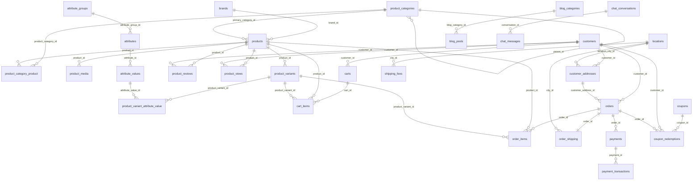

# Data Model

Project có hai lớp dữ liệu đang cùng tồn tại:

- Schema mới trong `database/migrations`, model mới trong `app/Infrastructure/Persistence/Eloquent`.
- Schema legacy có thể đối chiếu từ `shopbanhang.sql`, nhưng dump này là archive cũ, không phải dữ liệu production hiện hành.

Khi sửa dữ liệu, luôn xác định flow đang dùng model nào.

## ERD Tổng Quan



## Bảng Chính Và Model Tương Ứng

### Catalog

| Bảng | Model mới | Model legacy liên quan | Field quan trọng |
| --- | --- | --- | --- |
| `brands` | `Catalog\Brand` | legacy archive: `Brand`/old brand controllers | `name`, `slug`, `logo_path`, `is_active`, `display_order`, `meta` |
| `product_categories` | `Catalog\ProductCategory` | legacy archive: `CategoryProductModel` | `parent_id`, `name`, `slug`, `is_active`, `display_order`, `meta` |
| `products` | `Catalog\Product` | legacy archive: `app/Models/Product` (`tbl_product`) | `brand_id`, `primary_category_id`, `name`, `slug`, `price`, `sale_price`, `cost_price`, `stock_quantity`, `is_active`, `is_featured`, `is_hot`, `thumbnail_path`, `meta` |
| `product_category_product` | quan hệ many-to-many | không rõ | `product_id`, `product_category_id` |
| `product_media` | `Catalog\ProductMedia` | `Gallery` | `product_id`, `file_path`, `disk`, `collection`, `display_order` |
| `product_variants` | `Catalog\ProductVariant` | legacy archive: `ProductAttribute` | `product_id`, `sku`, `price`, `stock_quantity`, `is_active` |
| `product_reviews` | `Catalog\ProductReview` | `Comment`, `Rating` | `product_id`, `customer_id`, `rating`, `comment`, `status` |
| `product_views` | `Catalog\ProductView` | không | `product_id`, `customer_id`, `ip_address`, `user_agent`, tracking recommendation/search |

`Catalog\Product` append nhiều accessor legacy:

- `product_id` -> `id`
- `product_name` -> `name`
- `product_slug` -> `slug`
- `product_desc` -> `description`
- `product_content` -> `content`
- `product_price` -> `final_price`
- `product_quantity` -> `stock_quantity`
- `product_status` -> `0` khi active, `1` khi inactive
- `product_image` -> `thumbnail_path` hoặc media đầu tiên
- `price_cost` -> `cost_price`

Điều này giúp Blade/admin cũ dùng được model mới.

### Customer, Cart, Checkout

| Bảng | Model mới | Model legacy liên quan | Field quan trọng |
| --- | --- | --- | --- |
| `customers` | `Customer\Customer` | legacy archive: `app/Models/Customer` | `name`, `email`, `phone`, `password`, `avatar_path`, `is_active`, `meta` |
| `customer_addresses` | `Customer\Address` | `Shipping` legacy | `customer_id`, `recipient_name`, `recipient_phone`, `email`, `address_line1`, `location_*_id`, `is_default` |
| `locations` | `Geo\Location` | `City`, `Province`, `Wards` | `name`, `code`, `type`, `parent_id`, `is_active` |
| `shipping_fees` | `Shipping\ShippingFee` | `Feeship` | `city_id`, `province_id`, `ward_id`, `amount` |
| `carts` | `Checkout\Cart` | không | API/auth cart, không phải web session cart |
| `cart_items` | `Checkout\CartItem` | không | `cart_id`, `product_id`, `product_variant_id`, `quantity`, `price`, `subtotal`, `meta` |

Web storefront cart không ghi vào `carts/cart_items`. Nó dùng session key `cart` qua `CartService`.

### Order, Payment

| Bảng | Model mới | Model legacy liên quan | Field quan trọng |
| --- | --- | --- | --- |
| `orders` | `Order\Order` | legacy archive: `app/Models/Order` | `code`, `customer_id`, `status`, `payment_status`, `fulfillment_status`, `subtotal`, `discount_total`, `shipping_total`, `total`, `coupon_code`, `source`, `placed_at`, `meta` |
| `order_items` | `Order\OrderItem` | `OrderDetails` | `order_id`, `product_id`, `product_name`, `attributes`, `original_price`, `price`, `sale_price`, `cost_price`, `quantity`, `subtotal`, `discount_amount`, `meta` |
| `order_shipping` | `Order\OrderShipping` | `Shipping` legacy | `order_id`, `recipient_name`, `recipient_phone`, `email`, `city_id`, `province_id`, `ward_id`, `address_line1`, `shipping_method`, `shipping_fee` |
| `payments` | `Order\Payment` | cổng thanh toán legacy | `order_id`, `provider`, `status`, `currency`, `amount`, `paid_at`, `meta` |
| `payment_transactions` | `Order\PaymentTransaction` | không | `payment_id`, provider payload/callback/reference |

Status quan trọng:

- `orders.status`: `pending`, `confirmed`, `processing`, `shipped`, `completed`, `cancelled`, `refunded`
- `orders.payment_status`: `unpaid`, `pending`, `paid`, `failed`, `refunded`
- `orders.fulfillment_status`: `unfulfilled`, `partial`, `fulfilled`
- `payments.provider`: hiện checkout dùng `cod`, `bank_transfer`; code cũng có nhãn cho `paypal`, `momo`, `vnpay`

### Coupon, Marketing, Loyalty

| Bảng | Model mới | Field quan trọng |
| --- | --- | --- |
| `coupons` | `Marketing\Coupon` | `name`, `code`, `type`, `value`, `max_discount`, `min_order_total`, `usage_limit`, `usage_per_customer`, `used_count`, `starts_at`, `expires_at`, `is_active` |
| `coupon_redemptions` | `Marketing\CouponRedemption` | `coupon_id`, `customer_id`, `order_id`, `discount_amount` |
| `customer_segments` | `Marketing\CustomerSegment` | phân khúc khách hàng |
| `marketing_campaigns` | `Marketing\MarketingCampaign` | chiến dịch marketing |
| `loyalty_tiers`, `loyalty_rules`, `loyalty_transactions` | `Loyalty\*` | loyalty/điểm thưởng |

Coupon web được apply trong `CartController@check_coupon`, lưu session `coupon`, sau đó `CheckoutService` validate lại trước khi tạo order.

### CMS, Support, System

| Bảng | Model mới/legacy | Vai trò |
| --- | --- | --- |
| `blog_categories`, `blog_posts` | `Cms\BlogCategory`, `Cms\BlogPost`, compatibility `Post`, legacy `CatePost` | Bài viết. |
| `banners`, `site_links`, `site_contacts`, `documents`, `videos`, `news` | `Cms\*`, compatibility/legacy classes như `Slider`, `Contact`, `Document`, `Video`, `News` | Nội dung site. |
| `settings` | `System\Setting` | Cấu hình hệ thống. |
| `chat_conversations`, `chat_messages` | `Support\ChatConversation`, `Support\ChatMessage` | Chatbot và admin chat inbox. |
| `analytics_daily`, `analytics_events`, `page_views`, `conversion_tracking`, `user_sessions` | `Analytics\*` | Analytics. |
| `users`, Spatie permission tables | `app/Models/User`, Spatie models | Admin auth/roles/permissions. |
| `jobs`, `cache`, `personal_access_tokens` | Laravel tables | Queue/cache/Sanctum. |

## Legacy Tables / Archive Notes

Các model legacy còn trong `app/Models` chủ yếu là compatibility/archive và không nên dùng cho flow runtime mới. Ví dụ `app/Models/Product.php` dùng:

- table: `tbl_product`
- primary key: `product_id`
- field: `product_name`, `product_slug`, `category_id`, `brand_id`, `product_price`, `product_image`, `product_status`, `price_cost`

Runtime đã được audit để không còn phụ thuộc trực tiếp vào `tbl_*` trong các vùng được scan. Không viết query raw dựa trên suy đoán tên bảng; dùng model mới trong `App\Infrastructure\Persistence\Eloquent` hoặc chạy audit trước khi cleanup:

```bash
php artisan legacy:audit-runtime --fail-on-issues
```

## Quy Tắc Khi Sửa Data Model

- Tạo migration mới, không sửa migration cũ nếu không được yêu cầu.
- Cập nhật model mới hoặc legacy model đúng với flow đang sửa.
- Nếu thêm field sản phẩm hiển thị ở admin, cập nhật `ProductController::validateProductRequest()` và `mapProductData()`.
- Nếu field ảnh/file, kiểm tra logic upload trong `ProductService`.
- Nếu field ảnh hưởng order, cập nhật snapshot order item trong `CheckoutService`.
- Nếu field bắt buộc, cập nhật factory/seeder/test.
- Chạy test liên quan và `git diff --check`.
