# Bộ sơ đồ phân tích hệ thống cho báo cáo ĐATN

Tài liệu này tổng hợp các sơ đồ phục vụ báo cáo Đồ án tốt nghiệp cho hệ thống website bán hàng thiết bị công nghệ bằng `Laravel 11`. Nội dung được xây dựng sau khi kiểm tra `DOCUMENTATION_TEMPLATE.md`, `routes/web.php`, `routes/web/frontend.php`, `routes/web/admin.php`, `routes/api.php`, `app/Http/Controllers`, `app/Models`, `app/Application`, `app/Infrastructure/Persistence/Eloquent`, `database/migrations` và `resources/views`.

Các sơ đồ bên dưới chỉ mô tả chức năng có cơ sở trong mã nguồn hiện tại. Những phần chưa xác định được từ code được ghi chú rõ, không tự suy diễn là đã hoàn chỉnh.

## 1. Use Case Diagram tổng quát

### Mục đích

Sơ đồ use case tổng quát mô tả các actor chính và phạm vi chức năng lớn của hệ thống. Các use case được xác định từ route storefront trong `routes/web/frontend.php`, route admin trong `routes/web/admin.php` và API trong `routes/api.php`.

### Code Mermaid

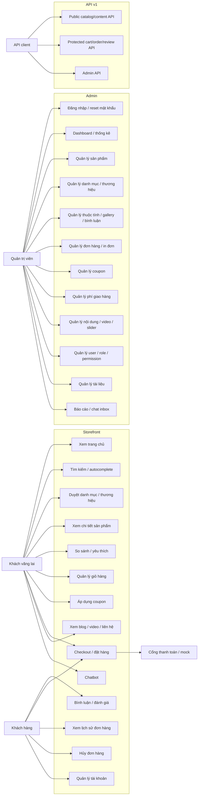

### Giải thích thành phần chính

`Khách vãng lai` có thể xem trang chủ, tìm kiếm, xem sản phẩm, thêm giỏ hàng và checkout theo luồng guest. `Khách hàng` là người có tài khoản trong bảng `customers`, có thể xem lịch sử đơn hàng, hủy đơn khi hợp lệ và quản lý tài khoản. `Quản trị viên` sử dụng khu vực admin được bảo vệ bởi `auth:web`, `admin.access` và `admin.permission`. `API client` đại diện cho client gọi các route trong `routes/api.php`, gồm public API, protected API qua `auth:sanctum` và admin API.

### Ghi chú chưa xác định từ code

Tích hợp thanh toán thật với `MoMo` và `VNPAY` chưa xác định từ code; trong `CheckoutController`, các phương thức `momo_payment` và `vnpay_payment` trả thông báo cổng đang tạm tắt, còn `VnPayMockController` là luồng mock.

## 2. Activity Diagram cho luồng mua hàng

### Mục đích

Sơ đồ mô tả luồng nghiệp vụ mua hàng từ lúc người dùng duyệt sản phẩm đến khi hệ thống tạo đơn hàng. Luồng dựa trên `HomeController`, `ProductController`, `CartController`, `CheckoutController`, `CartService`, `CouponService`, `ShippingService` và `CheckoutService`.

### Code Mermaid

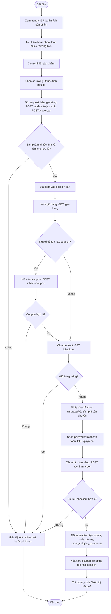

### Giải thích thành phần chính

Giỏ hàng storefront được lưu trong session key `cart` bởi `CartService::SESSION_KEY`. Khi thêm sản phẩm, `CartService@addItem` tìm sản phẩm bằng `ProductService`, kiểm tra thuộc tính nếu có, kiểm tra tồn kho và lưu snapshot giá vào session. Khi đặt hàng, `CheckoutController@confirm_order` gọi `CheckoutService@confirmOrder`; service này dùng `DB::transaction` để tạo `orders`, `order_items`, `order_shipping`, `payments` và ghi nhận coupon redemption nếu có.

### Ghi chú chưa xác định từ code

Luồng trừ tồn kho sau khi tạo đơn hàng chưa xác định rõ từ code đã inspect. Code có kiểm tra tồn kho khi thêm vào giỏ hàng nhưng chưa thấy bước giảm `stock_quantity` trong `CheckoutService@confirmOrder`.

## 3. Activity Diagram cho luồng quản trị sản phẩm/đơn hàng

### Mục đích

Sơ đồ mô tả luồng tổng quát khi quản trị viên đăng nhập, được kiểm tra quyền và thực hiện quản trị sản phẩm hoặc đơn hàng. Luồng dựa trên `routes/web/admin.php`, `AuthController`, `ProductController`, `OrderController`, `AdminPermissions` và các middleware `auth:web`, `admin.access`, `admin.permission`.

### Code Mermaid

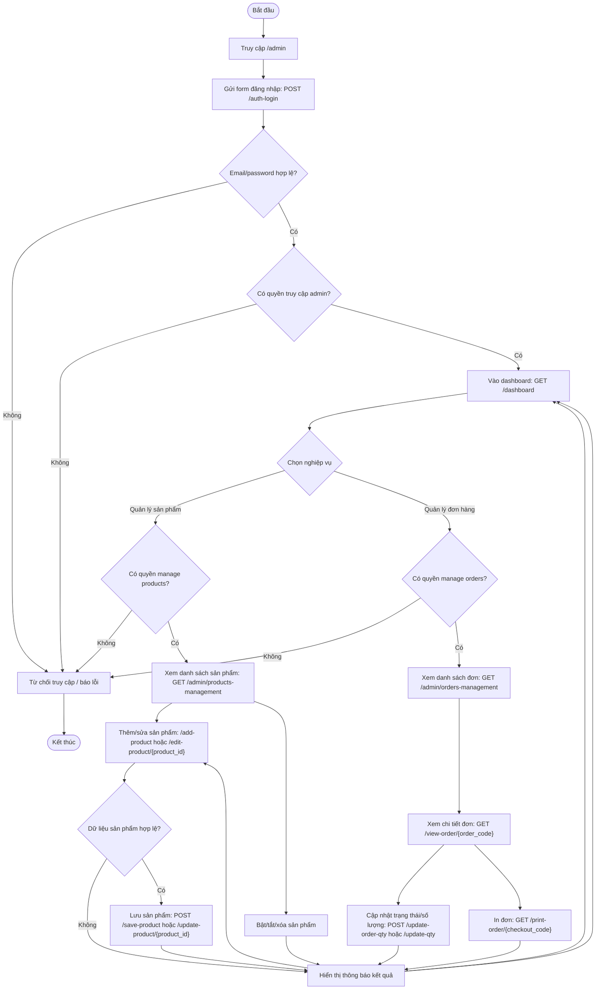

### Giải thích thành phần chính

Admin login được xử lý bởi `AuthController@login`. Sau khi đăng nhập, hệ thống kiểm tra quyền truy cập admin qua `AdminAccess`. Nhóm quản lý sản phẩm trong `routes/web/admin.php` nằm dưới middleware `admin.permission:manage products`. Nhóm quản lý đơn hàng nằm dưới middleware `admin.permission:manage orders`. Quản lý sản phẩm dùng `ProductController` và `ProductService`; quản lý đơn hàng dùng `OrderController` và một số service legacy như `LegacyOrderWorkflowService`, `LegacyOrderPresentationService`.

### Ghi chú chưa xác định từ code

Phần admin order hiện vẫn có dấu hiệu dùng bảng/service legacy qua `App\Models\Order` và `LegacyOrderWorkflowService`. Việc admin order đã chuyển hoàn toàn sang bảng chuẩn hóa `orders` chưa xác định từ code.

## 4. Sequence Diagram cho luồng thêm vào giỏ hàng và đặt hàng

### Mục đích

Sơ đồ mô tả tuần tự tương tác giữa người dùng, trình duyệt, route, controller, request validation, service, session và database trong hai luồng: thêm sản phẩm vào giỏ hàng và xác nhận đơn hàng.

### Code Mermaid

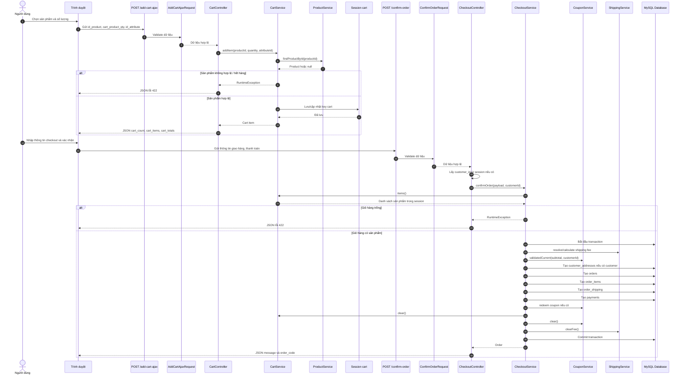

### Giải thích thành phần chính

Đoạn đầu của sequence diagram phản ánh `CartController@add_cart_ajax` và `CartService@addItem`. Đoạn sau phản ánh `CheckoutController@confirm_order` và `CheckoutService@confirmOrder`. Việc tạo đơn hàng được thực hiện trong transaction để các bảng `orders`, `order_items`, `order_shipping` và `payments` được ghi nhất quán.

### Ghi chú chưa xác định từ code

Tự động xác nhận thanh toán ngân hàng hoặc callback thanh toán thật từ cổng ngoài chưa xác định từ code.

## 5. Class Diagram mức phân tích

### Mục đích

Sơ đồ lớp mức phân tích mô tả các controller, service và model/entity chính tham gia vào các luồng catalog, giỏ hàng, checkout, đơn hàng và quản trị sản phẩm.

### Code Mermaid

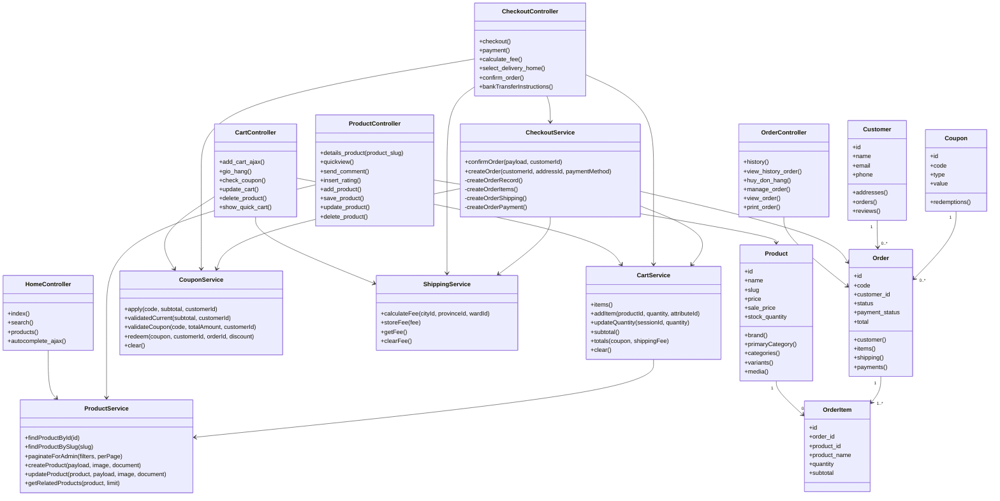

### Giải thích thành phần chính

Các controller nhận request từ route và điều phối sang service/model. `CartService` xử lý nghiệp vụ giỏ hàng session. `CheckoutService` xử lý đặt hàng và ghi dữ liệu trong transaction. `ProductService` xử lý truy vấn và quản trị sản phẩm. Các model/entity chính gồm `Product`, `Customer`, `Order`, `OrderItem` và `Coupon`, tương ứng với các bảng chuẩn hóa trong migration.

### Ghi chú chưa xác định từ code

Repo có cả model legacy trong `app/Models` và model chuẩn hóa trong `app/Infrastructure/Persistence/Eloquent`. Sơ đồ này ưu tiên lớp chuẩn hóa đang được dùng trong `CartService`, `CheckoutService`, `ProductController` và `OrderController`; một số luồng admin order vẫn còn dùng service/model legacy.

## 6. ERD dựa trên migration/model hiện có

### Mục đích

Sơ đồ ERD mô tả các thực thể dữ liệu chính và quan hệ giữa chúng, dựa trên `database/migrations` và các quan hệ trong model Eloquent như `Product`, `Customer`, `Order`.

### Code Mermaid

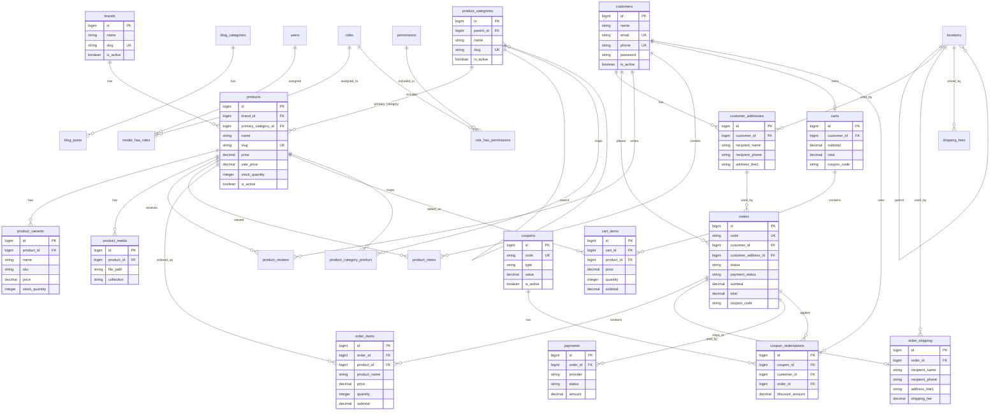

### Giải thích thành phần chính

Nhóm catalog gồm `brands`, `product_categories`, `products`, `product_variants`, `product_media`, `product_reviews` và bảng pivot `product_category_product`. Nhóm khách hàng và giỏ hàng gồm `customers`, `customer_addresses`, `carts`, `cart_items`. Nhóm đặt hàng gồm `orders`, `order_items`, `order_shipping`, `payments`. Nhóm coupon gồm `coupons`, `coupon_redemptions`. Nhóm phân quyền admin gồm `users`, `roles`, `permissions` và các bảng pivot của `spatie/laravel-permission`.

### Ghi chú chưa xác định từ code

Một số bảng legacy như `tbl_slider`, `tbl_icons`, `tbl_product_attribute` chỉ còn nên được xem như archive để đối chiếu dữ liệu cũ, không phải dependency runtime chính. Nếu báo cáo cần mô tả đầy đủ phần legacy, cần đối chiếu thêm với `database/import_legacy_tables.sql` hoặc tooling setup legacy đã được guard.

## 7. Sơ đồ kiến trúc tổng quan hệ thống

### Mục đích

Sơ đồ này mô tả kiến trúc tổng quan của dự án theo các lớp chính: client, route, controller, service/application, persistence/model, database và view. Sơ đồ bám theo cấu trúc thực tế trong repo, gồm `routes`, `app/Http/Controllers`, `app/Application`, `app/Infrastructure/Persistence/Eloquent`, `database/migrations` và `resources/views`.

### Code Mermaid

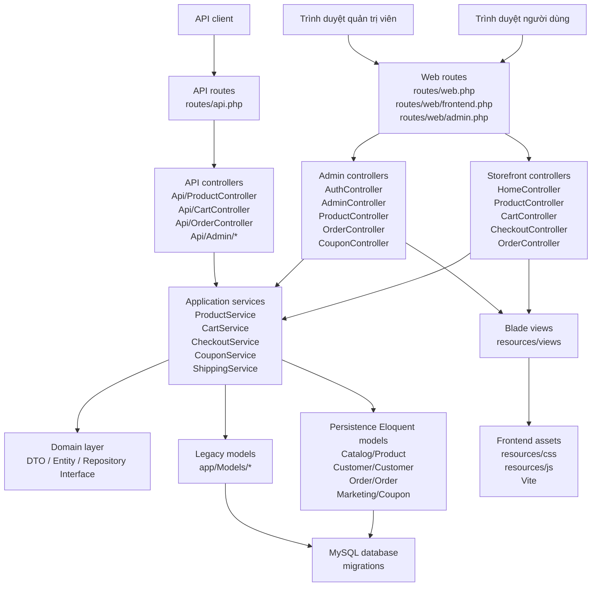

### Giải thích thành phần chính

Storefront và admin cùng đi qua `routes/web.php`, nhưng được tách thành `routes/web/frontend.php` và `routes/web/admin.php`. API được tách riêng ở `routes/api.php`. Controller điều phối request, service xử lý nghiệp vụ, model Eloquent chuẩn hóa và model legacy cùng truy cập database. Giao diện chính sử dụng `Blade`, còn CSS/JS được quản lý trong `resources/css`, `resources/js` và build bằng `Vite`.

### Ghi chú chưa xác định từ code

Sơ đồ này mô tả kiến trúc source code, không mô tả hạ tầng triển khai production vì cấu hình server thực tế chưa xác định từ code.

## 8. Sơ đồ phân rã module hệ thống

### Mục đích

Sơ đồ phân rã module giúp trình bày hệ thống theo các khối nghiệp vụ lớn. Các module được xác định từ route, controller, view và migration hiện có.

### Code Mermaid

```mermaid
flowchart TD
    System["Website bán hàng thiết bị công nghệ"]

    Storefront["Storefront"]
    Admin["Admin"]
    API["API v1"]
    Data["Database"]

    Catalog["Catalog\nSản phẩm, danh mục, thương hiệu"]
    CartCheckout["Cart & Checkout\nGiỏ hàng, coupon, giao hàng, đặt hàng"]
    Customer["Customer\nĐăng nhập, tài khoản, lịch sử đơn"]
    Content["Content\nBlog, video, liên hệ, slider"]
    Support["Support\nChatbot, compare, yêu thích"]

    AdminCatalog["Admin Catalog\nSản phẩm, danh mục, thương hiệu, thuộc tính, gallery"]
    AdminOrder["Admin Order\nĐơn hàng, in đơn, giao hàng"]
    AdminContent["Admin Content\nBài viết, video, slider, thông tin site"]
    AdminAccess["Admin Access\nUser, role, permission"]
    AdminReport["Admin Report\nLợi nhuận, product discovery, dashboard"]

    ApiPublic["Public API\nproducts, categories, brands, blog, settings"]
    ApiProtected["Protected API\ncart, orders, reviews, user"]
    ApiAdmin["Admin API\nproducts, categories, brands, orders, statistics"]

    CoreTables["Core tables\nproducts, customers, orders"]
    CmsTables["CMS tables\nblog_posts, videos, banners"]
    AuthTables["Auth tables\nusers, roles, permissions"]

    System --> Storefront
    System --> Admin
    System --> API
    System --> Data

    Storefront --> Catalog
    Storefront --> CartCheckout
    Storefront --> Customer
    Storefront --> Content
    Storefront --> Support

    Admin --> AdminCatalog
    Admin --> AdminOrder
    Admin --> AdminContent
    Admin --> AdminAccess
    Admin --> AdminReport

    API --> ApiPublic
    API --> ApiProtected
    API --> ApiAdmin

    Data --> CoreTables
    Data --> CmsTables
    Data --> AuthTables
```

### Giải thích thành phần chính

Storefront phục vụ người mua hàng. Admin phục vụ quản trị viên. API phục vụ các client kỹ thuật và có nhóm public/protected/admin rõ ràng trong `routes/api.php`. Database được chia thành nhóm core commerce, CMS và auth/permission.

### Ghi chú chưa xác định từ code

Ứng dụng mobile riêng chưa xác định từ code, vì vậy `API client` chỉ được mô tả như tác nhân kỹ thuật, không mô tả một app mobile cụ thể.

## 9. State Diagram trạng thái đơn hàng

### Mục đích

Sơ đồ trạng thái mô tả vòng đời cơ bản của đơn hàng theo enum `status` trong migration `2025_10_23_001400_create_orders_table.php` và logic trong `OrderController`.

### Code Mermaid

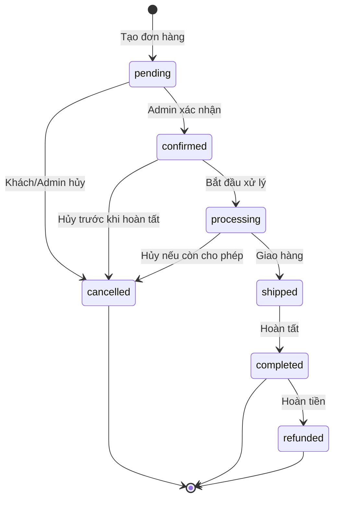

### Giải thích thành phần chính

Bảng `orders` có các trạng thái `pending`, `confirmed`, `processing`, `shipped`, `completed`, `cancelled`, `refunded`. Khi khách đặt hàng qua `CheckoutService`, đơn mới được tạo với `status = pending`. Trong `OrderController`, khách hàng có thể hủy đơn nếu trạng thái không nằm trong `cancelled`, `completed`, `refunded`.

### Ghi chú chưa xác định từ code

Luồng chuyển trạng thái admin từ `pending` sang `confirmed`, `processing`, `shipped`, `completed` trong bảng chuẩn hóa `orders` chưa xác định đầy đủ từ code đã inspect vì phần admin order còn dùng service legacy.

## 10. Sequence Diagram quản lý sản phẩm admin

### Mục đích

Sơ đồ mô tả tuần tự xử lý khi quản trị viên thêm hoặc cập nhật sản phẩm. Luồng dựa trên `routes/web/admin.php`, `ProductController`, `ProductService`, `ProductPricingService`, `BrandRepositoryInterface`, `CategoryRepositoryInterface` và bảng `products`.

### Code Mermaid

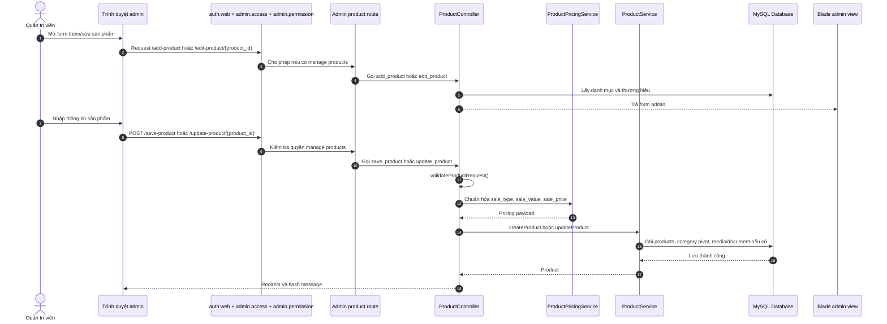

### Giải thích thành phần chính

Route sản phẩm admin được bảo vệ bởi `admin.permission:manage products`. `ProductController` validate dữ liệu sản phẩm, chuẩn hóa giá và khuyến mãi, sau đó gọi `ProductService` để tạo hoặc cập nhật dữ liệu. Các bảng liên quan gồm `products`, `brands`, `product_categories`, `product_category_product`, `product_media`.

### Ghi chú chưa xác định từ code

Quy trình upload tài liệu/hình ảnh chi tiết phụ thuộc logic trong `ProductService`; sơ đồ chỉ mô tả ở mức phân tích, không đi sâu từng bước lưu file.

## 11. Data Flow Diagram mức ngữ cảnh cho checkout

### Mục đích

Sơ đồ mô tả luồng dữ liệu chính trong nghiệp vụ checkout: dữ liệu từ người dùng, dữ liệu giỏ hàng session, coupon, phí giao hàng và dữ liệu đơn hàng ghi xuống database.

### Code Mermaid

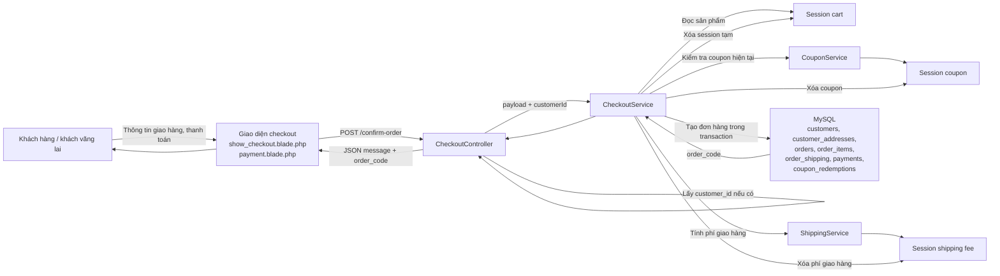

### Giải thích thành phần chính

Checkout nhận dữ liệu từ form Blade và session. `CheckoutService` tổng hợp dữ liệu giỏ hàng, coupon, phí giao hàng để tạo đơn hàng. Dữ liệu cuối cùng được ghi vào các bảng chuẩn hóa, trong đó `orders` giữ thông tin tổng quan, `order_items` giữ dòng sản phẩm, `order_shipping` giữ địa chỉ giao hàng và `payments` giữ thông tin thanh toán.

### Ghi chú chưa xác định từ code

Luồng kết nối thanh toán trực tuyến thật và callback cập nhật `payment_status` chưa xác định từ code.

## 12. Sơ đồ phân quyền admin

### Mục đích

Sơ đồ mô tả cách hệ thống kiểm soát quyền admin dựa trên route middleware và `AdminPermissions`.

### Code Mermaid

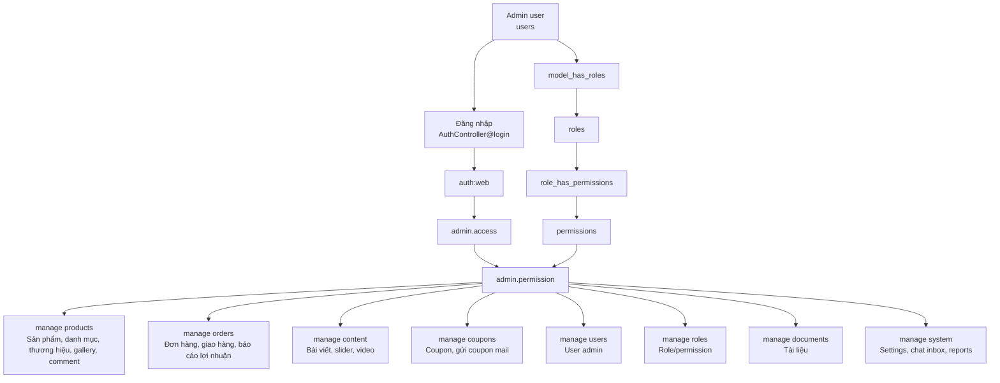

### Giải thích thành phần chính

Admin đăng nhập bằng `AuthController@login`, sau đó phải qua `auth:web` và `admin.access`. Từng nhóm route admin được kiểm tra bằng `admin.permission`. Danh sách quyền chuẩn nằm trong `App\Support\AdminPermissions`, gồm `manage users`, `manage roles`, `manage documents`, `manage products`, `manage content`, `manage orders`, `manage coupons`, `manage system`. Dữ liệu role/permission được lưu qua các bảng của `spatie/laravel-permission`.

### Ghi chú chưa xác định từ code

Ma trận quyền theo từng màn hình chi tiết chưa được mô tả đầy đủ trong code route ở mức từng nút thao tác nhỏ; sơ đồ này mô tả theo nhóm route và permission chính.

## 13. Component Diagram cho các thành phần Laravel chính

### Mục đích

Sơ đồ mô tả các component kỹ thuật chính của hệ thống Laravel, giúp người đọc hiểu cách storefront, admin, API, service, model, view và database phối hợp với nhau.

### Code Mermaid

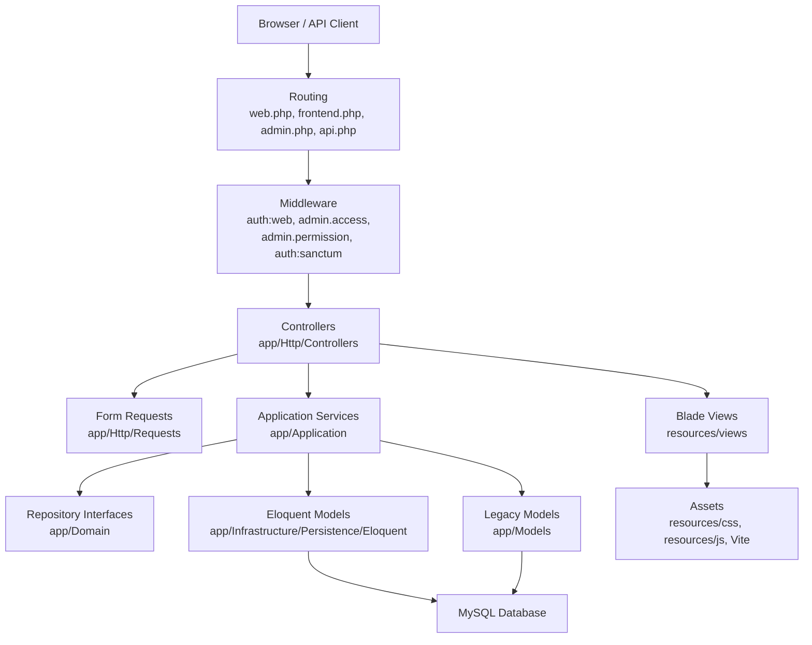

### Giải thích thành phần chính

Route tiếp nhận request, middleware kiểm soát xác thực và phân quyền, controller điều phối xử lý, request class validate dữ liệu, service xử lý nghiệp vụ, model truy cập database và view trả giao diện `Blade`. Sơ đồ phản ánh đúng việc repo có cả lớp Eloquent chuẩn hóa và model legacy.

### Ghi chú chưa xác định từ code

Sơ đồ không mô tả hạ tầng ngoài ứng dụng như load balancer, CDN hoặc object storage vì chưa xác định từ code.

## 14. Deployment Diagram mức phân tích

### Mục đích

Sơ đồ mô tả môi trường triển khai logic của ứng dụng Laravel theo mức phân tích. Đây không phải cấu hình server production thực tế, mà là mô hình triển khai tối thiểu suy ra từ công nghệ trong repo.

### Code Mermaid

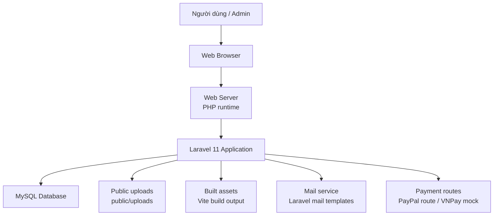

### Giải thích thành phần chính

Ứng dụng chạy trên Laravel/PHP, dùng `MySQL` theo cấu hình database, dùng `public/uploads` cho tài nguyên upload và dùng `Vite` cho frontend assets. Repo có mail templates và các controller mail legacy, đồng thời có route PayPal và VNPay mock.

### Ghi chú chưa xác định từ code

Server production, domain, SSL, queue worker, cron, Redis, CDN và cấu hình cloud chưa xác định từ code.

## 15. Sequence Diagram đăng nhập admin

### Mục đích

Sơ đồ mô tả luồng đăng nhập quản trị viên dựa trên `AuthController@login`, route `POST /auth-login`, middleware `throttle:5,1`, bảng `users` và phân quyền admin.

### Code Mermaid

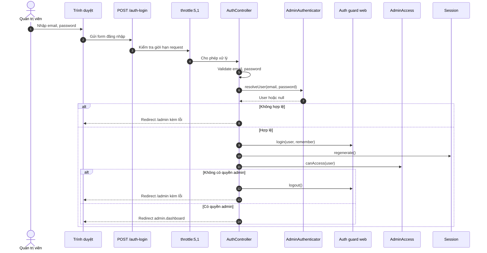

### Giải thích thành phần chính

Route đăng nhập admin nằm trong group `guest:web`. Sau khi xác thực tài khoản, hệ thống gọi `AdminAccess::canAccess` để kiểm tra người dùng có quyền vào admin hay không. Nếu hợp lệ, người dùng được chuyển tới `admin.dashboard`.

### Ghi chú chưa xác định từ code

Cơ chế 2FA cho admin chưa xác định từ code.

## 16. Sequence Diagram áp dụng coupon

### Mục đích

Sơ đồ mô tả luồng người dùng áp dụng mã giảm giá tại giỏ hàng, dựa trên `POST /check-coupon`, `CartController@check_coupon`, `ApplyCouponRequest` và `CouponService`.

### Code Mermaid

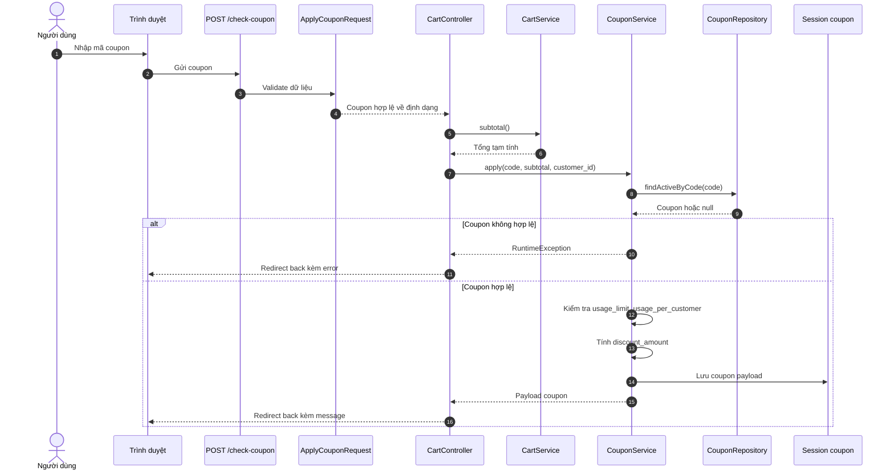

### Giải thích thành phần chính

`CouponService` kiểm tra coupon active, điều kiện tổng đơn, giới hạn số lượt dùng và giới hạn theo khách hàng. Coupon hợp lệ được lưu vào session để dùng lại trong checkout.

### Ghi chú chưa xác định từ code

Giao diện quản trị chi tiết điều kiện coupon theo phân khúc khách hàng có bảng dữ liệu hỗ trợ, nhưng mức hoàn chỉnh của toàn bộ luồng segment coupon chưa xác định từ code đã inspect.

## 17. Activity Diagram đăng ký và đăng nhập khách hàng

### Mục đích

Sơ đồ mô tả luồng khách hàng đăng ký hoặc đăng nhập trong khu vực checkout, dựa trên `CheckoutController`, `RegisterCustomerRequest`, `LoginCustomerRequest` và bảng `customers`.

### Code Mermaid

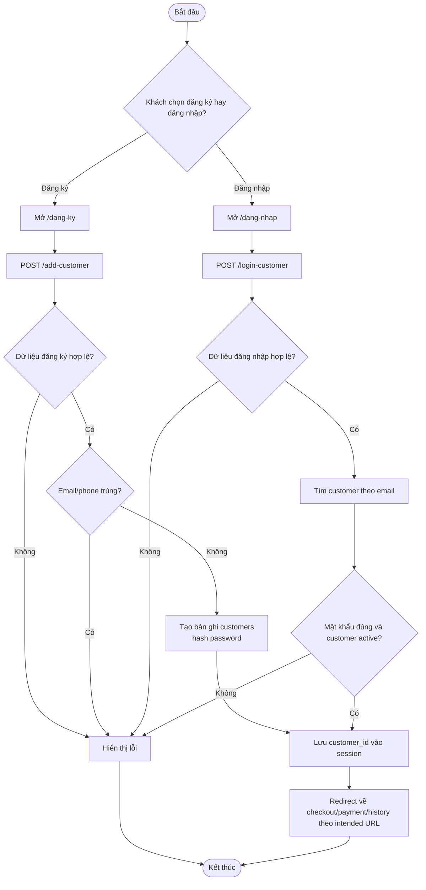

### Giải thích thành phần chính

Khách hàng đăng ký qua `POST /add-customer`; hệ thống tạo `Customer` với mật khẩu được `bcrypt`. Khách hàng đăng nhập qua `POST /login-customer`; hệ thống tìm `Customer` theo email và kiểm tra mật khẩu bằng `StorefrontCustomerPassword`. Khi thành công, session lưu `customer_id`.

### Ghi chú chưa xác định từ code

Xác minh email/phone bắt buộc cho khách hàng trước checkout chưa xác định từ code.

## 18. Sequence Diagram hủy đơn hàng

### Mục đích

Sơ đồ mô tả luồng khách hàng hủy đơn hàng qua `POST /huy-don-hang`, dựa trên `OrderController@huy_don_hang` và bảng `orders`.

### Code Mermaid

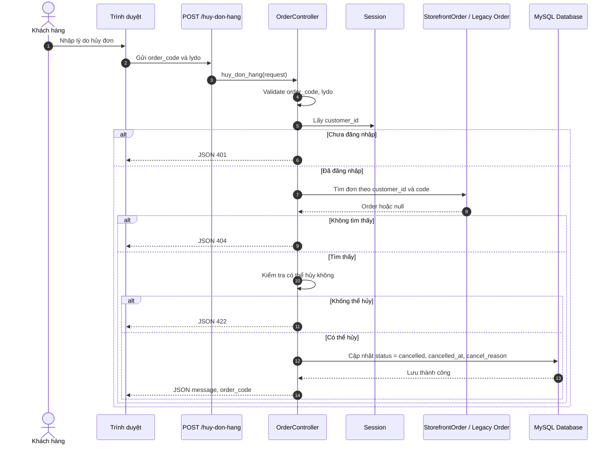

### Giải thích thành phần chính

Với đơn chuẩn hóa, `OrderController` tìm `StorefrontOrder` theo `customer_id` và `code`. Đơn chỉ được hủy nếu trạng thái không nằm trong `cancelled`, `completed`, `refunded`. Với dữ liệu legacy, controller có nhánh xử lý qua `App\Models\Order`.

### Ghi chú chưa xác định từ code

Quy trình hoàn tiền tự động khi hủy đơn chưa xác định từ code.

## 19. Sequence Diagram chatbot storefront

### Mục đích

Sơ đồ mô tả luồng người dùng gửi tin nhắn chatbot, dựa trên route `/chatbot/conversation`, `/chatbot/messages`, `ChatController` và các service chatbot trong `app/Application/AI/Services`.

### Code Mermaid

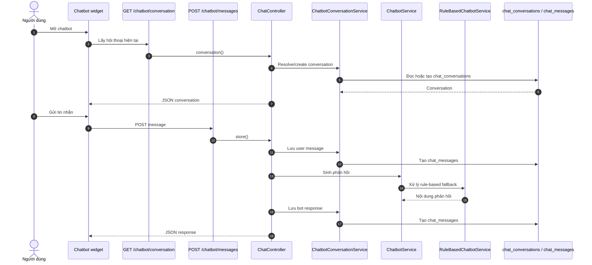

### Giải thích thành phần chính

Repo có `ChatController`, `RuleBasedChatbotService`, `ChatbotService`, `ChatbotConversationService`, `chat_conversations` và `chat_messages`. Sơ đồ thể hiện chatbot ở mức đã có trong code: hội thoại, tin nhắn người dùng và phản hồi bot.

### Ghi chú chưa xác định từ code

Việc gọi dịch vụ AI bên ngoài có class `OpenAiChatbotClient`, nhưng mức cấu hình và sử dụng thực tế trong môi trường chạy chưa xác định từ code đã inspect.

## 20. Sơ đồ API route group

### Mục đích

Sơ đồ mô tả cách `routes/api.php` chia API thành public API, protected API và admin API.

### Code Mermaid

```mermaid
flowchart TD
    ApiRoot["/api/v1"]

    Public["Public API\nkhông yêu cầu auth:sanctum"]
    Protected["Protected API\nauth:sanctum"]
    AdminApi["Admin API\nauth:sanctum + admin.access:sanctum"]

    Products["Products\n/products, /products/latest,\n/products/search, /products/{slug}"]
    Categories["Categories\n/categories, /categories/tree"]
    Brands["Brands\n/brands"]
    Content["Content\n/blog, /settings, /chatbot"]
    PublicAuth["Auth\n/auth/login, /auth/register, /auth/refresh"]

    UserProfile["User profile\n/user"]
    CartApi["Cart\n/cart, /cart/add, /cart/update, /cart/remove"]
    OrderApi["Orders\n/orders, /orders/{id}, cancel"]
    ReviewApi["Reviews\nPOST/PUT/DELETE /reviews"]

    AdminProducts["Admin products\napiResource products"]
    AdminCatalog["Admin categories / brands"]
    AdminOrders["Admin orders\nstatus update"]
    AdminStats["Admin statistics"]

    ApiRoot --> Public
    ApiRoot --> Protected
    ApiRoot --> AdminApi

    Public --> Products
    Public --> Categories
    Public --> Brands
    Public --> Content
    Public --> PublicAuth

    Protected --> UserProfile
    Protected --> CartApi
    Protected --> OrderApi
    Protected --> ReviewApi

    AdminApi --> AdminProducts
    AdminApi --> AdminCatalog
    AdminApi --> AdminOrders
    AdminApi --> AdminStats
```

### Giải thích thành phần chính

Public API phục vụ dữ liệu catalog, nội dung và auth. Protected API yêu cầu `auth:sanctum`, phục vụ user profile, cart, order và review. Admin API yêu cầu cả `auth:sanctum` và `admin.access:sanctum`, đồng thời kiểm tra `admin.permission` theo nhóm quyền.

### Ghi chú chưa xác định từ code

Client cụ thể sử dụng API, ví dụ app mobile production, chưa xác định từ code.

## 21. ERD mở rộng cho CMS, chat và analytics

### Mục đích

Sơ đồ bổ sung cho ERD chính, tập trung vào các bảng nội dung, chatbot và analytics đã có trong migration.

### Code Mermaid

```mermaid
erDiagram
    blog_categories ||--o{ blog_posts : contains
    customers ||--o{ chat_conversations : starts
    users ||--o{ chat_conversations : handles
    chat_conversations ||--o{ chat_messages : contains
    customers ||--o{ analytics_events : triggers
    products ||--o{ analytics_events : referenced_by
    orders ||--o{ analytics_events : referenced_by
    products ||--o{ product_views : viewed
    customers ||--o{ product_views : views
    customers ||--o{ product_search_queries : searches
    product_categories ||--o{ product_search_queries : filters
    products ||--o{ product_recommendation_impressions : recommended

    blog_categories {
        bigint id PK
        string name
        string slug UK
        boolean is_active
    }

    blog_posts {
        bigint id PK
        bigint blog_category_id FK
        string title
        string slug UK
        string status
        timestamp published_at
    }

    videos {
        bigint id PK
        string title
        string slug UK
        string video_url
        boolean is_active
    }

    chat_conversations {
        bigint id PK
        bigint customer_id FK
        bigint user_id FK
        string session_token
        string channel
        string status
    }

    chat_messages {
        bigint id PK
        bigint conversation_id FK
        bigint customer_id FK
        bigint user_id FK
        string sender
        text message
    }

    analytics_events {
        bigint id PK
        string event_type
        bigint customer_id FK
        bigint order_id FK
        bigint product_id FK
        json payload
    }

    product_views {
        bigint id PK
        bigint product_id FK
        bigint customer_id FK
        string ip_address
        timestamp viewed_at
    }

    product_search_queries {
        bigint id PK
        bigint customer_id FK
        bigint category_id FK
        string keyword
        integer results_count
    }
```

### Giải thích thành phần chính

CMS gồm `blog_categories`, `blog_posts`, `videos`. Chatbot/admin chat gồm `chat_conversations` và `chat_messages`. Analytics gồm `analytics_events`, `product_views`, `product_search_queries` và `product_recommendation_impressions`.

### Ghi chú chưa xác định từ code

Không phải toàn bộ bảng analytics đều chắc chắn đã được hiển thị trên giao diện quản trị; sơ đồ chỉ thể hiện bảng và quan hệ có trong migration.

## 22. Activity Diagram quản lý coupon

### Mục đích

Sơ đồ mô tả luồng quản trị coupon dựa trên `routes/web/admin.php`, `CouponController`, quyền `manage coupons` và bảng `coupons`.

### Code Mermaid

```mermaid
flowchart TD
    Start([Bắt đầu])
    AdminLogin["Admin đã đăng nhập"]
    Permission{"Có quyền manage coupons?"}
    ListCoupon["Xem danh sách coupon\nGET /list-coupon"]
    OpenForm["Mở form thêm coupon\nGET /insert-coupon"]
    Submit["Gửi form\nPOST /insert-coupon-code"]
    Validate{"Dữ liệu coupon hợp lệ?"}
    Save["Lưu vào bảng coupons"]
    Delete{"Admin xóa coupon?"}
    DeleteAction["DELETE /delete-coupon/{coupon_id}"]
    Message["Hiển thị thông báo"]
    Denied["Từ chối truy cập"]
    End([Kết thúc])

    Start --> AdminLogin --> Permission
    Permission -- Không --> Denied --> End
    Permission -- Có --> ListCoupon --> OpenForm --> Submit --> Validate
    Validate -- Không --> Message --> OpenForm
    Validate -- Có --> Save --> Message --> ListCoupon
    ListCoupon --> Delete
    Delete -- Có --> DeleteAction --> Message
    Delete -- Không --> End
```

### Giải thích thành phần chính

Route coupon admin nằm dưới middleware `admin.permission:manage coupons`. Admin có thể mở danh sách coupon, thêm coupon và xóa coupon. Coupon phía khách hàng được sử dụng qua `POST /check-coupon` và `CouponService`.

### Ghi chú chưa xác định từ code

Toàn bộ giao diện quản lý nâng cao như segment coupon, lịch chạy tự động marketing hoặc stacking coupon chưa xác định đầy đủ từ code đã inspect.

## 23. Activity Diagram quản lý nội dung

### Mục đích

Sơ đồ mô tả luồng admin quản lý nội dung như bài viết, danh mục bài viết, slider và video, dựa trên nhóm route `admin.permission:manage content`.

### Code Mermaid

```mermaid
flowchart TD
    Start([Bắt đầu])
    Admin["Admin đã đăng nhập"]
    Permission{"Có quyền manage content?"}
    Choose{"Chọn loại nội dung"}
    CategoryPost["Danh mục bài viết\nCategoryPost"]
    Post["Bài viết\nPostController"]
    Slider["Slider\nSliderController"]
    Video["Video\nVideoController"]
    Form["Mở form thêm/sửa"]
    Submit["Gửi dữ liệu"]
    Validate{"Dữ liệu hợp lệ?"}
    Save["Lưu dữ liệu"]
    DeleteOrStatus["Xóa hoặc bật/tắt nếu route hỗ trợ"]
    Message["Hiển thị thông báo"]
    Denied["Từ chối truy cập"]
    End([Kết thúc])

    Start --> Admin --> Permission
    Permission -- Không --> Denied --> End
    Permission -- Có --> Choose
    Choose --> CategoryPost --> Form
    Choose --> Post --> Form
    Choose --> Slider --> Form
    Choose --> Video --> Form
    Form --> Submit --> Validate
    Validate -- Không --> Message --> Form
    Validate -- Có --> Save --> Message
    Save --> DeleteOrStatus --> Message --> End
```

### Giải thích thành phần chính

Nhóm route content admin trong `routes/web/admin.php` gồm quản lý danh mục bài viết, bài viết, slider và video. Các controller tương ứng là `CategoryPost`, `PostController`, `SliderController` và `VideoController`.

### Ghi chú chưa xác định từ code

Workflow duyệt bài nhiều bước, lịch xuất bản chi tiết hoặc biên tập đa người chưa xác định từ code.

## 24. Sơ đồ quan hệ route - controller - view chính

### Mục đích

Sơ đồ giúp liên kết các route chính với controller và view tương ứng, phục vụ phần mô tả thiết kế giao diện và luồng điều hướng.

### Code Mermaid

```mermaid
flowchart LR
    HomeRoute["GET /, /trang-chu"]
    SearchRoute["GET/POST /tim-kiem, /san-pham"]
    DetailRoute["GET /chi-tiet/{product_slug}"]
    CartRoute["GET /gio-hang"]
    CheckoutRoute["GET /checkout, /payment"]
    HistoryRoute["GET /history, /view-history-order/{order_code}"]
    AdminProductRoute["/add-product, /admin/products-management, /edit-product/{id}"]
    AdminOrderRoute["/admin/orders-management, /view-order/{code}"]

    HomeController["HomeController"]
    ProductController["ProductController"]
    CartController["CartController"]
    CheckoutController["CheckoutController"]
    OrderController["OrderController"]

    HomeView["home.blade.php"]
    SearchView["pages/sanpham/*.blade.php"]
    DetailView["pages/sanpham/show_details.blade.php"]
    CartView["pages/cart/cart_ajax.blade.php"]
    CheckoutView["pages/checkout/*.blade.php"]
    HistoryView["pages/history/*.blade.php"]
    AdminProductView["admin/*product*.blade.php"]
    AdminOrderView["admin/manage_order.blade.php\nadmin/view_order.blade.php"]

    HomeRoute --> HomeController --> HomeView
    SearchRoute --> HomeController --> SearchView
    DetailRoute --> ProductController --> DetailView
    CartRoute --> CartController --> CartView
    CheckoutRoute --> CheckoutController --> CheckoutView
    HistoryRoute --> OrderController --> HistoryView
    AdminProductRoute --> ProductController --> AdminProductView
    AdminOrderRoute --> OrderController --> AdminOrderView
```

### Giải thích thành phần chính

Sơ đồ tập trung vào các route Blade chính. Storefront dùng các view trong `resources/views/pages` và partial storefront; admin dùng `resources/views/admin` và `admin_layout.blade.php`.

### Ghi chú chưa xác định từ code

Sơ đồ không liệt kê toàn bộ route vì `routes/web/frontend.php` và `routes/web/admin.php` có nhiều route chi tiết; mục tiêu là mô tả các tuyến chính cho báo cáo.

## Kết luận

Bộ sơ đồ trên bám theo cấu trúc phân tích thiết kế hệ thống được gợi ý trong `DOCUMENTATION_TEMPLATE.md` cho đề tài lập trình hướng đối tượng. Các actor, module, use case, luồng nghiệp vụ, class và entity đều được xác định từ mã nguồn hiện tại. Những điểm chưa xác định rõ từ code đã được ghi chú để tránh mô tả vượt quá hiện trạng triển khai.

## Phụ lục: Prompt chi tiết để tái tạo bộ sơ đồ

Phần này lưu lại prompt chi tiết có thể dùng lại với AI để tạo hoặc rà soát bộ sơ đồ phân tích thiết kế hệ thống. Prompt yêu cầu AI đọc `DOCUMENTATION_TEMPLATE.md` và inspect code thật trước khi viết, nhằm hạn chế việc suy diễn hoặc mô tả chức năng không có trong dự án.

````text
Hãy đọc dự án Laravel hiện tại và file `DOCUMENTATION_TEMPLATE.md`, sau đó phân tích hệ thống để tạo bộ sơ đồ phục vụ báo cáo ĐATN.

Bối cảnh đề tài:
- Tên đề tài: Xây dựng website bán hàng thiết bị công nghệ bằng Laravel
- Loại đề tài: lập trình, phân tích và thiết kế hệ thống hướng đối tượng
- Công nghệ chính: Laravel 11, PHP, Blade, MySQL, HTML, CSS, JavaScript, Vite
- Mục tiêu tài liệu: phục vụ Chương 2 - Phân tích và thiết kế hệ thống trong báo cáo ĐATN

Yêu cầu bắt buộc:
1. Trước khi viết, phải inspect code thật trong repo, tối thiểu gồm:
   - `DOCUMENTATION_TEMPLATE.md`
   - `composer.json`
   - `package.json`
   - `routes/web.php`
   - `routes/api.php` nếu có
   - các file route được require/include thêm nếu có
   - `app/Http/Controllers`
   - `app/Models`
   - `app/Application` nếu có
   - `app/Infrastructure` nếu có
   - `database/migrations`
   - `resources/views`

2. Chỉ mô tả các chức năng, actor, route, controller, model, bảng dữ liệu và luồng nghiệp vụ thật sự có trong code.
   - Không tự bịa công nghệ.
   - Không tự bịa chức năng.
   - Không mô tả tích hợp thanh toán thật nếu trong code chỉ có mock/disabled.
   - Nếu một thông tin chưa xác định rõ từ code, phải ghi rõ: “chưa xác định từ code”.

3. Bám theo mục “Graduation Thesis Report Guide” trong `DOCUMENTATION_TEMPLATE.md`.
   - Văn phong phải phù hợp báo cáo ĐATN.
   - Nội dung tập trung vào phân tích và thiết kế hệ thống.
   - Không đi quá sâu vào code triển khai chi tiết.
   - Tuy nhiên khi nhắc tên file, class, route, table, command, middleware, service thì phải dùng backtick.

4. Tạo sơ đồ bằng Mermaid hoặc PlantUML để có thể copy trực tiếp vào báo cáo.
   - Ưu tiên Mermaid nếu phù hợp.
   - Mỗi sơ đồ phải có code block đầy đủ.
   - Mỗi sơ đồ phải có tiêu đề riêng.
   - Mỗi sơ đồ phải có mô tả mục đích.
   - Mỗi sơ đồ phải có phần giải thích các thành phần chính.
   - Nếu sơ đồ có actor/use case/class/entity/route thì tên phải bám theo code thật trong dự án.

5. Lưu toàn bộ kết quả vào:
   - `docs/diagrams.md`

Yêu cầu về cấu trúc file `docs/diagrams.md`:
- Mở đầu tài liệu:
  - Nêu mục đích của tài liệu sơ đồ.
  - Nêu phạm vi phân tích.
  - Nêu các nguồn code đã inspect.
  - Nêu nguyên tắc: chỉ mô tả theo code thật, phần chưa rõ ghi “chưa xác định từ code”.

Với mỗi sơ đồ, trình bày theo cấu trúc sau:

## [Số thứ tự]. [Tên sơ đồ]

**Mục đích:**
Mô tả sơ đồ này dùng để làm gì trong báo cáo ĐATN.

**Cơ sở từ code:**
Liệt kê ngắn gọn các file/class/route/model/migration liên quan, ví dụ:
- `routes/web.php`
- `routes/web/frontend.php`
- `routes/web/admin.php`
- `app/Http/Controllers/...`
- `app/Models/...`
- `database/migrations/...`

**Sơ đồ:**
```mermaid
...
```

**Giải thích:**
Giải thích ngắn gọn các actor, module, class, entity, route hoặc bước xử lý chính trong sơ đồ.

**Ghi chú/ràng buộc:**
Nếu có điểm chưa xác định rõ từ code thì ghi rõ “chưa xác định từ code”.

Danh sách sơ đồ cần tạo:

1. Use Case Diagram tổng quát
   - Xác định các actor thật từ hệ thống, ví dụ: khách vãng lai, khách hàng đã đăng nhập, quản trị viên.
   - Xác định các nhóm chức năng thật từ route/controller/view.
   - Không thêm actor hoặc chức năng không có trong code.
   - Thể hiện quan hệ include/extend nếu xác định được từ luồng code.

2. Use Case Diagram cho storefront
   - Tập trung vào người dùng phía website bán hàng.
   - Gồm các chức năng như xem trang chủ, xem danh mục, xem sản phẩm, tìm kiếm, xem chi tiết sản phẩm, giỏ hàng, checkout, lịch sử đơn hàng nếu có trong code.
   - Phân biệt chức năng cần đăng nhập và không cần đăng nhập nếu route/middleware thể hiện rõ.

3. Use Case Diagram cho admin
   - Tập trung vào quản trị viên.
   - Bám theo route admin, controller admin và middleware quyền hạn.
   - Thể hiện các nhóm quyền/quản lý thật có trong code, ví dụ quản lý sản phẩm, đơn hàng, coupon, nội dung, người dùng, vai trò nếu có.

4. Activity Diagram cho luồng mua hàng
   - Mô tả từ lúc người dùng xem sản phẩm, thêm vào giỏ hàng, cập nhật giỏ hàng, nhập thông tin giao hàng, xác nhận đơn hàng.
   - Thể hiện điều kiện giỏ hàng rỗng, chưa đăng nhập, coupon nếu có.
   - Không mô tả thanh toán online thật nếu code chưa hỗ trợ thật.

5. Activity Diagram cho luồng checkout
   - Tập trung chi tiết hơn vào quá trình checkout.
   - Bám theo controller/service checkout thật.
   - Thể hiện session cart, thông tin shipping, coupon, tạo order, order item, payment nếu code có.

6. Activity Diagram cho luồng quản trị sản phẩm
   - Mô tả quản trị viên vào trang sản phẩm, thêm/sửa/xóa/cập nhật trạng thái sản phẩm nếu code có.
   - Thể hiện kiểm tra đăng nhập admin và quyền nếu middleware có.

7. Activity Diagram cho luồng quản trị đơn hàng
   - Mô tả xem danh sách đơn hàng, xem chi tiết, cập nhật trạng thái, hủy/xử lý đơn nếu có.
   - Nếu trạng thái đơn hàng không đầy đủ hoặc không rõ, ghi “chưa xác định từ code”.

8. Activity Diagram cho quản lý coupon
   - Chỉ tạo nếu trong code có route/controller/model/migration coupon.
   - Mô tả tạo/cập nhật/xóa/áp dụng coupon theo code thật.

9. Activity Diagram cho quản lý nội dung/CMS
   - Chỉ tạo nếu code có module blog, banner, page, video hoặc content management.
   - Không tự thêm module CMS nếu code không có.

10. Sequence Diagram cho luồng thêm vào giỏ hàng
    - Thể hiện tương tác giữa User/Browser, route, controller, service/session, model nếu có.
    - Bám theo route thêm giỏ hàng thật.
    - Nếu cart lưu session thì thể hiện rõ session.

11. Sequence Diagram cho luồng đặt hàng
    - Thể hiện Browser, CheckoutController, CheckoutService, database/tables liên quan.
    - Thể hiện tạo order, order items, shipping, payment nếu code có.
    - Thể hiện clear cart/session sau khi đặt hàng nếu code có.

12. Sequence Diagram cho luồng đăng nhập khách hàng
    - Chỉ mô tả nếu route/controller auth frontend có trong code.
    - Thể hiện kiểm tra credentials, session/auth guard nếu xác định được.

13. Sequence Diagram cho luồng đăng nhập admin
    - Bám theo route admin login và middleware admin thật.
    - Thể hiện điều kiện đăng nhập thành công/thất bại.

14. Sequence Diagram cho quản lý sản phẩm admin
    - Thể hiện Admin, Controller, Model/Service, Database.
    - Bám theo controller admin sản phẩm thật.

15. Sequence Diagram cho hủy đơn hàng
    - Chỉ tạo nếu code có route/controller hủy đơn.
    - Thể hiện người dùng gửi yêu cầu hủy, controller xử lý, cập nhật trạng thái đơn nếu có.

16. Sequence Diagram cho chatbot
    - Chỉ tạo nếu code có route/controller/service chatbot.
    - Thể hiện Browser, ChatbotController/API, service, dữ liệu liên quan.
    - Nếu nguồn dữ liệu/AI provider chưa xác định, ghi rõ “chưa xác định từ code”.

17. Class Diagram mức phân tích
    - Dựa trên model, controller, service chính trong repo.
    - Không cần vẽ mọi class trong Laravel framework.
    - Tập trung vào các lớp nghiệp vụ chính như product, category, brand, cart/checkout, order, user, coupon nếu có.
    - Thể hiện quan hệ association/aggregation/composition nếu xác định được từ model/migration.
    - Nếu project có cả legacy model và infrastructure model thì ghi rõ trong giải thích.

18. Class Diagram cho module checkout/order
    - Tập trung vào các class/controller/service/model liên quan đến đặt hàng.
    - Thể hiện trách nhiệm của từng class ở mức phân tích.

19. Class Diagram cho module admin/product
    - Tập trung vào quản lý sản phẩm, danh mục, thương hiệu, hình ảnh nếu có.

20. ERD tổng quát
    - Dựa trên `database/migrations` và quan hệ trong `app/Models`.
    - Thể hiện các bảng chính, khóa chính, khóa ngoại và quan hệ.
    - Không tự thêm bảng không có migration/model.
    - Nếu quan hệ chỉ suy ra từ tên cột nhưng không có foreign key rõ, ghi chú là suy luận từ migration/model.

21. ERD cho bán hàng/order
    - Tập trung vào user/customer, orders, order_items, products, shipping, payments, coupons nếu có.
    - Thể hiện quan hệ một-nhiều/nhiều-một rõ ràng.

22. ERD cho catalog sản phẩm
    - Tập trung vào products, categories, brands, product images, attributes nếu có.
    - Chỉ dùng bảng thật trong migration.

23. State Diagram trạng thái đơn hàng
    - Dựa trên các trạng thái đơn hàng thật có trong code, controller, enum, constant hoặc dữ liệu migration/seeder nếu có.
    - Nếu trạng thái không được chuẩn hóa rõ, ghi “chưa xác định từ code”.

24. Component Diagram kiến trúc Laravel
    - Thể hiện các thành phần: routes, controllers, middleware, services/application layer nếu có, models/ORM, views, database.
    - Bám theo cấu trúc thư mục thật trong repo.
    - Không thêm công nghệ như Redis, queue, Elasticsearch nếu code không có.

25. Deployment Diagram mức phân tích
    - Mô tả triển khai logic của hệ thống Laravel: browser, web server/app server, Laravel app, MySQL, Vite-built assets.
    - Nếu môi trường production cụ thể chưa xác định từ code, ghi “chưa xác định từ code”.
    - Không bịa Docker/cloud nếu repo không có.

26. DFD mức ngữ cảnh
    - Thể hiện các tác nhân ngoài hệ thống và luồng dữ liệu chính: người dùng, quản trị viên, hệ thống website, cơ sở dữ liệu.
    - Nếu có thanh toán mock/disabled thì thể hiện là “chưa tích hợp thanh toán thật” hoặc “payment disabled/mock”.

27. DFD mức 1 cho luồng mua hàng
    - Thể hiện các tiến trình: xem sản phẩm, quản lý giỏ hàng, checkout, tạo đơn hàng, lưu dữ liệu.
    - Bám theo controller/service/table thật.

28. Sơ đồ phân rã module hệ thống
    - Nhóm các module thật trong code: storefront, admin, auth, catalog, cart/checkout, order, coupon, content/blog, chatbot, API nếu có.
    - Không thêm module không có trong code.

29. Sơ đồ route-controller-view chính
    - Map các route chính tới controller và view tương ứng nếu xác định được.
    - Nếu một route dùng closure hoặc view chưa xác định thì ghi rõ.

30. Sơ đồ middleware/phân quyền
    - Thể hiện middleware thật trong route, ví dụ `auth`, `guest`, `admin.access`, `admin.permission` nếu có.
    - Thể hiện nhóm quyền admin thật nếu có constant/config.

31. Sơ đồ API route group
    - Chỉ tạo nếu `routes/api.php` có route.
    - Thể hiện nhóm public API, protected API, admin API nếu có.
    - Ghi rõ middleware như `auth:sanctum`, `admin.access:sanctum` nếu code có.

32. Sơ đồ sitemap/giao diện người dùng
    - Dựa trên `resources/views` và route frontend/admin.
    - Thể hiện các màn hình chính: trang chủ, danh sách sản phẩm, chi tiết sản phẩm, giỏ hàng, checkout, tài khoản, lịch sử đơn, admin dashboard nếu có.

Yêu cầu chất lượng nội dung:
- Mỗi sơ đồ phải giải thích đủ để người đọc báo cáo hiểu được:
  - Ai sử dụng chức năng?
  - Chức năng dùng để làm gì?
  - Dữ liệu nào được đọc/ghi?
  - Thành phần code nào chịu trách nhiệm?
  - Điểm nào chưa xác định từ code?
- Không chỉ đưa code sơ đồ trống hoặc quá ngắn.
- Không dùng tên chung chung như “System”, “Database”, “Controller” nếu có thể thay bằng tên thật từ code.
- Không đưa các quan hệ quá chắc chắn nếu code không chứng minh được.
- Nếu một sơ đồ không thể tạo vì thiếu dữ liệu trong code, vẫn tạo mục tương ứng và ghi rõ lý do chưa xác định từ code.

Yêu cầu kiểm tra sau khi viết:
- Kiểm tra file `docs/diagrams.md` có đủ sơ đồ.
- Kiểm tra tất cả code block Mermaid/PlantUML đều đóng đúng.
- Chạy `git diff --check -- docs/diagrams.md` nếu có thể.
- Cuối cùng báo cáo lại:
  - Đã tạo bao nhiêu sơ đồ.
  - File đã lưu ở đâu.
  - Những phần nào chưa xác định từ code.
  - Có chạy kiểm tra được không.
````
