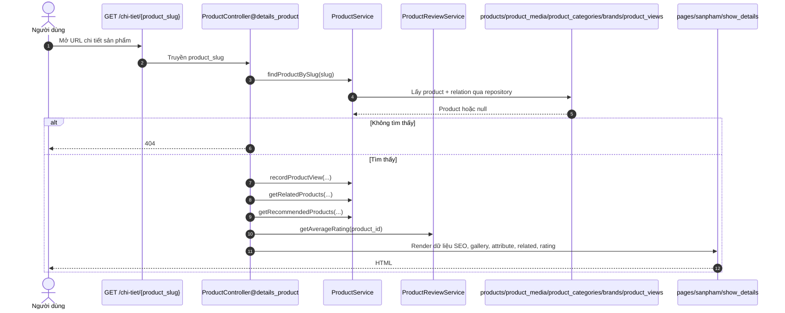
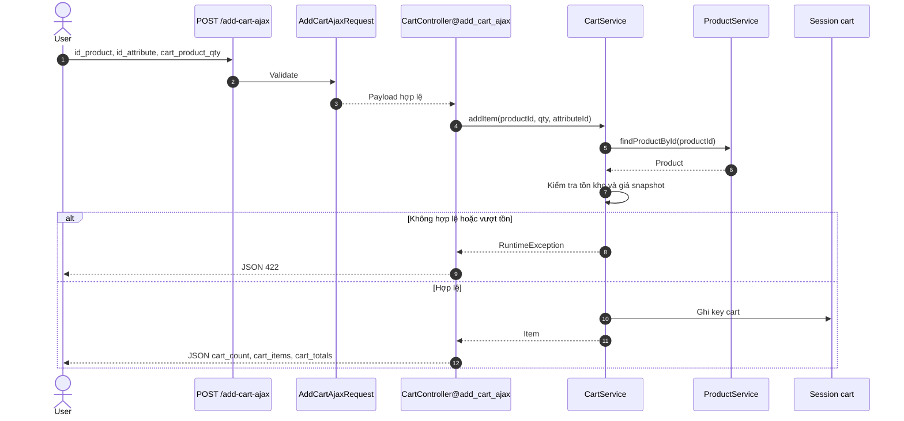
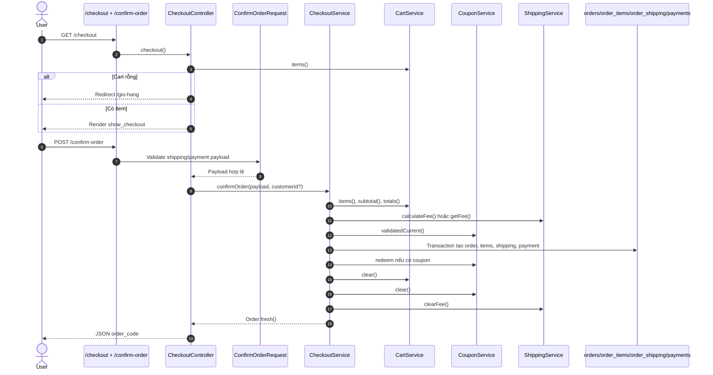
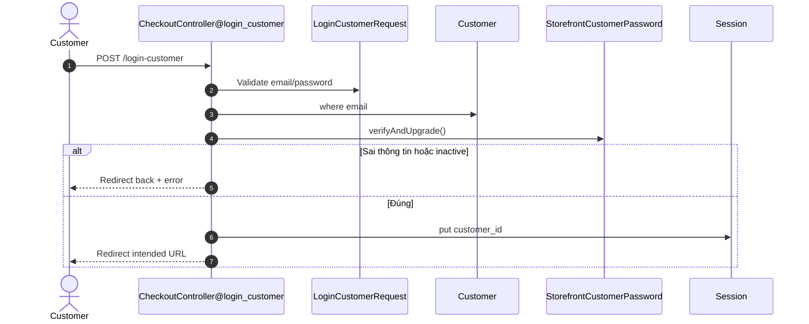
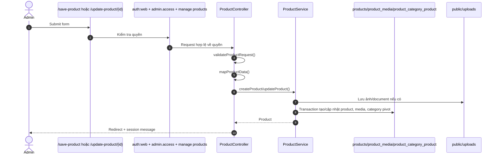
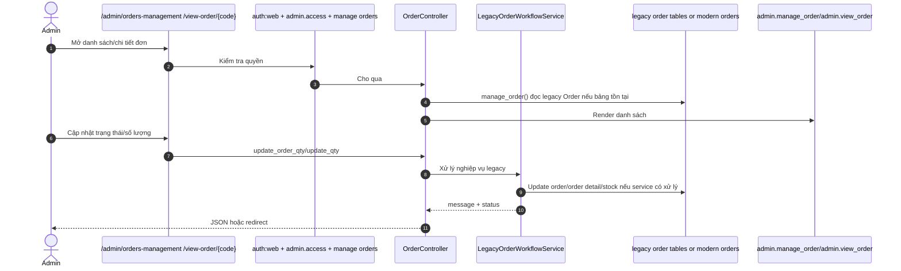

# Request Flows

Tài liệu này mô tả các luồng request chính theo route, controller, service/model và view đang tồn tại trong repo.

## 1. Luồng Xem Sản Phẩm

### Route chính

| Tác vụ | Route | Controller |
| --- | --- | --- |
| Trang chi tiết | `GET /chi-tiet/{product_slug}` | `ProductController@details_product` |
| Quick view | `POST /quickview` | `ProductController@quickview` |
| Load bình luận | `POST /load-comment` | `ProductController@load_comment` |
| Gửi bình luận | `POST /send-comment` | `ProductController@send_comment` |
| Gửi rating | `POST /insert-rating` | `ProductController@insert_rating` |

### File liên quan

| Loại | File |
| --- | --- |
| Controller | `app/Http/Controllers/ProductController.php` |
| Request | `app/Http/Requests/Storefront/Product/*` |
| Service | `ProductService`, `ProductReviewService`, `ProductPricingService` |
| Model mới | `Infrastructure/Persistence/Eloquent/Catalog/Product`, `ProductCategory`, `Brand`, `ProductMedia`, `ProductView` |
| Variant/attribute | `Infrastructure/Persistence/Eloquent/Catalog/ProductVariant` được map thành shape cũ cho Blade |
| View | `resources/views/pages/sanpham/show_details.blade.php`, `partials/quickview_modal_body`, `partials/review_thread` |

Ghi chú:

- `Product` mới có accessor legacy như `product_id`, `product_name`, `product_price`, nên Blade cũ vẫn dùng được key legacy.
- Product view được ghi qua `ProductService::recordProductView`.
- `legacyProductAttributes()` là tên helper compatibility; dữ liệu hiện lấy từ `product_variants`, không đọc trực tiếp `tbl_product_attribute`.

## 2. Luồng Thêm Giỏ Hàng

### Route chính

| Tác vụ | Route | Controller |
| --- | --- | --- |
| Trang giỏ hàng | `GET /gio-hang` | `CartController@gio_hang` |
| Thêm qua AJAX | `POST /add-cart-ajax` | `CartController@add_cart_ajax` |
| Cập nhật nhiều item | `POST /update-cart` | `CartController@update_cart` |
| Cập nhật quick cart | `POST /update-quick-cart` | `CartController@update_quick_cart` |
| Xóa item | `DELETE /del-product/{session_id}` hoặc `DELETE /delete-to-cart/{rowId}` | `CartController@delete_product` |
| Xóa theo product id | `POST/DELETE /remove-item` | `CartController@remove_item` |
| Xóa toàn bộ | `POST/DELETE /del-all-product` | `CartController@delete_all_product` |

### File liên quan

| Loại | File |
| --- | --- |
| Controller | `app/Http/Controllers/CartController.php` |
| Request | `app/Http/Requests/Storefront/Cart/*` |
| Service | `CartService`, `CouponService`, `ShippingService` |
| Model | `Catalog\Product`, legacy `ProductAttribute` nếu chọn attribute |
| Session | `cart`, `coupon`, `fee` |
| View | `resources/views/pages/cart/cart_ajax.blade.php`, `pages/cart/partials/*` |

Ghi chú:

- Web cart không dùng bảng `carts`; dữ liệu nằm trong session key `cart`.
- Mỗi item có `session_id`, `product_id`, `product_price`, `product_qty`, `product_quantity`, `product_attribute_id`.
- Khi cart rỗng, trang cart sẽ clear coupon và phí ship tạm trong session.

## 3. Luồng Checkout

### Route chính

| Tác vụ | Route | Controller |
| --- | --- | --- |
| Form checkout | `GET /checkout` | `CheckoutController@checkout` |
| Trang payment | `GET /payment` | `CheckoutController@payment` |
| Chọn tỉnh/huyện/xã | `POST /select-delivery-home` | `CheckoutController@select_delivery_home` |
| Tính phí ship | `POST /calculate-fee` | `CheckoutController@calculate_fee` |
| Xác nhận đơn | `POST /confirm-order` | `CheckoutController@confirm_order` |
| Chuyển khoản | `GET /payment/bank-transfer/{order_code}` | `CheckoutController@bankTransferInstructions` |

### File liên quan

| Loại | File |
| --- | --- |
| Controller | `app/Http/Controllers/CheckoutController.php` |
| Request | `app/Http/Requests/Storefront/Checkout/*` |
| Service | `CheckoutService`, `CartService`, `CouponService`, `ShippingService` |
| Model | `Customer`, `Address`, `Location`, `ShippingFee`, `Order`, `OrderItem`, `OrderShipping`, `Payment`, `CouponRedemption` |
| View | `pages/checkout/show_checkout`, `payment`, `bank_transfer_instructions` |

Ghi chú:

- Khách vãng lai vẫn checkout được. Nếu không có `customer_id`, order có `customer_id = null` và session lưu `guest_order_code`.
- `shipping_method` được map thành `payment_method` nếu request không gửi `payment_method`.
- `cod` tạo payment status `pending`; provider khác tạo status `processing`.
- Bank transfer instruction chỉ hiển thị cho order có payment provider `bank_transfer`.

## 4. Luồng Đăng Nhập

### Khách hàng storefront

| Tác vụ | Route | Controller |
| --- | --- | --- |
| Form đăng nhập | `GET /dang-nhap` | `CheckoutController@login_checkout` |
| Form đăng ký | `GET /dang-ky` | `CheckoutController@register_checkout` |
| Submit đăng nhập | `POST /login-customer` | `CheckoutController@login_customer` |
| Submit đăng ký | `POST /add-customer` | `CheckoutController@add_customer` |
| Logout | `GET /dang-xuat-khach-hang` | `CheckoutController@dang_xuat_khachhang` |

File liên quan:

- Request: `LoginCustomerRequest`, `RegisterCustomerRequest`
- Model: `Infrastructure/Persistence/Eloquent/Customer/Customer`
- Support: `StorefrontCustomerAuth`, `StorefrontCustomerPassword`
- View: `resources/views/pages/checkout/auth_checkout.blade.php`

### Admin

| Tác vụ | Route | Controller |
| --- | --- | --- |
| Form login | `GET /admin` | `AuthController@login_auth` |
| Submit login | `POST /auth-login` | `AuthController@login` |
| Register admin | `GET/POST /admin/register` | `AuthController@showRegisterForm/register` |
| Logout | `POST /logout-auth` | `AuthController@logout_auth` |

File liên quan:

- `app/Support/AdminAuthenticator.php`
- `app/Support/AdminAccess.php`
- `app/Support/AdminPermissions.php`
- Spatie tables: roles, permissions, model_has_roles, model_has_permissions
- View: `resources/views/admin/custom_auth/*`

Admin login dùng `Auth::guard('web')`, sau đó middleware `admin.access` và `admin.permission`.

## 5. Luồng Quản Trị Sản Phẩm

### Route chính

| Tác vụ | Route | Controller |
| --- | --- | --- |
| Danh sách chính | `GET /admin/products-management` | `Admin\AdminWorkspaceController@productsManagement` |
| Danh sách cũ | `GET /all-product` | Compatibility redirect to `/admin/products-management` |
| Form thêm | `GET /add-product` | `ProductController@add_product` |
| Lưu mới | `POST /save-product` | `ProductController@save_product` |
| Form sửa | `GET /edit-product/{product_id}` | `ProductController@edit_product` |
| Cập nhật | `POST /update-product/{product_id}` | `ProductController@update_product` |
| Xóa | `DELETE /delete-product/{product_id}` | `ProductController@delete_product` |
| Bật/tắt | `PATCH /active-product/{id}`, `/unactive-product/{id}` | `ProductController` |
| Xóa document | `POST /delete-document` | `ProductController@delete_document` |

Tất cả nằm trong permission `manage products`.

### File liên quan

| Loại | File |
| --- | --- |
| Controller | `app/Http/Controllers/ProductController.php` |
| Service | `Application/Catalog/Services/ProductService`, `ProductPricingService` |
| Repository | `EloquentProductRepository`, category/brand repositories |
| Model | `Catalog\Product`, `ProductMedia`, `ProductCategory`, `Brand` |
| View | `resources/views/admin/add_product.blade.php`, `all_product.blade.php`, `edit_product.blade.php` |
| Upload | `public/uploads/product`, `public/uploads/document`, copy tương thích sang `public/uploads/gallery` |

Ghi chú:

- Form admin gửi field legacy như `product_name`, `product_price`, `product_cate`.
- Controller map sang schema mới như `name`, `price`, `primary_category_id`.
- `product_status = 0` nghĩa là active theo mapping hiện tại.

## 6. Luồng Quản Trị Đơn Hàng

### Route chính

| Tác vụ | Route | Controller |
| --- | --- | --- |
| Danh sách đơn chính | `GET /admin/orders-management` | `Admin\AdminWorkspaceController@ordersManagement` |
| Danh sách đơn cũ | `GET /manage-order` | Compatibility redirect to `/admin/orders-management` |
| Chi tiết đơn | `GET /view-order/{order_code}` | `OrderController@view_order` |
| In PDF | `GET /print-order/{checkout_code}` | `OrderController@print_order` |
| Cập nhật trạng thái/số lượng | `POST /update-order-qty` | `OrderController@update_order_qty` |
| Cập nhật từng dòng | `POST /update-qty` | `OrderController@update_qty` |
| Xóa đơn | `DELETE /delete-order/{order_code}` | `OrderController@order_code` |
| Báo cáo lợi nhuận | `GET /product-profit` | `ProductProfitController@index` |

Tất cả nằm trong permission `manage orders`.

### File liên quan

| Loại | File |
| --- | --- |
| Controller | `app/Http/Controllers/OrderController.php` |
| Service | `LegacyOrderWorkflowService`, `LegacyOrderPresentationService`, `LegacyOrderHistoryService` |
| Model runtime | `Infrastructure/Persistence\Eloquent\Order\Order`, `OrderItem`, `OrderShipping`, `Payment` |
| Legacy note | Service names còn chữ `Legacy` vì giữ compatibility cho route/view cũ; runtime không import trực tiếp `app/Models/Order` hoặc `tbl_order`. |
| View | `resources/views/admin/manage_order.blade.php`, `admin/view_order.blade.php`, `admin/order/print.blade.php` |

Ghi chú:

- Admin order hiện đi qua service compatibility nhưng dùng schema modern `orders`, `order_items`, `order_shipping`, `payments`.
- Storefront history dùng schema modern khi các bảng `orders`, `order_items`, `order_shipping`, `payments` sẵn sàng.
- Khi sửa trạng thái đơn hoặc tồn kho, đọc service trong `app/Application/Order/Services` trước.
