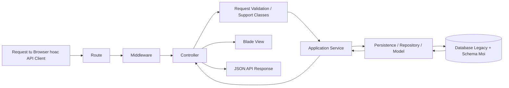
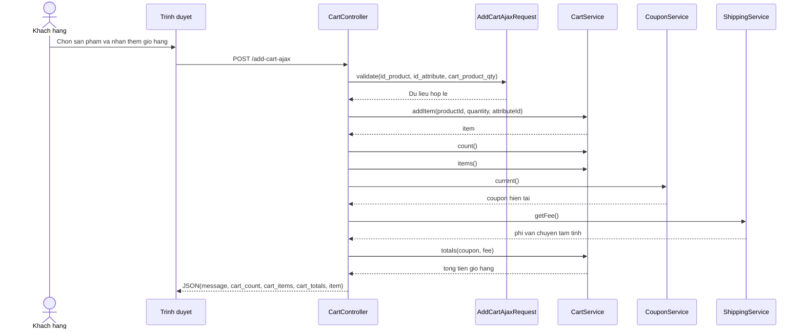
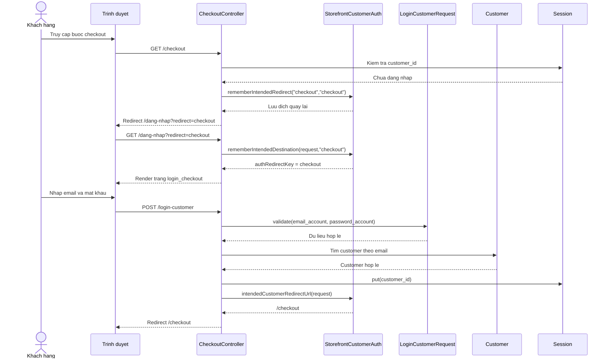

# PHẦN BỔ SUNG CHO CHƯƠNG 3. PHÂN TÍCH VÀ THIẾT KẾ HỆ THỐNG

Tài liệu này được viết để bổ sung trực tiếp cho phần phân tích và thiết kế của báo cáo. Nội dung tập trung vào bốn khoảng trống thường khiến Chương 3 còn thiếu chiều sâu khi đối chiếu với repo thật:

- quy trình phân tích hệ thống
- thiết kế kiến trúc tổng thể theo luồng xử lý request
- thiết kế cơ sở dữ liệu với bảng mapping legacy sang schema mới
- các sơ đồ sequence hoặc activity bám các route đang tồn tại thật trong mã nguồn

Các phần bên dưới được viết theo hướng Word-ready. Anh có thể ghép nguyên mục hoặc lấy từng tiểu mục để chèn vào Chương 3 hiện tại.

---

# 3.x. QUY TRÌNH PHÂN TÍCH HỆ THỐNG

## 3.x.1. Khảo sát hiện trạng hệ thống


Quá trình khảo sát hiện trạng cho thấy hệ thống hiện tại được tổ chức quanh ba mặt triển khai chính. Mặt thứ nhất là storefront dành cho khách hàng, được định nghĩa chủ yếu trong `routes/web/frontend.php` và nhóm view `resources/views/pages`. Mặt thứ hai là khu vực admin, được định nghĩa trong `routes/web/admin.php` cùng các controller và view quản trị. Mặt thứ ba là REST API, được tổ chức trong `routes/api.php` với các nhóm public, protected và admin.

Song song với đó, lớp dữ liệu của hệ thống cũng được nhận diện theo hai hướng. Một mặt, nhiều luồng vẫn sử dụng các bảng legacy như `tbl_product`, `tbl_category_product`, `tbl_customers`, `tbl_order`, `tbl_coupon`, `tbl_shipping`, `tbl_order_details`, `tbl_payment`. Mặt khác, lớp migrations mới đã tạo ra các bảng chuẩn hóa hơn như `products`, `product_categories`, `product_variants`, `customers`, `orders`, `order_items`, `payments`, `payment_transactions`, `product_reviews`, `chat_conversations`, `chat_messages`.

Việc khảo sát hiện trạng theo cách này giúp cho bước phân tích không bị tách rời khỏi mã nguồn thực tế. Đây là cơ sở quan trọng để báo cáo phản ánh đúng bản chất của dự án, thay vì mô tả hệ thống như một mô hình lý tưởng không còn tương ứng với repo.

## 3.x.2. Xác định yêu cầu hệ thống

Sau khi khảo sát hiện trạng, bước tiếp theo là xác định các yêu cầu của hệ thống. Quá trình này được thực hiện bằng cách đối chiếu giữa chức năng đang có trong mã nguồn, nhu cầu nghiệp vụ của một website thương mại điện tử và phạm vi thực hiện của đề tài.

Ở mức chức năng, yêu cầu được chia theo ba nhóm. Nhóm thứ nhất là yêu cầu của khách hàng trên storefront, bao gồm tìm kiếm, xem sản phẩm, thêm giỏ hàng, áp dụng coupon, đăng nhập, checkout, thanh toán, theo dõi đơn hàng, bình luận, đánh giá và so sánh sản phẩm. Nhóm thứ hai là yêu cầu của quản trị viên, bao gồm quản lý catalog, nội dung, đơn hàng, quyền truy cập, báo cáo, tài liệu và inbox hỗ trợ. Nhóm thứ ba là yêu cầu của API, bao gồm cung cấp dữ liệu cho client và hỗ trợ tích hợp.

Ở mức phi chức năng, hệ thống cần bảo đảm giao diện dễ dùng, phân quyền rõ ràng, dữ liệu tương đối nhất quán, có khả năng mở rộng và có kiểm tra chất lượng cho các luồng quan trọng. Với dự án hybrid, yêu cầu phi chức năng còn bao gồm khả năng duy trì tương thích với luồng cũ trong khi vẫn cho phép chuẩn hóa dần sang kiến trúc mới.

## 3.x.3. Mô hình hóa hệ thống

Sau bước xác định yêu cầu, hệ thống được mô hình hóa thông qua các sơ đồ use case, activity, sequence và ERD. Vai trò của bước mô hình hóa là chuyển các mô tả chức năng thành các cấu trúc dễ nhìn, dễ đối chiếu và dễ kiểm tra tính đầy đủ.

Đối với đề tài này, mô hình hóa không thể chỉ dừng ở mức thương mại điện tử tổng quát. Các sơ đồ cần bám sát các route và luồng thật trong repo. Ví dụ, hoạt động thêm sản phẩm vào giỏ hàng phải bám vào route `POST /add-cart-ajax`, quá trình đăng nhập rồi quay lại checkout phải bám vào `GET /checkout`, `GET /dang-nhap`, `POST /login-customer`, còn nghiệp vụ cập nhật sản phẩm ở admin phải bám vào `POST /update-product/{product_id}`.

Việc mô hình hóa theo route thật có ý nghĩa quan trọng vì nó tạo cầu nối trực tiếp giữa báo cáo và mã nguồn. Điều này giúp người đọc hiểu rằng phần thiết kế không phải là lý thuyết chung chung, mà phản ánh chính các luồng đang được triển khai trong hệ thống.

## 3.x.4. Thiết kế hệ thống

Từ kết quả khảo sát, xác định yêu cầu và mô hình hóa, bước cuối cùng là thiết kế hệ thống. Phần thiết kế trong đề tài này bao gồm ba lớp chính.

Lớp thứ nhất là thiết kế kiến trúc tổng thể, trong đó xác định vai trò của route, middleware, controller, request validation, support classes, service layer, persistence và presentation layer. Lớp thứ hai là thiết kế dữ liệu, trong đó làm rõ mối quan hệ giữa schema legacy và schema mới. Lớp thứ ba là thiết kế luồng nghiệp vụ, trong đó mô tả chi tiết cách request được xử lý qua các tầng của hệ thống.

Do dự án đang trong quá trình hiện đại hóa, phần thiết kế cũng cần phản ánh đúng chiến lược chuyển đổi. Nghĩa là, không mô tả như thể toàn bộ hệ thống đã chuyển sang một kiến trúc mới hoàn chỉnh, mà phải thể hiện rõ sự tồn tại song song giữa các thành phần legacy và các thành phần đã được chuẩn hóa.

## 3.x.5. Ý nghĩa của quy trình phân tích đối với đề tài

Quy trình phân tích hệ thống có vai trò đặc biệt quan trọng trong đề tài này vì nó giúp giải quyết một khó khăn lớn: repo không còn là một dự án CRUD nhỏ và thuần nhất. Nếu không có bước khảo sát và mô hình hóa cẩn thận, báo cáo rất dễ rơi vào hai trạng thái cực đoan. Một là chỉ kể lại các tính năng bề mặt mà không phản ánh kiến trúc thật. Hai là vẽ ra một mô hình quá lý tưởng, không còn ăn khớp với tình trạng mã nguồn hiện tại.

Nhờ có quy trình phân tích hệ thống rõ ràng, phần thiết kế có cơ sở chắc hơn, các sơ đồ dễ bám thực tế hơn và toàn bộ báo cáo có tính thuyết phục cao hơn khi bảo vệ.

---

# 3.x. THIẾT KẾ KIẾN TRÚC TỔNG THỂ THEO LUỒNG XỬ LÝ

## 3.x.1. Quan điểm thiết kế kiến trúc

Kiến trúc tổng thể của hệ thống được tổ chức theo hướng phân tầng. Luồng xử lý đi từ request của người dùng hoặc client, qua route và middleware, tới controller, sau đó sang request validation hoặc support classes khi cần, tiếp tục đi vào service layer và persistence layer, cuối cùng mới tương tác với cơ sở dữ liệu rồi trả kết quả ra view hoặc JSON API response.

Điểm đặc thù của hệ thống là không phải mọi luồng đều đã đi hết qua toàn bộ các tầng chuẩn hóa mới. Một số phần storefront và admin vẫn còn tính chất legacy hơn, trong khi các phần mới hơn đã dịch chuyển khá rõ sang service layer và persistence layer. Vì vậy, thiết kế kiến trúc tổng thể cần thể hiện được cả hướng tổ chức chuẩn lẫn thực tế hybrid của repo.

## 3.x.2. Mô tả luồng Request -> Controller -> Service -> Persistence -> Database/View/API

Khi người dùng gửi request tới hệ thống, route trước tiên xác định request sẽ được điều hướng tới controller nào. Trong nhiều trường hợp, request còn phải đi qua middleware để kiểm tra điều kiện truy cập như xác thực, phân quyền hoặc trạng thái phiên làm việc.

Tại controller, request được tiếp nhận và điều phối. Nếu request có dữ liệu đầu vào quan trọng, lớp request validation sẽ thực hiện kiểm tra trước khi controller xử lý sâu hơn. Ở các luồng cần điều hướng hoặc chuẩn hóa logic giao diện, support classes cũng có thể tham gia để gom những quy tắc lặp lại.

Sau bước điều phối ban đầu, controller chuyển phần nghiệp vụ chính sang service layer. Đây là nơi xử lý các thao tác như thêm sản phẩm vào giỏ hàng, tính tổng tiền, xác nhận đơn hàng, cập nhật sản phẩm, quản lý báo cáo hoặc xử lý recommendation.

Service layer sau đó tương tác với persistence layer hoặc model để truy vấn và cập nhật dữ liệu trong cơ sở dữ liệu. Kết quả cuối cùng được trả ngược lại cho controller, từ đó controller render view Blade nếu là web hoặc trả JSON nếu là API.

Nhìn theo luồng này, có thể thấy controller chỉ nên giữ vai trò điều phối. Nghiệp vụ nằm ở service, dữ liệu nằm ở persistence hoặc model, còn presentation nằm ở Blade hoặc API resource. Đây là tư tưởng thiết kế quan trọng giúp hệ thống dễ bảo trì hơn khi mở rộng.

## 3.x.3. Sơ đồ kiến trúc tổng thể



## 3.x.4. Vai trò của từng tầng trong kiến trúc

`Route` là tầng định tuyến, giúp hệ thống tách rõ các entry point giữa storefront, admin và API. `Middleware` là tầng kiểm tra điều kiện truy cập, đặc biệt quan trọng với admin và API protected routes. `Controller` là tầng điều phối request. `Request validation` là tầng kiểm tra dữ liệu đầu vào. `Support classes` là tầng gom các quy tắc dùng chung như điều hướng đăng nhập, phân quyền admin hoặc workspace behavior.

`Application service` là tầng xử lý nghiệp vụ cốt lõi. `Persistence` là tầng làm việc với dữ liệu, bao gồm model, repository và Eloquent entities mới. `Database` là tầng lưu trữ cuối cùng, hiện đang tồn tại dưới cả dạng legacy tables lẫn schema chuẩn hóa mới. `View` và `API response` là tầng hiển thị kết quả ra cho người dùng hoặc client.

## 3.x.5. Giá trị của kiến trúc này đối với dự án

Thiết kế kiến trúc tổng thể theo luồng xử lý nêu trên giúp hệ thống có khả năng mở rộng tốt hơn. Khi có thêm module mới như chatbot, reports, API admin hoặc các chức năng recommendation, hệ thống không cần tiếp tục dồn toàn bộ logic vào controller.

Đối với dự án đang ở trạng thái hybrid, kiến trúc này còn đóng vai trò như một “đích đến chuẩn hóa”. Nghĩa là, dù chưa phải mọi luồng đều đồng nhất tuyệt đối, nhưng hướng tổ chức hiện tại đã đủ rõ để tiếp tục hiện đại hóa mà không phá vỡ hoàn toàn luồng cũ.

---

# 3.x. THIẾT KẾ CƠ SỞ DỮ LIỆU VÀ BẢNG MAPPING LEGACY SANG SCHEMA MỚI

## 3.x.1. Nguyên tắc thiết kế dữ liệu trong dự án

Thiết kế cơ sở dữ liệu của dự án không diễn ra trong bối cảnh xây mới hoàn toàn, mà trong bối cảnh phải dung hòa giữa hai yêu cầu. Yêu cầu thứ nhất là duy trì tính chạy được của các luồng đang bám vào bảng legacy. Yêu cầu thứ hai là từng bước chuẩn hóa schema để phục vụ API, service layer và mở rộng nghiệp vụ.

Vì vậy, phần thiết kế dữ liệu cần nhìn theo hai chiều. Chiều thứ nhất là dữ liệu đang được vận hành trong hiện tại. Chiều thứ hai là đích dữ liệu chuẩn hóa mà hệ thống đang hướng tới. Sự song song này không phải là dấu hiệu của một hệ thống sai, mà là biểu hiện của một chiến lược chuyển đổi dần và an toàn hơn viết lại toàn bộ.

## 3.x.2. Bảng mapping giữa dữ liệu legacy và schema mới

Bảng dưới đây mô tả một số ánh xạ quan trọng giữa lớp dữ liệu cũ và lớp dữ liệu mới trong repo.

| Nhóm nghiệp vụ | Bảng legacy | Schema mới | Ghi chú |
|---|---|---|---|
| Thương hiệu | `tbl_brand` | `brands` | Ánh xạ khá trực tiếp qua tên, slug, trạng thái |
| Danh mục sản phẩm | `tbl_category_product` | `product_categories` | Có thêm quan hệ cha con qua `parent_id` |
| Sản phẩm | `tbl_product` | `products` | Schema mới tách rõ giá, tồn kho, category chính, brand |
| Thuộc tính sản phẩm | `tbl_product_attribute` | `product_variants`, `attributes`, `attribute_values` | Không phải mapping 1:1 tuyệt đối, là hướng chuẩn hóa sâu hơn |
| Khách hàng | `tbl_customers` | `customers` | Có bổ sung `meta`, trạng thái hoạt động, dữ liệu chuẩn hóa hơn |
| Địa chỉ giao hàng | `tbl_shipping` | `customer_addresses`, `order_shipping` | Một bản ghi shipping cũ được tách thành dữ liệu địa chỉ và giao hàng |
| Đơn hàng | `tbl_order` | `orders` | Schema mới tách rõ trạng thái đơn, thanh toán, fulfillment |
| Chi tiết đơn hàng | `tbl_order_details` | `order_items` | Chuẩn hóa từng dòng sản phẩm trong đơn |
| Thanh toán | `tbl_payment` | `payments`, `payment_transactions` | Dữ liệu payment được tách thành payment chính và lịch sử giao dịch |
| Mã giảm giá | `tbl_coupon` | `coupons`, `coupon_redemptions` | Schema mới hỗ trợ cả thông tin coupon và lượt sử dụng |
| Bình luận, đánh giá | `tbl_comment`, `tbl_rating` | `product_reviews` | Dữ liệu comment và rating được gom về một mô hình review chuẩn hơn |
| Danh mục bài viết | `tbl_category_post` | `blog_categories` | Phục vụ chuẩn hóa CMS |
| Bài viết | `tbl_posts` | `blog_posts` | Chuẩn hóa nội dung blog, slug, metadata |

## 3.x.3. Nhận xét về bảng mapping

Qua bảng mapping có thể thấy không phải mọi bảng legacy đều chuyển sang đúng một bảng mới. Ở nhiều trường hợp, một bảng cũ được tách ra thành nhiều thực thể chuyên biệt hơn trong schema mới. Ví dụ, `tbl_order` không chỉ tương ứng với `orders`, mà còn liên quan chặt tới `order_items`, `order_shipping`, `payments` và `payment_transactions`.

Điều này cho thấy thiết kế cơ sở dữ liệu mới của hệ thống theo hướng chuẩn hóa và phân tách trách nhiệm rõ hơn. Mỗi nhóm dữ liệu được mô hình hóa chi tiết hơn để hỗ trợ nghiệp vụ, truy vấn và báo cáo tốt hơn trong tương lai.

## 3.x.4. Ý nghĩa của thiết kế dữ liệu hybrid

Thiết kế dữ liệu hybrid mang lại hai lợi ích lớn. Thứ nhất, nó giúp hệ thống duy trì khả năng vận hành đối với các luồng cũ mà không cần đóng băng toàn bộ việc phát triển. Thứ hai, nó tạo ra nền tảng chuẩn để các phần mới như API, reports, chatbot và analytics có thể bám vào.

Tuy nhiên, mặt còn lại của cách tiếp cận này là báo cáo phải mô tả trung thực sự song song giữa hai lớp dữ liệu. Nếu chỉ mô tả schema mới mà bỏ qua legacy, phần phân tích sẽ thiếu chính xác. Nếu chỉ mô tả legacy, báo cáo sẽ không phản ánh đúng hướng hiện đại hóa của dự án.

---

# 3.x. SƠ ĐỒ SEQUENCE VÀ ACTIVITY BÁM ROUTE THẬT

## 3.x.1. Sequence diagram cho route `POST /add-cart-ajax`

Sơ đồ này bám trực tiếp vào route `POST /add-cart-ajax`, controller `CartController::add_cart_ajax`, request `AddCartAjaxRequest`, service `CartService`, `CouponService` và `ShippingService`.



**Mô tả dưới hình:**  
Sơ đồ sequence của nghiệp vụ thêm sản phẩm vào giỏ hàng thể hiện rõ luồng AJAX ở storefront. Sau khi request được kiểm tra hợp lệ bởi `AddCartAjaxRequest`, controller gọi `CartService` để thêm sản phẩm, sau đó tiếp tục truy xuất số lượng giỏ hàng, danh sách item, coupon hiện tại và phí vận chuyển tạm tính để trả về response JSON hoàn chỉnh. Đây là luồng có tính thực tế cao vì không chỉ lưu item mà còn đồng bộ nhiều thành phần giao diện liên quan như badge và quick cart.

## 3.x.2. Sequence diagram cho luồng `login -> checkout redirect`

Sơ đồ này bám vào các route và method thật gồm `GET /checkout`, `GET /dang-nhap`, `POST /login-customer`, `CheckoutController::checkout`, `CheckoutController::login_checkout`, `CheckoutController::login_customer` và support class `StorefrontCustomerAuth`.



**Mô tả dưới hình:**  
Sơ đồ sequence của luồng đăng nhập rồi quay lại checkout cho thấy hệ thống không điều hướng ngẫu nhiên sau khi người dùng đăng nhập. Khi khách hàng truy cập `checkout` nhưng chưa xác thực, hệ thống dùng `StorefrontCustomerAuth` để ghi nhớ đích quay lại, sau đó chuyển người dùng tới màn hình đăng nhập. Sau khi `POST /login-customer` thành công, controller dựa vào thông tin redirect đã lưu để trả người dùng về đúng bước checkout. Đây là một chi tiết nhỏ nhưng có ý nghĩa lớn đối với trải nghiệm mua hàng.

## 3.x.3. Activity diagram cho route `POST /update-product/{product_id}`

Sơ đồ này bám vào route `POST /update-product/{product_id}`, controller `ProductController::update_product` và service `ProductService::updateProduct`.

```mermaid
flowchart TD
    A[Quan tri vien gui form cap nhat san pham] --> B[POST /update-product/{product_id}]
    B --> C[ProductController tim san pham theo id]
    C --> D{San pham ton tai?}
    D -- Khong --> E[Redirect ve /admin/products-management voi thong bao loi]
    D -- Co --> F[validateProductRequest]
    F --> G{Du lieu hop le?}
    G -- Khong --> H[Quay lai form va hien thi loi validation]
    G -- Co --> I[mapProductData]
    I --> J[ProductService.updateProduct]
    J --> K[Mo DB transaction]
    K --> L[Cap nhat pricing payload va meta]
    L --> M{Co file document moi?}
    M -- Co --> N[Xoa document cu neu co va luu document moi]
    M -- Khong --> O[Bo qua buoc document]
    N --> P
    O --> P
    P --> Q{Co anh moi?}
    Q -- Co --> R[Xoa thumbnail cu, luu anh moi, tao media moi]
    Q -- Khong --> S[Giữ anh hien tai]
    R --> T
    S --> T
    T --> U[Update product qua persistence layer]
    U --> V{Co category_ids?}
    V -- Co --> W[Dong bo categories]
    V -- Khong --> X[Bo qua dong bo category]
    W --> Y[Fresh brand, categories, media]
    X --> Y
    Y --> Z[Invalidate product cache]
    Z --> AA[Redirect /admin/products-management voi thong bao thanh cong]
```

**Mô tả dưới hình:**  
Sơ đồ activity của nghiệp vụ cập nhật sản phẩm ở admin cho thấy đây không phải là một thao tác CRUD đơn giản. Sau khi xác minh sản phẩm tồn tại và dữ liệu đầu vào hợp lệ, controller ánh xạ payload rồi chuyển việc xử lý sang `ProductService`. Tại đây, hệ thống mở transaction, cập nhật pricing, metadata, file document, ảnh sản phẩm, media gallery, category relation và cuối cùng invalidates cache sản phẩm trước khi chuyển người dùng về danh sách quản trị. Luồng này phản ánh khá rõ xu hướng chuẩn hóa nghiệp vụ ở lớp service trong repo.

## 3.x.4. Gợi ý cách đưa các sơ đồ vào bản Word

Nếu anh muốn dùng trực tiếp trong báo cáo Word, có thể đi theo hai cách. Cách thứ nhất là giữ nguyên mã Mermaid như một phần phụ lục kỹ thuật. Cách thứ hai là dựng lại thành hình bằng Mermaid Live Editor hoặc các công cụ chuyển sơ đồ, sau đó chèn hình vào Chương 3 và giữ lại đoạn mô tả dưới hình như đã viết ở trên.

Về mặt học thuật, cách tốt nhất là chèn hình sơ đồ trong thân bài và nếu cần thì đặt mã Mermaid ở phần phụ lục. Như vậy, báo cáo vừa có hình trực quan để đọc nhanh, vừa có cơ sở kỹ thuật để chứng minh sơ đồ bám route thật.

---

# KẾT LUẬN CHO PHẦN BỔ SUNG

Bốn nội dung bổ sung ở trên giúp phần phân tích và thiết kế của báo cáo chắc hơn theo đúng hiện trạng repo. Thay vì chỉ dừng ở mức mô tả use case và ERD, phần này bổ sung thêm quy trình phân tích hệ thống, thiết kế kiến trúc tổng thể theo luồng xử lý, thiết kế cơ sở dữ liệu ở trạng thái hybrid và các sơ đồ bám route thật trong mã nguồn.

Nếu ghép các mục này vào Chương 3 hiện có, phần phân tích và thiết kế sẽ đầy hơn, sát repo hơn và dễ bảo vệ hơn trước các câu hỏi về tính thực tế của kiến trúc và luồng xử lý.
