# BỘ BIỂU ĐỒ BỔ SUNG CHO CHƯƠNG 3

Tài liệu này bổ sung thêm các biểu đồ còn thiếu để phần phân tích và thiết kế nhìn đầy hơn trong báo cáo đồ án. Nếu chỉ dùng các file trước, phần biểu đồ đã có kiến trúc tổng thể và một số sequence hoặc activity quan trọng, nhưng vẫn còn thiếu nhóm biểu đồ tổng quan như use case và ERD trực quan.

Bộ biểu đồ dưới đây được viết theo hướng dễ chuyển sang hình để chèn vào Word. Anh có thể giữ nguyên mã Mermaid ở phụ lục hoặc dựng thành hình bằng Mermaid Live Editor.

---

# 3.x. BIỂU ĐỒ USE CASE TỔNG QUÁT CỦA HỆ THỐNG

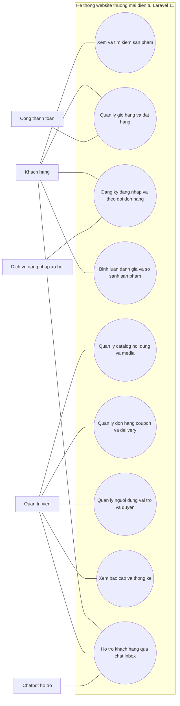

**Mô tả dưới hình:**  
Biểu đồ use case tổng quát thể hiện hai tác nhân trung tâm của hệ thống là khách hàng và quản trị viên. Khách hàng chủ yếu tương tác với storefront để xem sản phẩm, tìm kiếm, so sánh, giỏ hàng, thanh toán và theo dõi đơn hàng. Quản trị viên tương tác với khu vực admin để quản lý catalog, nội dung, đơn hàng, người dùng, quyền hạn và báo cáo. Ngoài ra, hệ thống còn liên kết với các tác nhân hỗ trợ như dịch vụ đăng nhập xã hội, cổng thanh toán và chatbot.

---

# 3.x. BIỂU ĐỒ USE CASE PHÍA KHÁCH HÀNG

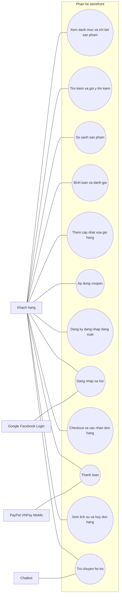

**Mô tả dưới hình:**  
Biểu đồ use case phía khách hàng mô tả các nghiệp vụ chính trên storefront. Người dùng có thể duyệt sản phẩm, tìm kiếm, so sánh, thêm vào giỏ hàng, áp dụng mã giảm giá, đăng nhập theo nhiều cách, đi qua checkout, thanh toán và theo dõi lịch sử đơn hàng. Các tác nhân hỗ trợ như cổng thanh toán, dịch vụ đăng nhập xã hội và chatbot được gắn với các use case tương ứng, giúp sơ đồ bám sát hơn với thực tế triển khai của repo.

---

# 3.x. BIỂU ĐỒ USE CASE PHÍA QUẢN TRỊ VIÊN

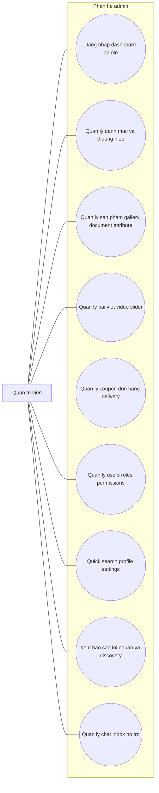

**Mô tả dưới hình:**  
Biểu đồ use case phía quản trị viên thể hiện rõ rằng khu vực admin không chỉ dừng ở CRUD sản phẩm. Ngoài catalog, hệ thống còn có quản lý nội dung, delivery, coupon, người dùng, vai trò, quyền truy cập, báo cáo và hộp thư chat hỗ trợ. Điều này phản ánh đúng hướng phát triển của repo như một hệ thống vận hành nội bộ tương đối hoàn chỉnh.

---

# 3.x. BIỂU ĐỒ PHÂN HỆ API

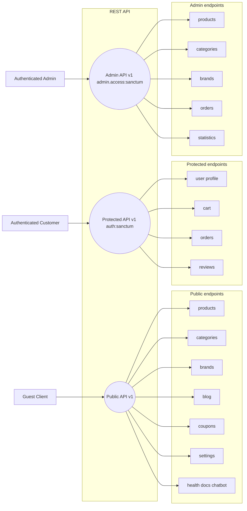

**Mô tả dưới hình:**  
Biểu đồ phân hệ API mô tả ba lớp truy cập chính của hệ thống: public API, protected API và admin API. Cấu trúc này bám sát `routes/api.php` và cho thấy hệ thống không chỉ phục vụ giao diện web mà còn có một mặt dịch vụ riêng cho truy vấn dữ liệu, tích hợp và quản trị.

---

# 3.x. ERD TỔNG QUÁT CỦA SCHEMA CHUẨN HÓA

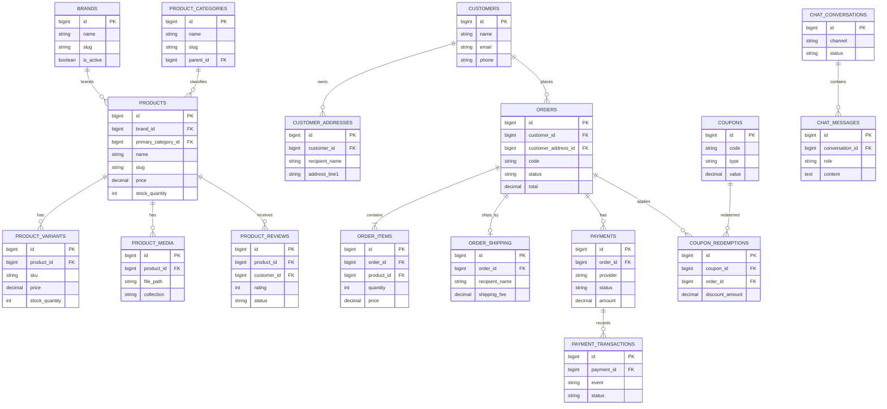

**Mô tả dưới hình:**  
ERD tổng quát của schema chuẩn hóa tập trung vào các nhóm dữ liệu trọng yếu của hệ thống như catalog, customer, order, payment, review và chat support. Sơ đồ này không thay thế hoàn toàn ERD hybrid, nhưng có giá trị lớn trong việc trình bày rõ hướng dữ liệu mà hệ thống đang chuẩn hóa tới.

---

# 3.x. BIỂU ĐỒ ÁNH XẠ DỮ LIỆU HYBRID GIỮA LEGACY VÀ SCHEMA MỚI

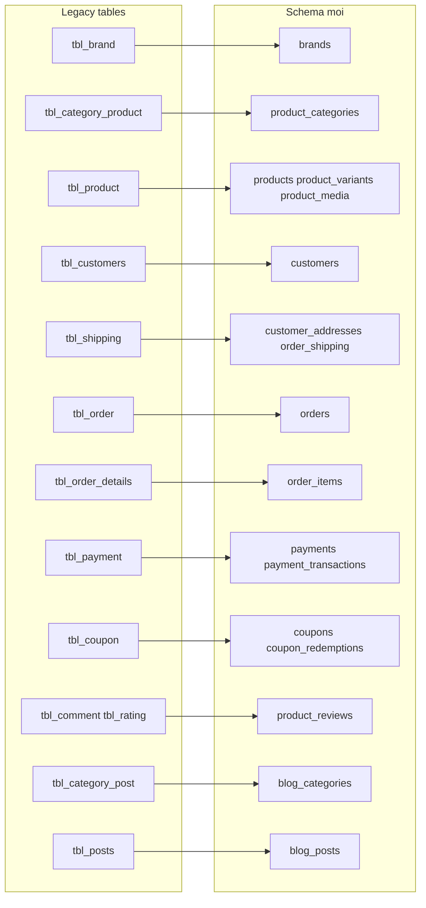

**Mô tả dưới hình:**  
Biểu đồ ánh xạ dữ liệu hybrid giúp người đọc nhìn trực tiếp sự chuyển đổi từ lớp bảng legacy sang lớp schema mới. Đây là biểu đồ rất hữu ích trong bối cảnh dự án hiện tại, vì nó cho thấy rõ hệ thống không phải chỉ còn legacy, cũng chưa hoàn toàn là greenfield chuẩn hóa, mà đang ở trạng thái chuyển đổi từng phần.

---

# 3.x. ACTIVITY DIAGRAM CHO NGHIỆP VỤ `POST /confirm-order`

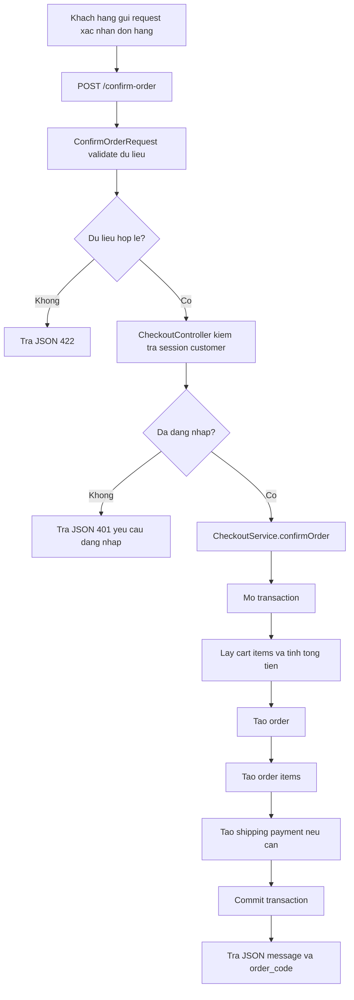

**Mô tả dưới hình:**  
Activity diagram của nghiệp vụ xác nhận đơn hàng cho thấy checkout trong hệ thống không dừng ở render giao diện, mà còn có một bước xử lý backend khá rõ ràng. Sau khi request được kiểm tra hợp lệ và xác minh khách hàng đã đăng nhập, `CheckoutService` thực hiện quy trình tạo đơn, chi tiết đơn, dữ liệu giao hàng và thông tin thanh toán rồi mới trả về mã đơn hàng cho phía client.

---

# 3.x. ACTIVITY DIAGRAM CHO NGHIỆP VỤ TÌM KIẾM VÀ GỢI Ý TÌM KIẾM

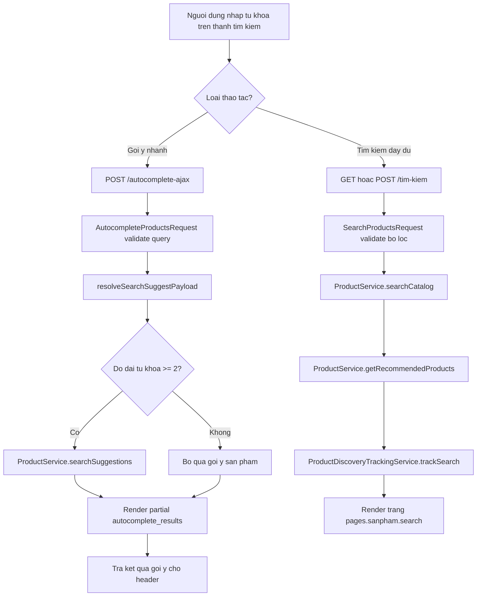

**Mô tả dưới hình:**  
Biểu đồ activity của nghiệp vụ tìm kiếm và gợi ý tìm kiếm thể hiện hai luồng song song trong storefront. Luồng thứ nhất là gợi ý động qua `POST /autocomplete-ajax`, dùng để trả về partial kết quả ngay trên header. Luồng thứ hai là tìm kiếm đầy đủ qua `/tim-kiem`, trong đó hệ thống không chỉ truy vấn dữ liệu mà còn kết hợp bộ lọc, recommendation và tracking hành vi tìm kiếm. Đây là nghiệp vụ quan trọng đối với website bán thiết bị công nghệ vì ảnh hưởng trực tiếp đến khả năng khám phá sản phẩm.

---

# 3.x. SEQUENCE DIAGRAM CHO NGHIỆP VỤ TÍNH PHÍ VẬN CHUYỂN

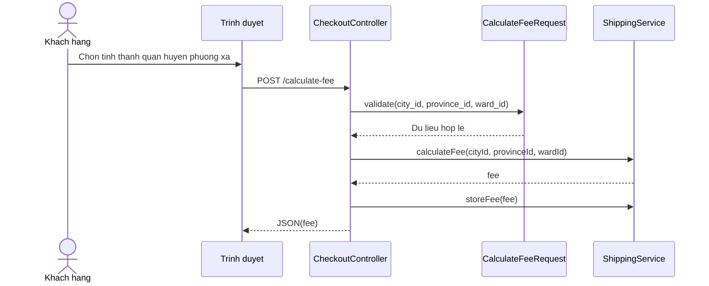

**Mô tả dưới hình:**  
Sơ đồ sequence của nghiệp vụ tính phí vận chuyển mô tả một luồng AJAX quan trọng trong checkout. Sau khi người dùng chọn các đơn vị hành chính phù hợp, `CalculateFeeRequest` kiểm tra dữ liệu đầu vào, rồi controller gọi `ShippingService` để tính phí tạm tính và lưu phí này vào trạng thái hiện hành của phiên mua hàng. Kết quả được trả về dưới dạng JSON để giao diện cập nhật tổng tiền mà không cần tải lại toàn bộ trang.

---

# 3.x. SEQUENCE DIAGRAM CHO NGHIỆP VỤ ĐĂNG NHẬP QUẢN TRỊ VIÊN

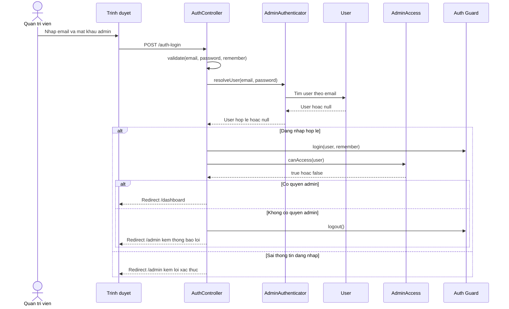

**Mô tả dưới hình:**  
Sơ đồ sequence của nghiệp vụ đăng nhập quản trị cho thấy hệ thống không chỉ kiểm tra đúng sai của mật khẩu mà còn kiểm tra cả quyền truy cập vào admin. `AdminAuthenticator` chịu trách nhiệm giải mã logic xác thực, kể cả trường hợp mật khẩu legacy cần nâng cấp sang hash mới. Sau khi đăng nhập thành công, `AdminAccess` tiếp tục kiểm tra xem người dùng có thuộc nhóm vai trò được phép vào admin hay không. Điều này giúp hệ thống tăng tính an toàn và phù hợp với mô hình phân quyền theo vai trò.

---

# 3.x. SEQUENCE DIAGRAM CHO NGHIỆP VỤ CHATBOT STOREFRONT

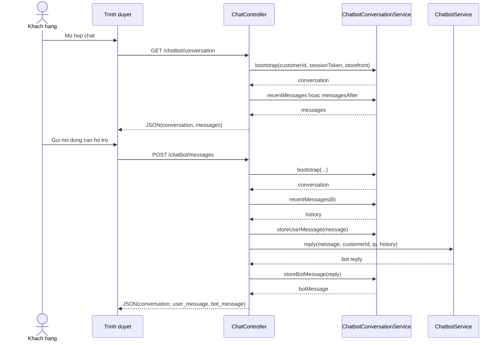

**Mô tả dưới hình:**  
Sơ đồ sequence của chatbot storefront cho thấy hệ thống hỗ trợ hội thoại theo cách có trạng thái chứ không chỉ trả lời từng câu rời rạc. Khi người dùng mở hộp chat, controller bootstrap cuộc hội thoại và nạp các tin nhắn gần đây. Khi người dùng gửi nội dung mới, controller lưu tin nhắn của khách, lấy lịch sử hội thoại gần nhất rồi gọi `ChatbotService` để sinh phản hồi. Cuối cùng, cả tin nhắn người dùng và tin nhắn bot đều được lưu lại trong conversation service trước khi trả về phía trình duyệt.

---

# 3.x. BIỂU ĐỒ TRIỂN KHAI TỔNG THỂ

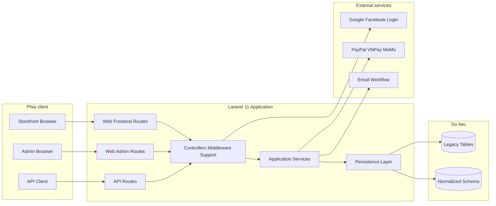

**Mô tả dưới hình:**  
Biểu đồ triển khai tổng thể cho thấy hệ thống có ba đầu vào chính là storefront browser, admin browser và API client. Tất cả các luồng này đều đi qua ứng dụng Laravel 11, trong đó các thành phần route, controller, middleware, support classes, service layer và persistence layer phối hợp với nhau để truy xuất dữ liệu ở cả lớp legacy và lớp schema chuẩn hóa mới. Đồng thời, hệ thống còn liên kết với các dịch vụ ngoài như đăng nhập xã hội, cổng thanh toán và email workflow.

---

# KẾT LUẬN CHO BỘ BIỂU ĐỒ

Với file này, phần biểu đồ của Chương 3 sẽ đầy hơn đáng kể. Kết hợp với file phân tích thiết kế đã có, anh hiện có:

- use case tổng quát
- use case storefront
- use case admin
- kiến trúc tổng thể
- phân hệ API
- ERD chuẩn hóa
- sơ đồ ánh xạ hybrid legacy sang schema mới
- sequence add-cart-ajax
- sequence login -> checkout redirect
- activity search và autocomplete
- sequence calculate-fee
- sequence admin login
- sequence chatbot storefront
- activity update product
- activity confirm-order
- deployment tổng thể

Mức này đã đủ chắc cho một Chương 3 đồ án. Nếu muốn dày thêm nữa, phần còn có thể mở rộng tiếp là biểu đồ search flow, chatbot flow và delivery fee flow.
