# BỘ USE CASE THEO MODULE CHO CHƯƠNG 3

Tài liệu này bổ sung thêm các biểu đồ use case theo module để đi sâu hơn vào từng nhóm chức năng chính của hệ thống. File này không thay thế các biểu đồ use case tổng quan đã có trong `thesis_report_diagram_pack.md`, mà đóng vai trò là lớp use case chi tiết hơn để Chương 3 đầy và bám repo thật hơn.

Nguyên tắc trình bày của file này là:

- giữ phạm vi ở mức module, không tách tới từng route đơn lẻ
- mỗi hình có ít tác nhân và số use case vừa phải để không rối
- phần mô tả dưới hình luôn nhắc route hoặc controller thật để tăng độ tin cậy
- thứ tự đánh số bắt đầu từ `Hình 3.11` vì bộ trước đã có nhóm hình từ `Hình 3.1` đến `Hình 3.10`

---

## Hình 3.11. Biểu đồ use case module tìm kiếm và khám phá sản phẩm

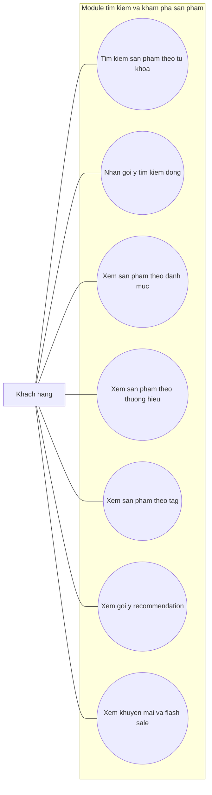

**Mô tả dưới hình:**  
Biểu đồ use case của module tìm kiếm và khám phá sản phẩm mô tả các thao tác đầu vào của khách hàng trong quá trình duyệt catalog. Người dùng có thể tìm kiếm sản phẩm theo từ khóa, nhận gợi ý động, xem sản phẩm theo danh mục, thương hiệu, tag và recommendation. Biểu đồ này bám các route như `/tim-kiem`, `/autocomplete-ajax`, `/goi-y-san-pham`, `/danh-muc/{slug_category_product}`, `/thuong-hieu/{brandSlug}`, `/tag/{product_tag}` và các controller như `HomeController`, `CategoryProduct`, `BrandProduct`, `ProductController`.

---

## Hình 3.12. Biểu đồ use case module chi tiết sản phẩm và tương tác

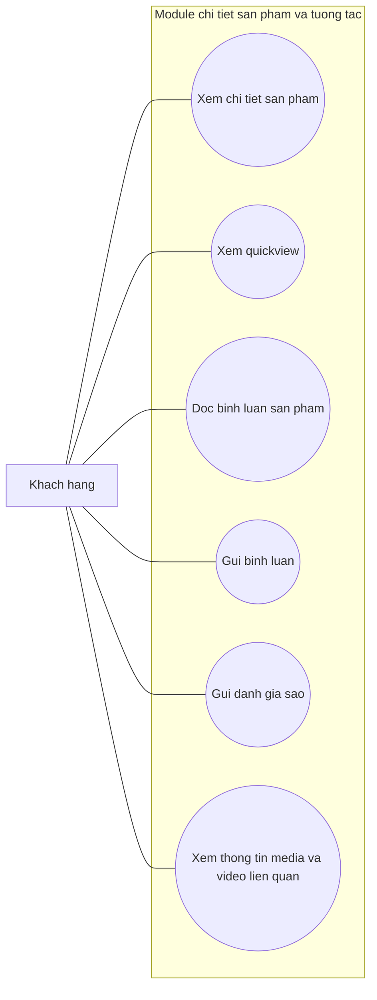

**Mô tả dưới hình:**  
Biểu đồ use case của module chi tiết sản phẩm tập trung vào trải nghiệm đọc thông tin và tương tác tại trang sản phẩm. Người dùng có thể mở trang chi tiết, xem nhanh qua quickview, theo dõi bình luận, gửi nhận xét và đánh giá sao. Biểu đồ này bám các route như `/chi-tiet/{product_slug}`, `/quickview`, `/load-comment`, `/send-comment`, `/insert-rating` và phần video hoặc media liên quan do `ProductController` và `VideoController` phục vụ.

---

## Hình 3.13. Biểu đồ use case module so sánh sản phẩm

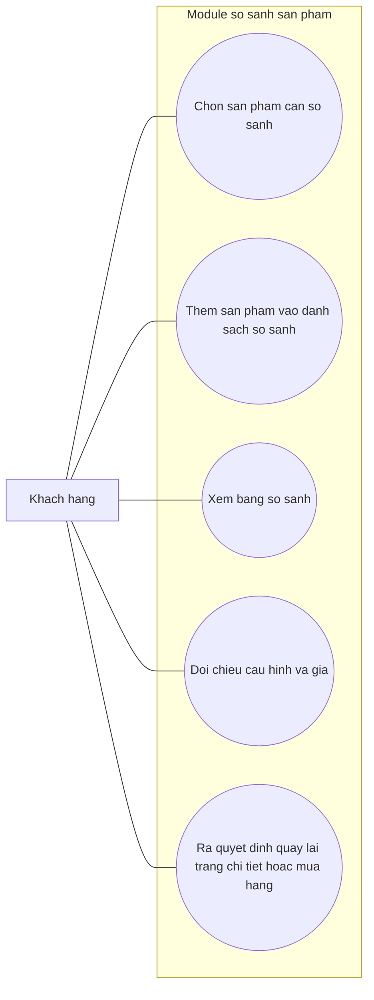

**Mô tả dưới hình:**  
Biểu đồ use case của module so sánh sản phẩm thể hiện một nghiệp vụ quan trọng đối với website bán thiết bị công nghệ, nơi khách hàng thường cần đối chiếu nhiều lựa chọn trước khi mua. Chức năng này bám route `/so-sanh` và nhóm controller `CompareController`, đồng thời hỗ trợ trực tiếp cho quá trình ra quyết định mua hàng.

---

## Hình 3.14. Biểu đồ use case module giỏ hàng và coupon

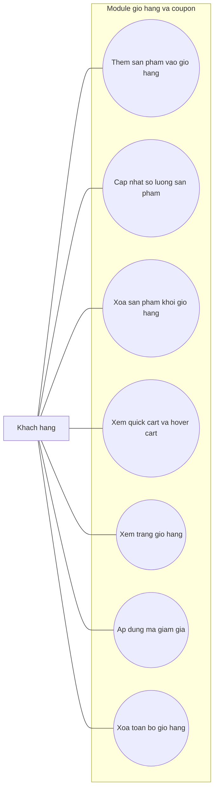

**Mô tả dưới hình:**  
Biểu đồ use case của module giỏ hàng và coupon mô tả các thao tác chính liên quan đến cart trên storefront. Người dùng có thể thêm hàng bằng AJAX, cập nhật số lượng, xóa sản phẩm, theo dõi quick cart, vào trang giỏ hàng và áp dụng mã khuyến mãi. Biểu đồ này bám các route như `/add-cart-ajax`, `/update-cart-quantity`, `/update-quick-cart`, `/gio-hang`, `/show_quick_cart`, `/hover-cart`, `/check-coupon` và `CartController`.

---

## Hình 3.15. Biểu đồ use case module tài khoản khách hàng

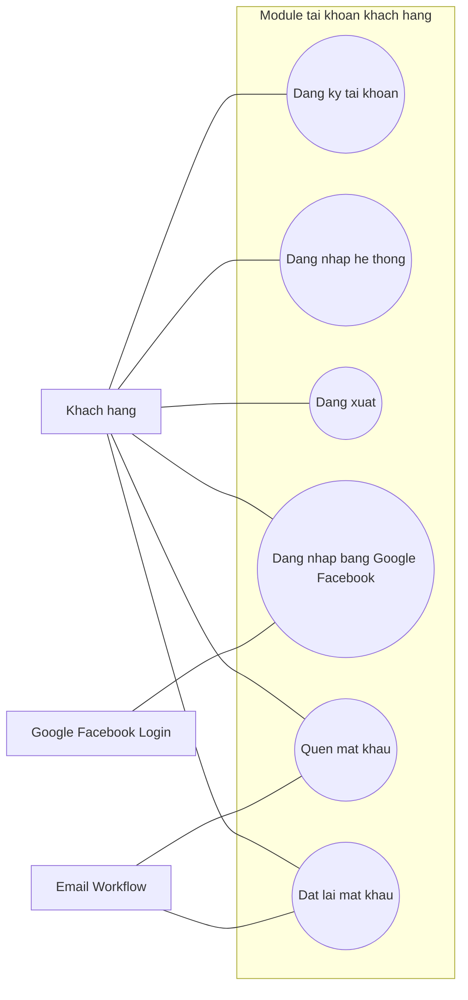

**Mô tả dưới hình:**  
Biểu đồ use case của module tài khoản khách hàng mô tả đầy đủ vòng đời xác thực của người mua trên storefront. Hệ thống hỗ trợ đăng ký, đăng nhập, đăng xuất, đăng nhập xã hội và luồng quên hoặc đặt lại mật khẩu. Biểu đồ này bám các route như `/add-customer`, `/login-customer`, `/dang-nhap`, `/dang-xuat-khach-hang`, `/login-facebook-customer`, `/login-customer-google`, `/quen-mat-khau`, `/recover-pass`, `/reset-new-pass` cùng `CheckoutController`, `AdminController`, `MailController`.

---

## Hình 3.16. Biểu đồ use case module checkout, thanh toán và đơn hàng

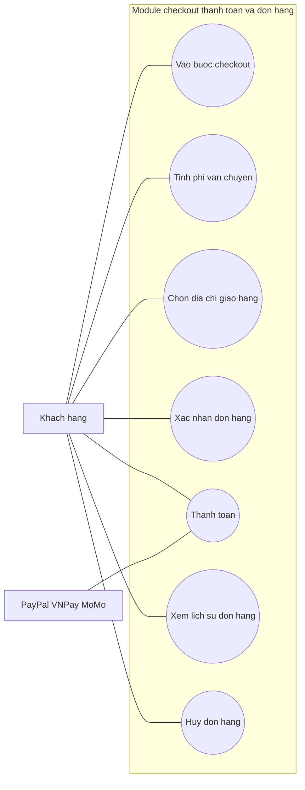

**Mô tả dưới hình:**  
Biểu đồ use case của module checkout, thanh toán và đơn hàng mô tả các chức năng hậu giỏ hàng của khách hàng. Người dùng vào checkout, tính phí vận chuyển, chọn địa chỉ, xác nhận đơn, đi qua thanh toán và theo dõi lịch sử đơn hàng. Biểu đồ này bám các route `/checkout`, `/payment`, `/calculate-fee`, `/select-delivery-home`, `/confirm-order`, `/vnpay_payment`, `/momo_payment`, `/history`, `/huy-don-hang`, cùng `CheckoutController`, `OrderController`, `PayPalController`.

---

## Hình 3.17. Biểu đồ use case module chatbot và hỗ trợ khách hàng

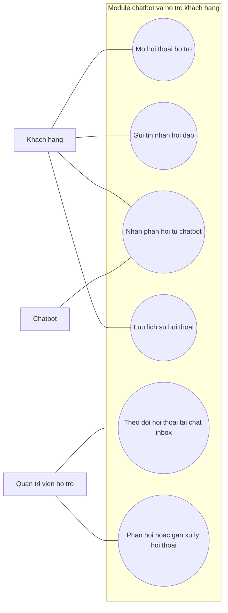

**Mô tả dưới hình:**  
Biểu đồ use case của module chatbot và hỗ trợ khách hàng thể hiện mối liên hệ giữa storefront và admin support. Khách hàng mở hội thoại, gửi câu hỏi và nhận phản hồi; phía quản trị có thể theo dõi cuộc trò chuyện trong chat inbox. Biểu đồ này bám các route `/chatbot/conversation`, `/chatbot/messages`, `/chat-inbox`, `/chat-inbox/conversations/{conversation}`, `ChatController` và `Admin\ChatInboxController`.

---

## Hình 3.18. Biểu đồ use case module xác thực và workspace quản trị

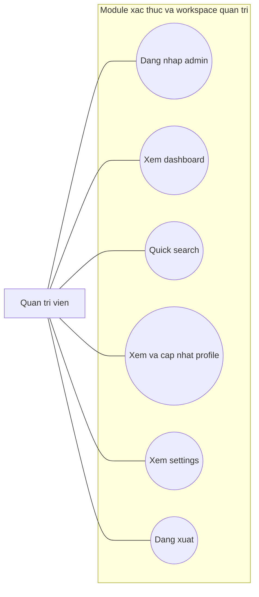

**Mô tả dưới hình:**  
Biểu đồ use case của module xác thực và workspace quản trị mô tả các thao tác nền tảng để quản trị viên sử dụng khu vực admin. Người dùng quản trị đăng nhập, vào dashboard, dùng quick search, quản lý hồ sơ cá nhân, vào settings và đăng xuất. Biểu đồ này bám các route `/admin`, `/auth-login`, `/dashboard`, `/admin/quick-search`, `/admin/profile`, `/admin/settings`, `/logout-auth` cùng `AuthController`, `AdminController`, `Admin\AdminWorkspaceController`.

---

## Hình 3.19. Biểu đồ use case module quản lý catalog

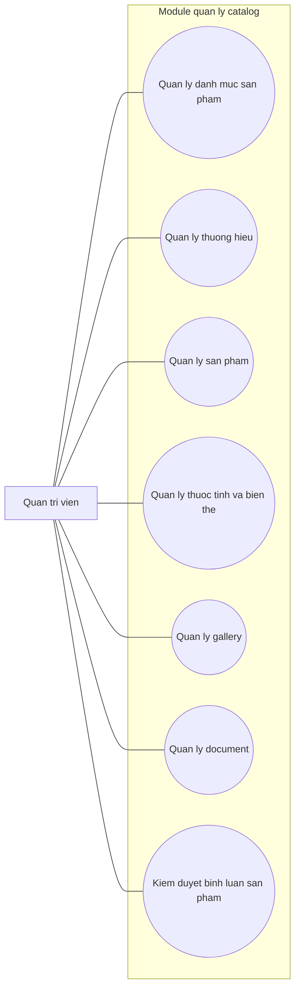

**Mô tả dưới hình:**  
Biểu đồ use case của module quản lý catalog mô tả nhóm nghiệp vụ trọng tâm nhất của admin. Quản trị viên có thể quản lý danh mục, thương hiệu, sản phẩm, thuộc tính, gallery, tài liệu và kiểm duyệt bình luận. Biểu đồ này bám các route `catalog/categories`, `catalog/brands`, `/admin/products-management`, `/admin/categories-management`, `/add-product`, `/update-product/{product_id}`, `/product-attribute`, `/add-gallery/{product_id}`, `/delete-document`, `/comment`, cùng `Admin\AdminWorkspaceController`, `ProductController`, `GalleryController`, `ProductAttributeController`, `Admin\Catalog\CategoryController`, `Admin\Catalog\BrandController`.

---

## Hình 3.20. Biểu đồ use case module quản lý nội dung

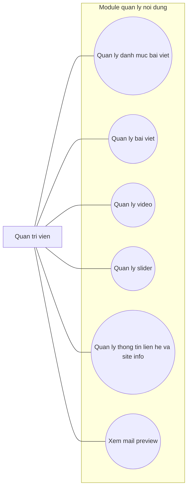

**Mô tả dưới hình:**  
Biểu đồ use case của module quản lý nội dung mô tả nhóm chức năng CMS của khu vực quản trị. Quản trị viên có thể quản lý category post, bài viết, video, slider và thông tin liên hệ của website. Biểu đồ này bám các route `/add-category-post`, `/all-category-post`, `/add-post`, `/all-post`, `/video`, `/manage-slider`, `/information`, `/mail-preview`, cùng `CategoryPost`, `PostController`, `VideoController`, `SliderController`, `ContactController`, `MailController`.

---

## Hình 3.21. Biểu đồ use case module vận hành đơn hàng và khuyến mãi

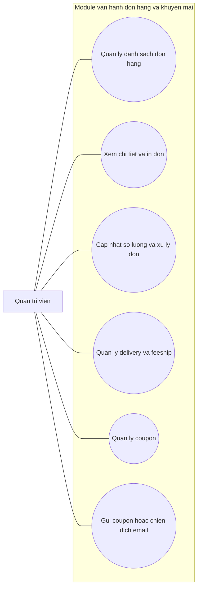

**Mô tả dưới hình:**  
Biểu đồ use case của module vận hành đơn hàng và khuyến mãi mô tả nhóm chức năng liên quan trực tiếp tới vận hành bán hàng. Quản trị viên có thể xem đơn, in đơn, cập nhật trạng thái hoặc số lượng, quản lý delivery, feeship, coupon và gửi chiến dịch email. Biểu đồ này bám các route `/admin/orders-management`, `/print-order/{checkout_code}`, `/view-order/{order_code}`, `/update-order-qty`, `/delivery`, `/insert-coupon`, `/send-coupon`, `/send-coupon-vip`, cùng `Admin\AdminWorkspaceController`, `OrderController`, `DeliveryController`, `CouponController`, `MailController`.

---

## Hình 3.22. Biểu đồ use case module người dùng, phân quyền và báo cáo

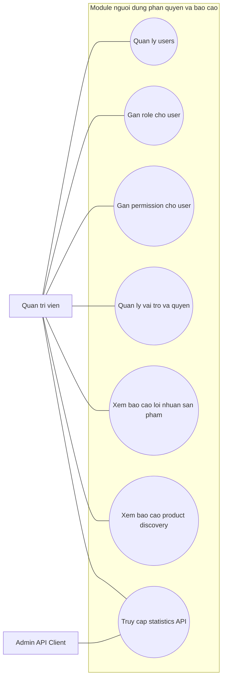

**Mô tả dưới hình:**  
Biểu đồ use case của module người dùng, phân quyền và báo cáo thể hiện nhóm nghiệp vụ quản trị hệ thống ở mức cao hơn catalog và nội dung. Quản trị viên có thể quản lý user, gán role, gán permission, xem các báo cáo quản trị và khai thác thống kê qua admin API. Biểu đồ này bám các route `users`, `/assign-role/{admin_id}`, `/assign-permission/{admin_id}`, `/index-spatie`, `/product-profit`, `/product-discovery-report`, `/api/v1/admin/statistics`, cùng `UserController`, `UserRolesController`, `Admin\ProductProfitController`, `Admin\ProductDiscoveryReportController`, `Api\Admin\StatisticsController`.

---

## Kết luận cho bộ use case theo module

Với file này, phần use case của báo cáo đã được mở rộng từ mức tổng quát sang mức module. Khi kết hợp với ba biểu đồ use case đã có trước đó, Chương 3 hiện sẽ có tổng cộng mười lăm biểu đồ use case, đủ dày để phản ánh nhiều lớp chức năng của hệ thống nhưng vẫn không rơi vào trạng thái chia quá nhỏ theo từng route riêng lẻ.

Ưu điểm của cách trình bày này là mỗi hình vẫn đọc độc lập được trong Word, vẫn gắn với route và controller thật trong repo, đồng thời giúp người bảo vệ giải thích hệ thống theo từng nhóm nghiệp vụ một cách rõ ràng hơn.
