# BỘ USE CASE PLANTUML CHO CHƯƠNG 3

Tài liệu này chuyển toàn bộ các biểu đồ use case hiện có sang định dạng PlantUML để thuận tiện hơn khi xuất hình và chèn vào báo cáo Word. File này không thay thế các file Mermaid trước đó, mà đóng vai trò là phiên bản chuyên dùng để dựng hình theo phong cách báo cáo đồ án.

Nguyên tắc trình bày của file này là:

- giữ nguyên phạm vi use case tổng quan và use case theo module
- giữ nguyên thứ tự đánh số hình để dễ ghép lại vào Chương 3
- dùng PlantUML độc lập cho từng hình để có thể xuất PNG hoặc SVG riêng lẻ
- giữ lại phần mô tả dưới hình để thuận tiện chèn vào Word

---

## Hình 3.1. Biểu đồ use case tổng quát của hệ thống

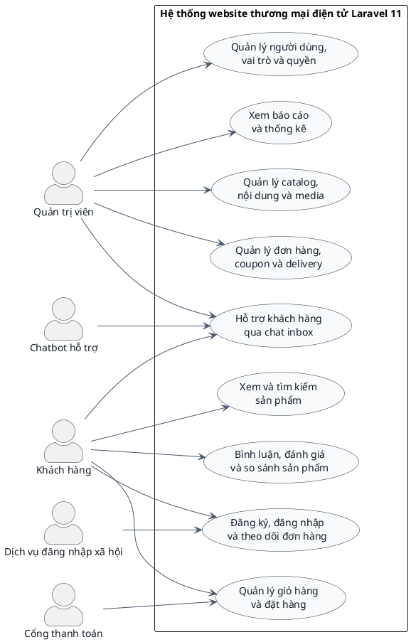

**Mô tả dưới hình:**  
Biểu đồ use case tổng quát thể hiện hai tác nhân trung tâm của hệ thống là khách hàng và quản trị viên. Khách hàng chủ yếu tương tác với storefront để xem sản phẩm, tìm kiếm, so sánh, giỏ hàng, thanh toán và theo dõi đơn hàng. Quản trị viên tương tác với khu vực admin để quản lý catalog, nội dung, đơn hàng, người dùng, quyền hạn và báo cáo. Ngoài ra, hệ thống còn liên kết với các tác nhân hỗ trợ như dịch vụ đăng nhập xã hội, cổng thanh toán và chatbot.

---

## Hình 3.2. Biểu đồ use case phía khách hàng

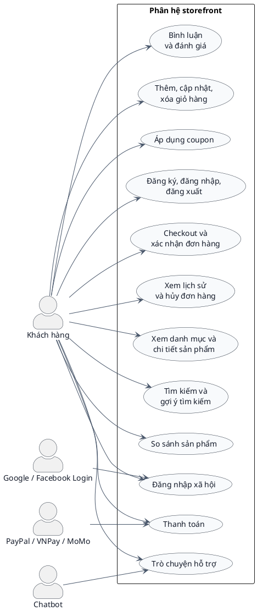

**Mô tả dưới hình:**  
Biểu đồ use case phía khách hàng mô tả các nghiệp vụ chính trên storefront. Người dùng có thể duyệt sản phẩm, tìm kiếm, so sánh, thêm vào giỏ hàng, áp dụng mã giảm giá, đăng nhập theo nhiều cách, đi qua checkout, thanh toán và theo dõi lịch sử đơn hàng. Các tác nhân hỗ trợ như cổng thanh toán, dịch vụ đăng nhập xã hội và chatbot được gắn với các use case tương ứng, giúp sơ đồ bám sát hơn với thực tế triển khai của repo.

---

## Hình 3.3. Biểu đồ use case phía quản trị viên

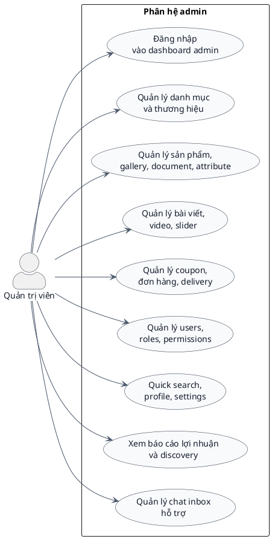

**Mô tả dưới hình:**  
Biểu đồ use case phía quản trị viên thể hiện rõ rằng khu vực admin không chỉ dừng ở CRUD sản phẩm. Ngoài catalog, hệ thống còn có quản lý nội dung, delivery, coupon, người dùng, vai trò, quyền truy cập, báo cáo và hộp thư chat hỗ trợ. Điều này phản ánh đúng hướng phát triển của repo như một hệ thống vận hành nội bộ tương đối hoàn chỉnh.

---

## Hình 3.11. Biểu đồ use case module tìm kiếm và khám phá sản phẩm

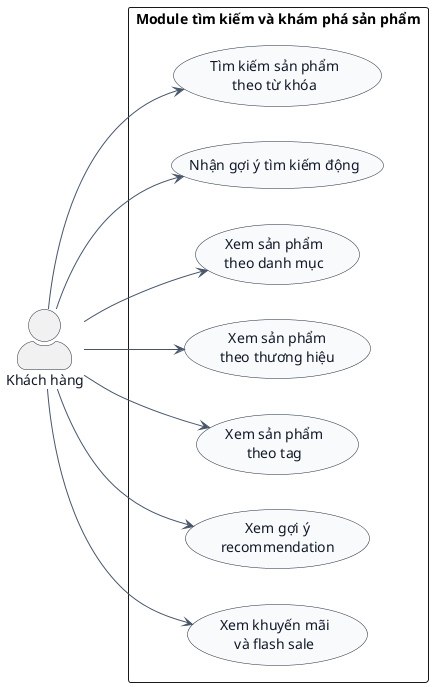

**Mô tả dưới hình:**  
Biểu đồ use case của module tìm kiếm và khám phá sản phẩm mô tả các thao tác đầu vào của khách hàng trong quá trình duyệt catalog. Người dùng có thể tìm kiếm sản phẩm theo từ khóa, nhận gợi ý động, xem sản phẩm theo danh mục, thương hiệu, tag và recommendation. Biểu đồ này bám các route như `/tim-kiem`, `/autocomplete-ajax`, `/goi-y-san-pham`, `/danh-muc/{slug_category_product}`, `/thuong-hieu/{brandSlug}`, `/tag/{product_tag}` và các controller như `HomeController`, `CategoryProduct`, `BrandProduct`, `ProductController`.

---

## Hình 3.12. Biểu đồ use case module chi tiết sản phẩm và tương tác

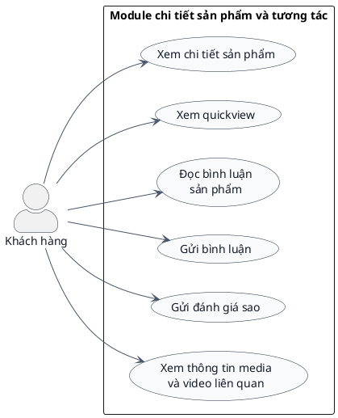

**Mô tả dưới hình:**  
Biểu đồ use case của module chi tiết sản phẩm tập trung vào trải nghiệm đọc thông tin và tương tác tại trang sản phẩm. Người dùng có thể mở trang chi tiết, xem nhanh qua quickview, theo dõi bình luận, gửi nhận xét và đánh giá sao. Biểu đồ này bám các route như `/chi-tiet/{product_slug}`, `/quickview`, `/load-comment`, `/send-comment`, `/insert-rating` và phần video hoặc media liên quan do `ProductController` và `VideoController` phục vụ.

---

## Hình 3.13. Biểu đồ use case module so sánh sản phẩm

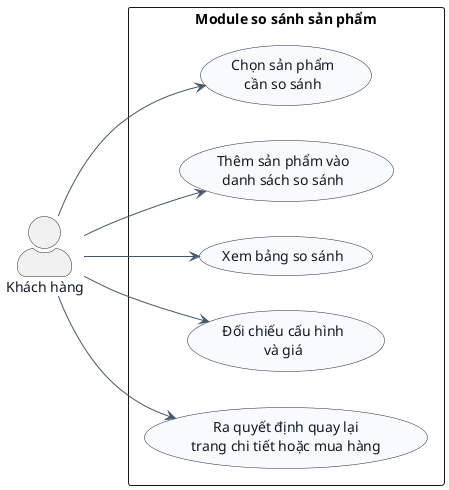

**Mô tả dưới hình:**  
Biểu đồ use case của module so sánh sản phẩm thể hiện một nghiệp vụ quan trọng đối với website bán thiết bị công nghệ, nơi khách hàng thường cần đối chiếu nhiều lựa chọn trước khi mua. Chức năng này bám route `/so-sanh` và nhóm controller `CompareController`, đồng thời hỗ trợ trực tiếp cho quá trình ra quyết định mua hàng.

---

## Hình 3.14. Biểu đồ use case module giỏ hàng và coupon

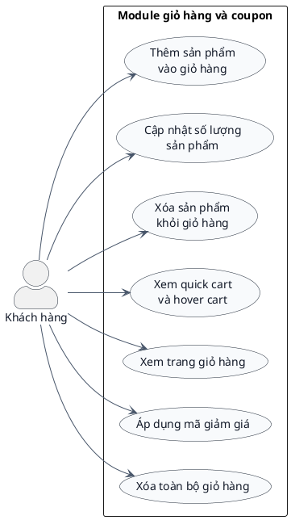

**Mô tả dưới hình:**  
Biểu đồ use case của module giỏ hàng và coupon mô tả các thao tác chính liên quan đến cart trên storefront. Người dùng có thể thêm hàng bằng AJAX, cập nhật số lượng, xóa sản phẩm, theo dõi quick cart, vào trang giỏ hàng và áp dụng mã khuyến mãi. Biểu đồ này bám các route như `/add-cart-ajax`, `/update-cart-quantity`, `/update-quick-cart`, `/gio-hang`, `/show_quick_cart`, `/hover-cart`, `/check-coupon` và `CartController`.

---

## Hình 3.15. Biểu đồ use case module tài khoản khách hàng

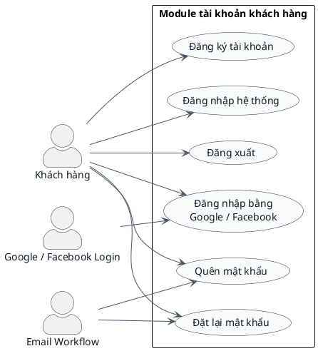

**Mô tả dưới hình:**  
Biểu đồ use case của module tài khoản khách hàng mô tả đầy đủ vòng đời xác thực của người mua trên storefront. Hệ thống hỗ trợ đăng ký, đăng nhập, đăng xuất, đăng nhập xã hội và luồng quên hoặc đặt lại mật khẩu. Biểu đồ này bám các route như `/add-customer`, `/login-customer`, `/dang-nhap`, `/dang-xuat-khach-hang`, `/login-facebook-customer`, `/login-customer-google`, `/quen-mat-khau`, `/recover-pass`, `/reset-new-pass` cùng `CheckoutController`, `AdminController`, `MailController`.

---

## Hình 3.16. Biểu đồ use case module checkout, thanh toán và đơn hàng

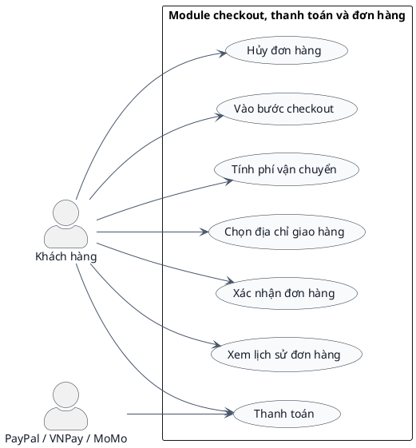

**Mô tả dưới hình:**  
Biểu đồ use case của module checkout, thanh toán và đơn hàng mô tả các chức năng hậu giỏ hàng của khách hàng. Người dùng vào checkout, tính phí vận chuyển, chọn địa chỉ, xác nhận đơn, đi qua thanh toán và theo dõi lịch sử đơn hàng. Biểu đồ này bám các route `/checkout`, `/payment`, `/calculate-fee`, `/select-delivery-home`, `/confirm-order`, `/vnpay_payment`, `/momo_payment`, `/history`, `/huy-don-hang`, cùng `CheckoutController`, `OrderController`, `PayPalController`.

---

## Hình 3.17. Biểu đồ use case module chatbot và hỗ trợ khách hàng

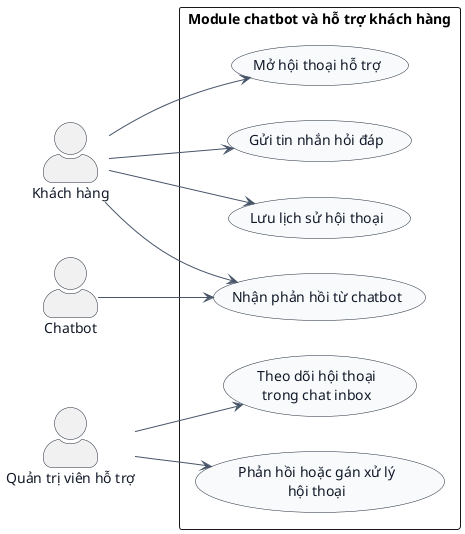

**Mô tả dưới hình:**  
Biểu đồ use case của module chatbot và hỗ trợ khách hàng thể hiện mối liên hệ giữa storefront và admin support. Khách hàng mở hội thoại, gửi câu hỏi và nhận phản hồi; phía quản trị có thể theo dõi cuộc trò chuyện trong chat inbox. Biểu đồ này bám các route `/chatbot/conversation`, `/chatbot/messages`, `/chat-inbox`, `/chat-inbox/conversations/{conversation}`, `ChatController` và `Admin\ChatInboxController`.

---

## Hình 3.18. Biểu đồ use case module xác thực và workspace quản trị

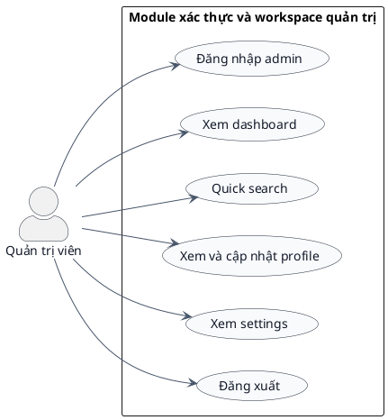

**Mô tả dưới hình:**  
Biểu đồ use case của module xác thực và workspace quản trị mô tả các thao tác nền tảng để quản trị viên sử dụng khu vực admin. Người dùng quản trị đăng nhập, vào dashboard, dùng quick search, quản lý hồ sơ cá nhân, vào settings và đăng xuất. Biểu đồ này bám các route `/admin`, `/auth-login`, `/dashboard`, `/admin/quick-search`, `/admin/profile`, `/admin/settings`, `/logout-auth` cùng `AuthController`, `AdminController`, `Admin\AdminWorkspaceController`.

---

## Hình 3.19. Biểu đồ use case module quản lý catalog

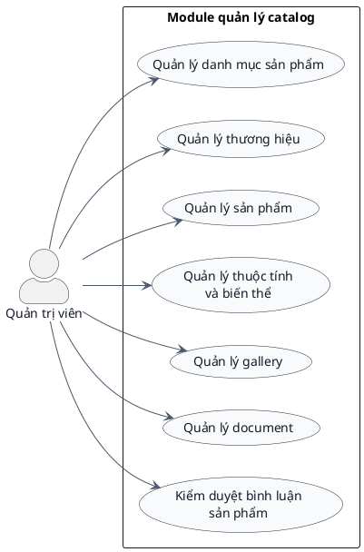

**Mô tả dưới hình:**  
Biểu đồ use case của module quản lý catalog mô tả nhóm nghiệp vụ trọng tâm nhất của admin. Quản trị viên có thể quản lý danh mục, thương hiệu, sản phẩm, thuộc tính, gallery, tài liệu và kiểm duyệt bình luận. Biểu đồ này bám các route `catalog/categories`, `catalog/brands`, `/admin/products-management`, `/admin/categories-management`, `/add-product`, `/update-product/{product_id}`, `/product-attribute`, `/add-gallery/{product_id}`, `/delete-document`, `/comment`, cùng `Admin\AdminWorkspaceController`, `ProductController`, `GalleryController`, `ProductAttributeController`, `Admin\Catalog\CategoryController`, `Admin\Catalog\BrandController`.

---

## Hình 3.20. Biểu đồ use case module quản lý nội dung

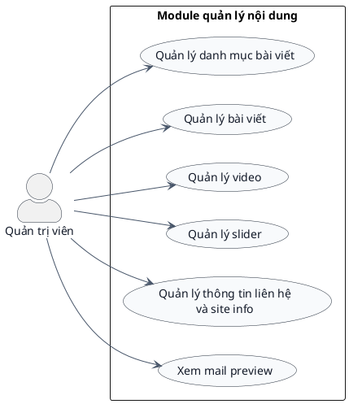

**Mô tả dưới hình:**  
Biểu đồ use case của module quản lý nội dung mô tả nhóm chức năng CMS của khu vực quản trị. Quản trị viên có thể quản lý category post, bài viết, video, slider và thông tin liên hệ của website. Biểu đồ này bám các route `/add-category-post`, `/all-category-post`, `/add-post`, `/all-post`, `/video`, `/manage-slider`, `/information`, `/mail-preview`, cùng `CategoryPost`, `PostController`, `VideoController`, `SliderController`, `ContactController`, `MailController`.

---

## Hình 3.21. Biểu đồ use case module vận hành đơn hàng và khuyến mãi

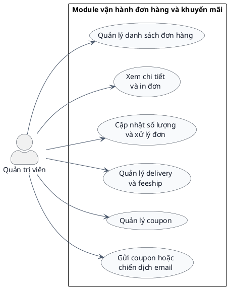

**Mô tả dưới hình:**  
Biểu đồ use case của module vận hành đơn hàng và khuyến mãi mô tả nhóm chức năng liên quan trực tiếp tới vận hành bán hàng. Quản trị viên có thể xem đơn, in đơn, cập nhật trạng thái hoặc số lượng, quản lý delivery, feeship, coupon và gửi chiến dịch email. Biểu đồ này bám các route `/admin/orders-management`, `/print-order/{checkout_code}`, `/view-order/{order_code}`, `/update-order-qty`, `/delivery`, `/insert-coupon`, `/send-coupon`, `/send-coupon-vip`, cùng `Admin\AdminWorkspaceController`, `OrderController`, `DeliveryController`, `CouponController`, `MailController`.

---

## Hình 3.22. Biểu đồ use case module người dùng, phân quyền và báo cáo

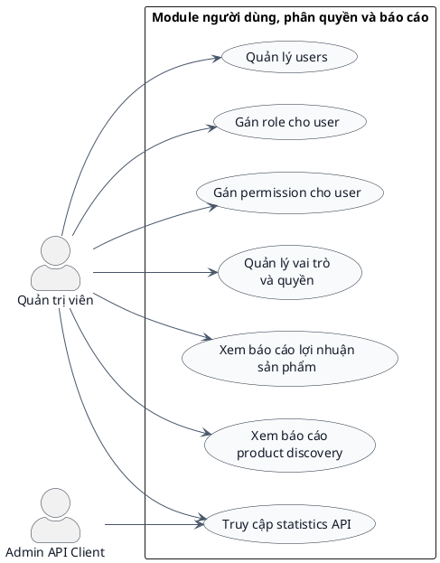

**Mô tả dưới hình:**  
Biểu đồ use case của module người dùng, phân quyền và báo cáo thể hiện nhóm nghiệp vụ quản trị hệ thống ở mức cao hơn catalog và nội dung. Quản trị viên có thể quản lý user, gán role, gán permission, xem các báo cáo quản trị và khai thác thống kê qua admin API. Biểu đồ này bám các route `users`, `/assign-role/{admin_id}`, `/assign-permission/{admin_id}`, `/index-spatie`, `/product-profit`, `/product-discovery-report`, `/api/v1/admin/statistics`, cùng `UserController`, `UserRolesController`, `Admin\ProductProfitController`, `Admin\ProductDiscoveryReportController`, `Api\Admin\StatisticsController`.

---

## Kết luận cho bộ use case PlantUML

File này giúp chuyển toàn bộ phần use case của Chương 3 từ Mermaid sang PlantUML mà vẫn giữ nguyên cấu trúc nội dung cũ. Khi kết hợp với các file Mermaid hiện có, anh sẽ có cả hai lựa chọn: Mermaid để chỉnh nhanh trong markdown, và PlantUML để xuất hình theo kiểu trình bày học thuật hơn trong báo cáo Word.

Nếu cần đồng bộ hóa toàn bộ phần biểu đồ của đồ án, bước tiếp theo hợp lý là chuyển tiếp các sơ đồ sequence, activity, ERD và deployment sang PlantUML theo đúng phong cách trình bày của file này.
