# BỘ USE CASE PLANTUML MỞ RỘNG BÁM REPO CHO CHƯƠNG 3

File này là bản use case mở rộng theo hướng đầy đủ nhất có thể dựa trên các route và module thực tế đang có trong repo. So với file `thesis_report_usecase_plantuml_revised_guest.md`, bản này có phạm vi rộng hơn:

- vẫn giữ ba tác nhân nghiệp vụ chính là `Khách vãng lai`, `Khách hàng`, `Quản trị viên`
- bổ sung các tác nhân kỹ thuật khi thực sự cần để mô tả đúng hệ thống, gồm `Cổng thanh toán`, `Nhà cung cấp đăng nhập xã hội`, `API client`
- tách thêm các module còn thiếu như `blog`, `contact`, `video shop`, `quên mật khẩu`, `social login`, `admin auth recovery`, `REST API`
- giữ cấu trúc PlantUML để có thể xuất hình trực tiếp cho báo cáo hoặc chọn lọc lại nếu cần rút gọn

Đánh giá nhanh bộ cũ:

- Bộ cũ đủ cho bản báo cáo gọn và dễ bảo vệ.
- Tuy nhiên, nếu xét theo tiêu chí bám repo thật và muốn phủ gần hết các luồng chính, bộ cũ vẫn còn thiếu một số nhánh chức năng quan trọng.
- Vì vậy, nên xem file này là bản use case đầy đủ hơn, còn file cũ là bản tối giản hơn cho trường hợp muốn giảm số lượng hình.

Lưu ý: vẫn giữ quy ước để `Hình 3.5` đến `Hình 3.10` dành cho các sơ đồ kiến trúc, activity, sequence, ERD ở các file khác.

---

## Hình 3.1. Biểu đồ use case tổng quát mở rộng của hệ thống

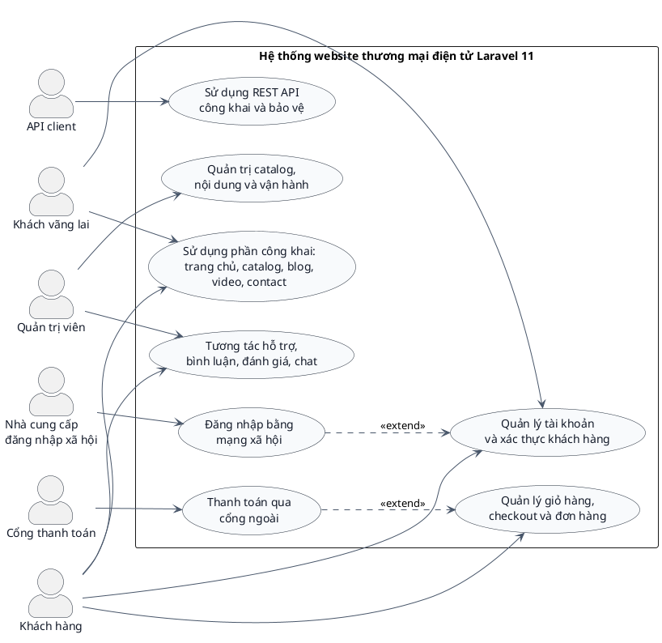

**Mô tả dưới hình:**  
Biểu đồ tổng quát mở rộng giữ ba tác nhân nghiệp vụ chính nhưng bổ sung thêm ba tác nhân kỹ thuật để mô tả đúng hơn các tích hợp thực tế của hệ thống. Cách biểu diễn này phù hợp khi muốn bám sát repo, đặc biệt ở các luồng thanh toán, đăng nhập xã hội và REST API.

---

## Hình 3.2. Biểu đồ use case phần khách vãng lai mở rộng

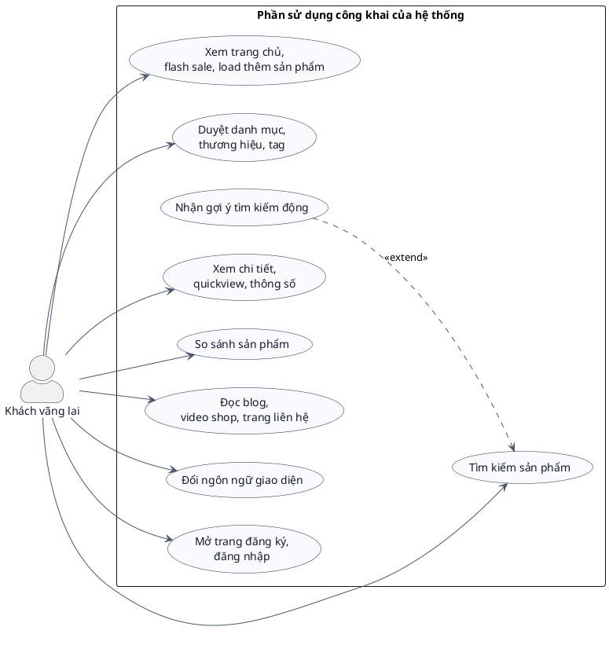

**Mô tả dưới hình:**  
Biểu đồ này mở rộng hơn bản cũ vì không chỉ bám các route catalog mà còn tính tới nội dung công khai như blog, video shop, contact page và đổi ngôn ngữ. Nhóm route tiêu biểu gồm `/`, `/tim-kiem`, `/autocomplete-ajax`, `/danh-muc/{slug_category_product}`, `/thuong-hieu/{brandSlug}`, `/tag/{product_tag}`, `/video-shop`, `/lien-he`, `lang/{locale}`.

---

## Hình 3.3. Biểu đồ use case phần khách hàng mở rộng

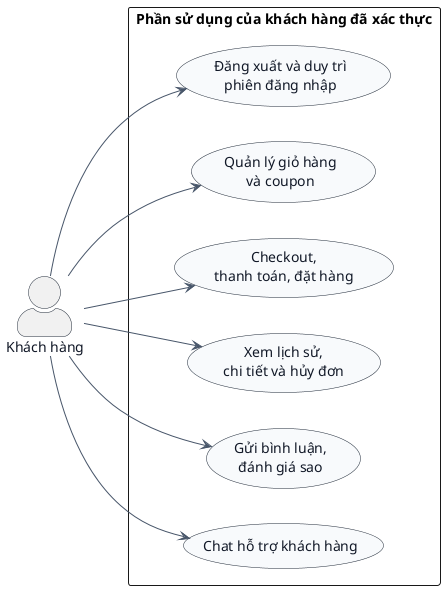

**Mô tả dưới hình:**  
Biểu đồ khách hàng mở rộng gom các thao tác sau xác thực thành các nhóm nghiệp vụ lớn hơn để nhìn hệ thống rõ hơn ở cấp actor. Các use case này tiếp tục được tách nhỏ ở các hình module phía sau.

---

## Hình 3.4. Biểu đồ use case phần quản trị viên mở rộng

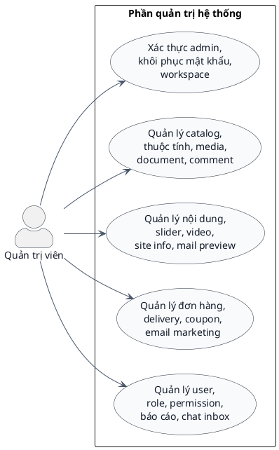

**Mô tả dưới hình:**  
Bản mở rộng của actor quản trị viên phản ánh rõ hơn phần vận hành thật của repo. Khu vực admin không chỉ có CRUD sản phẩm mà còn có xác thực riêng, khôi phục tài khoản, inbox hỗ trợ, mail preview, report và công cụ workspace.

---

## Hình 3.11. Biểu đồ use case module tìm kiếm và khám phá sản phẩm

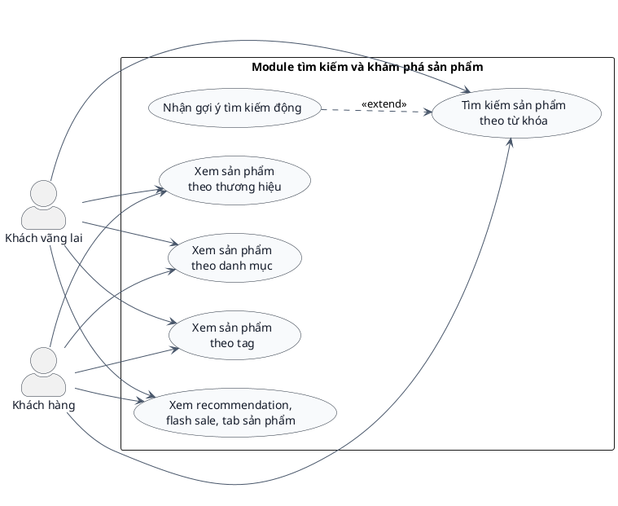

**Mô tả dưới hình:**  
Biểu đồ này bám các route `/tim-kiem`, `/autocomplete-ajax`, `/goi-y-san-pham`, `/danh-muc/{slug_category_product}`, `/thuong-hieu/{brandSlug}`, `/tag/{product_tag}`, `/product-tabs`. Đây là cụm chức năng quan trọng vì website bán thiết bị công nghệ có hành vi khám phá và so sánh rất cao.

---

## Hình 3.12. Biểu đồ use case module chi tiết sản phẩm, đánh giá và so sánh

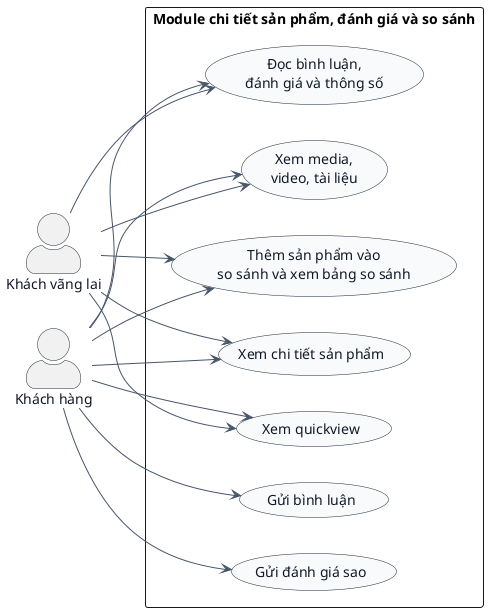

**Mô tả dưới hình:**  
Biểu đồ này phủ các route `/chi-tiet/{product_slug}`, `/quickview`, `/load-comment`, `/send-comment`, `/insert-rating`, `/so-sanh`, và cả phần hiển thị media/video/tài liệu trên trang sản phẩm. So với bản cũ, phần compare đã được gộp vào chung module khám phá sâu sản phẩm để bám hành vi người dùng hơn.

---

## Hình 3.13. Biểu đồ use case module nội dung công khai: blog, contact, video

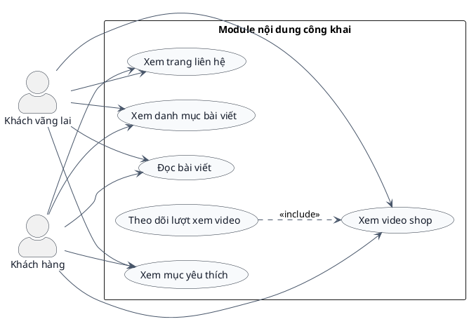

**Mô tả dưới hình:**  
Đây là nhóm chức năng thường bị bỏ quên nếu chỉ nhìn dự án như website bán hàng thuần. Biểu đồ bám các route `/lien-he`, `/danh-muc-bai-viet/{post_slug}`, `/bai-viet/{post_slug}`, `/video-shop`, `/watch-video`, `/yeu-thich`.

---

## Hình 3.14. Biểu đồ use case module giỏ hàng và coupon

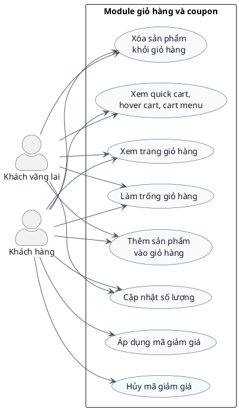

**Mô tả dưới hình:**  
Biểu đồ này bám các route `/add-cart-ajax`, `/save-cart`, `/update-cart`, `/update-cart-quantity`, `/show_quick_cart`, `/hover-cart`, `/show-cart-menu`, `/gio-hang`, `POST/DELETE /del-all-product`, `/check-coupon`, `DELETE /unset-coupon`.

---

## Hình 3.15. Biểu đồ use case module tài khoản khách hàng, khôi phục mật khẩu và đăng nhập xã hội

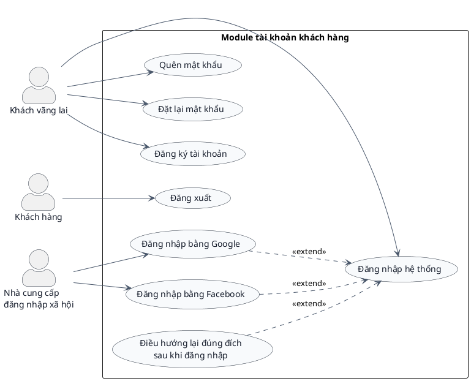

**Mô tả dưới hình:**  
Biểu đồ này mở rộng rõ hơn phần tài khoản vì repo có đủ đăng ký, đăng nhập, quên mật khẩu, đặt lại mật khẩu, đăng nhập Google/Facebook và cơ chế redirect quay lại đúng đích sau đăng nhập. Các route bám theo gồm `/add-customer`, `/login-customer`, `/dang-nhap`, `/dang-xuat-khach-hang`, `/quen-mat-khau`, `/recover-pass`, `/reset-new-pass`, `/login-facebook-customer`, `/login-customer-google`.

---

## Hình 3.16. Biểu đồ use case module checkout, thanh toán và lịch sử đơn hàng

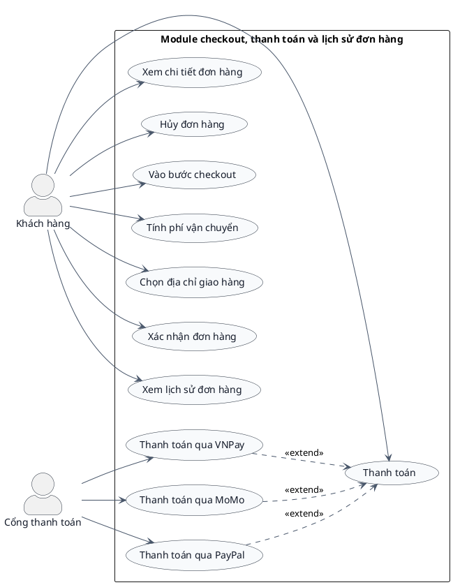

**Mô tả dưới hình:**  
Biểu đồ này là phần còn thiếu khá rõ trong bản gọn vì repo có thanh toán qua nhiều cổng ngoài. Các route tiêu biểu gồm `/checkout`, `/payment`, `/calculate-fee`, `/select-delivery-home`, `/confirm-order`, `/process-transaction`, `/vnpay_payment`, `/momo_payment`, `/history`, `/view-history-order/{order_code}`, `/huy-don-hang`.

---

## Hình 3.17. Biểu đồ use case module chat hỗ trợ khách hàng

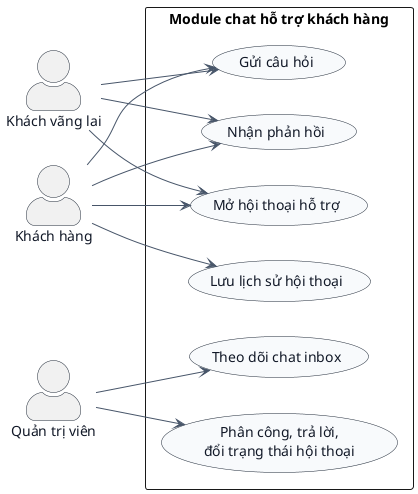

**Mô tả dưới hình:**  
Biểu đồ chat hỗ trợ bám cả phần storefront lẫn admin inbox. Các route liên quan gồm `/chatbot/conversation`, `/chatbot/messages`, `/chat-inbox`, `/chat-inbox/conversations/{conversation}`, `/chat-inbox/conversations/{conversation}/reply`, `/assign`, `/status`.

---

## Hình 3.18. Biểu đồ use case module xác thực và workspace quản trị

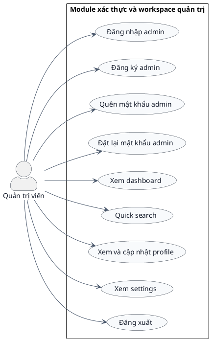

**Mô tả dưới hình:**  
Biểu đồ này đầy đủ hơn bản cũ vì đã đưa cả nhánh `register`, `forgot password`, `reset password` của admin vào. Các route bám theo gồm `/admin`, `/admin/register`, `/admin/forgot-password`, `/admin/reset-password/{token}`, `/auth-login`, `/dashboard`, `/admin/quick-search`, `/admin/profile`, `/admin/settings`, `/logout-auth`.

---

## Hình 3.19. Biểu đồ use case module quản lý catalog, sản phẩm, media và comment

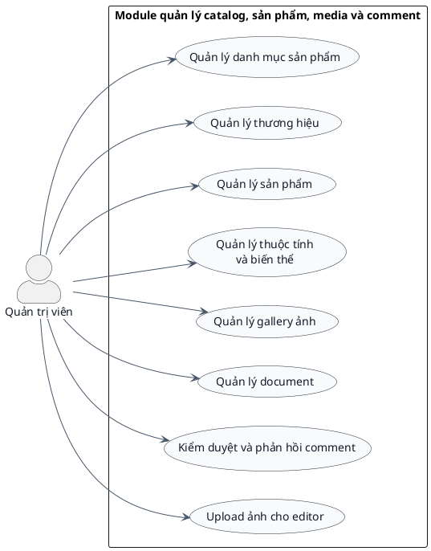

**Mô tả dưới hình:**  
Đây là một trong các module lớn nhất của admin. Nó phủ các route `catalog/categories`, `catalog/brands`, `/admin/products-management`, `/admin/categories-management`, `/add-product`, `/product-attribute/{product_id}`, `/attribute`, `/add-gallery/{product_id}`, `download_document/{path}/{name}`, `delete_document/{path}`, `/comment`, `/reply-comment`, `/uploads-ckeditor`.

---

## Hình 3.20. Biểu đồ use case module quản lý nội dung, site info và media marketing

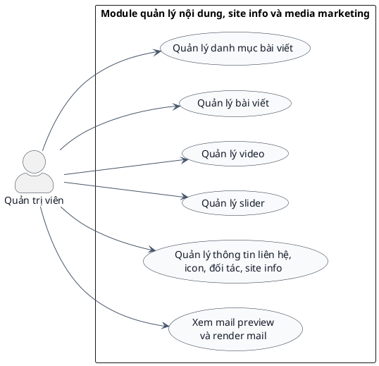

**Mô tả dưới hình:**  
Biểu đồ này bám các route `/add-category-post`, `/all-category-post`, `/add-post`, `/all-post`, `/video`, `/manage-slider`, `/information`, `/list-nut`, `/list-doitac`, `/save-info`, `/mail-preview`, `/mail-preview/render`.

---

## Hình 3.21. Biểu đồ use case module vận hành đơn hàng, delivery, coupon và email marketing

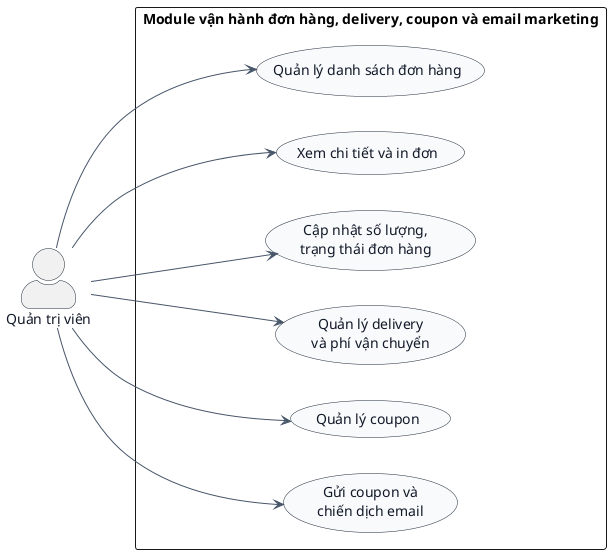

**Mô tả dưới hình:**  
Biểu đồ này bám các route `/admin/orders-management`, `/print-order/{checkout_code}`, `/view-order/{order_code}`, `/update-order-qty`, `/update-qty`, `/delivery`, `/select-delivery`, `/insert-delivery`, `/select-feeship`, `/insert-coupon`, `/list-coupon`, `/send-coupon`, `/send-coupon-vip`.

---

## Hình 3.22. Biểu đồ use case module người dùng, phân quyền, báo cáo và chat inbox quản trị

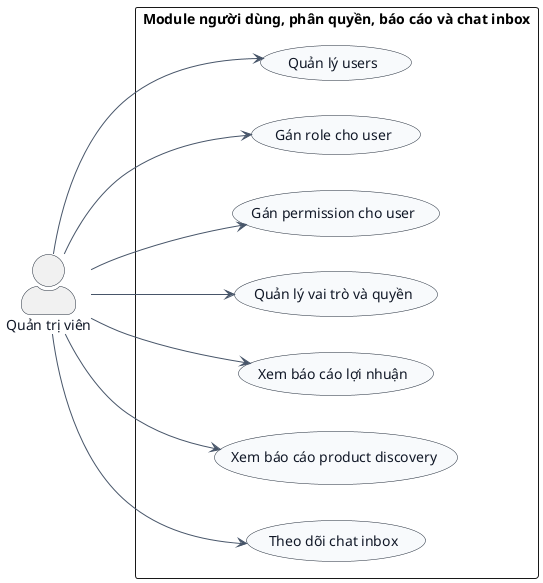

**Mô tả dưới hình:**  
Biểu đồ này gom các route `users`, `assign-roles`, `/create-spatie/{admin_id}`, `/create-permission/{admin_id}`, `/assign-role/{admin_id}`, `/assign-permission/{admin_id}`, `/index-spatie`, `/product-profit`, `/product-discovery-report`, `/chat-inbox`.

---

## Hình 3.23. Biểu đồ use case module Public API

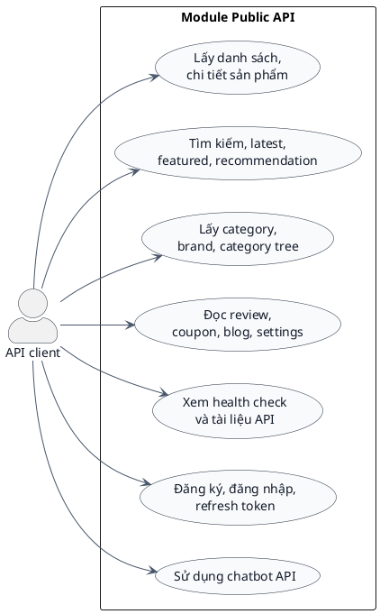

**Mô tả dưới hình:**  
Đây là phần mà bản use case gọn trước đó chưa biểu diễn. Biểu đồ bám các route `/api/v1/products`, `/latest`, `/featured`, `/search`, `/recommendations`, `/categories`, `/brands`, `/reviews`, `/coupons`, `/blog`, `/settings`, `/health`, `/docs`, `/chatbot`, `/auth/login`, `/auth/register`, `/auth/refresh`.

---

## Hình 3.24. Biểu đồ use case module Protected API cho khách hàng

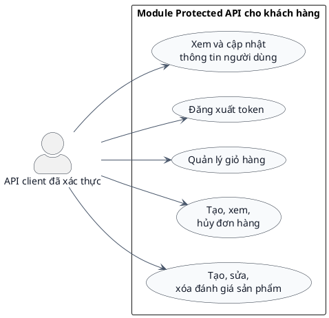

**Mô tả dưới hình:**  
Biểu đồ này bám các route bảo vệ bởi `auth:sanctum` như `/api/v1/user`, `/api/v1/auth/logout`, `/api/v1/cart`, `/api/v1/orders`, `/api/v1/reviews`.

---

## Hình 3.25. Biểu đồ use case module Admin API

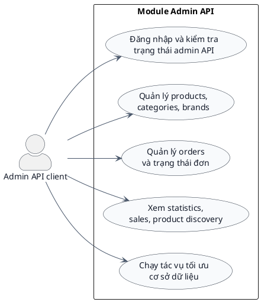

**Mô tả dưới hình:**  
Biểu đồ này bám các route `/api/v1/admin/auth/login`, `/api/v1/admin/auth/me`, `/api/v1/admin/products`, `/api/v1/admin/categories`, `/api/v1/admin/brands`, `/api/v1/admin/orders`, `/api/v1/admin/statistics`, `/optimize-database`, `/add-indexes`, `/slow-queries`.

---

## Kết luận cho bộ use case mở rộng

Nếu xét theo tiêu chí use case “đủ để trình bày gọn trong đồ án”, bộ file cũ đã ở mức dùng được. Tuy nhiên, nếu xét theo tiêu chí “đầy đủ nhất có thể” dựa trên repo hiện tại, bộ cũ chưa bao phủ hết các nhóm chức năng như:

- blog, contact, video shop, đổi ngôn ngữ
- quên mật khẩu, đặt lại mật khẩu, social login
- admin register, admin forgot/reset password
- thanh toán qua cổng ngoài
- public API, protected API, admin API

Vì vậy, file này nên được xem là bản mở rộng bám repo hơn. Khi đưa vào báo cáo Word, anh có thể:

- dùng toàn bộ nếu muốn thể hiện độ phủ use case tối đa
- hoặc chọn các hình trọng tâm như `3.1`, `3.2`, `3.3`, `3.4`, `3.14`, `3.15`, `3.16`, `3.19`, `3.21`, `3.22` nếu cần rút gọn

Trong trường hợp cần cân bằng giữa tính học thuật và độ dài báo cáo, cách tốt nhất là dùng file này làm nguồn chuẩn, sau đó chọn lọc các sơ đồ phù hợp nhất với Chương 3.
