# BỘ USE CASE PLANTUML ĐÃ CHỈNH LẠI CHO CHƯƠNG 3

Tài liệu này là phiên bản use case PlantUML được chỉnh lại theo hướng phù hợp hơn với báo cáo đồ án. So với bản trước, file này có ba thay đổi chính:

- bổ sung tác nhân `Khách vãng lai`
- bỏ các tác nhân hỗ trợ ngoài hệ thống như cổng thanh toán, dịch vụ đăng nhập xã hội, chatbot hay API client
- tách rõ use case theo từng phần: khách vãng lai, khách hàng và quản trị viên

Vì vậy, nếu anh muốn bộ sơ đồ nhìn “đồ án” hơn, gọn hơn và bám sát phân tích tác nhân chính của hệ thống, nên ưu tiên dùng file này khi xuất hình.

Lưu ý: các số hình từ `3.5` đến `3.10` vẫn được dành cho các biểu đồ kiến trúc, ERD, activity và sequence trong các file khác, nên bộ use case module tiếp tục bắt đầu từ `Hình 3.11`.

---

## Hình 3.1. Biểu đồ use case tổng quát của hệ thống

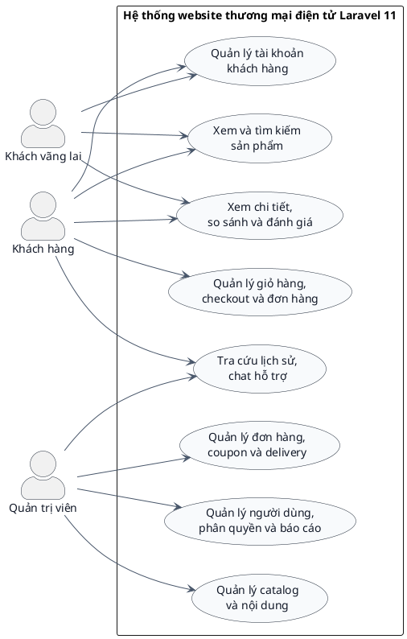

**Mô tả dưới hình:**  
Biểu đồ use case tổng quát đã được chỉnh lại theo hướng chỉ giữ ba tác nhân chính của hệ thống: khách vãng lai, khách hàng và quản trị viên. Cách tách này phản ánh đúng thực tế vận hành của website hơn vì người truy cập chưa đăng nhập vẫn có thể duyệt sản phẩm và tìm kiếm, còn các thao tác nhạy cảm hơn như checkout, xem lịch sử đơn hàng hay quản trị hệ thống được phân cho các tác nhân tương ứng.

---

## Hình 3.2. Biểu đồ use case phần khách vãng lai

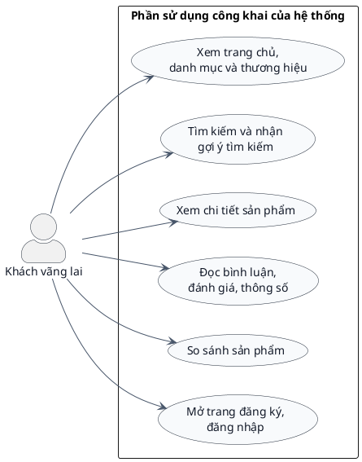

**Mô tả dưới hình:**  
Biểu đồ use case phần khách vãng lai nhấn mạnh rằng website không chỉ phục vụ người dùng đã đăng nhập. Một người truy cập chưa có tài khoản vẫn có thể vào trang chủ, duyệt sản phẩm, tìm kiếm, đọc thông tin, so sánh và sau đó mới quyết định chuyển sang bước xác thực. Đây là lý do tác nhân khách vãng lai cần được tách riêng trong báo cáo.

---

## Hình 3.3. Biểu đồ use case phần khách hàng

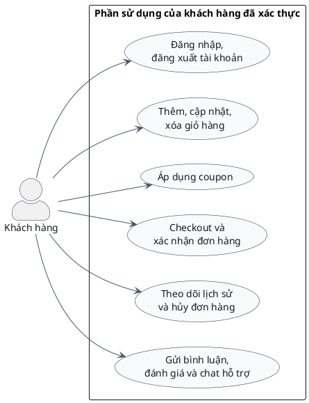

**Mô tả dưới hình:**  
Biểu đồ use case phần khách hàng gom các thao tác cần xác thực, đặc biệt là checkout, lịch sử đơn hàng và các tương tác có tính cá nhân. Cách tách này giúp báo cáo thể hiện rõ ranh giới giữa phần dùng công khai và phần dùng sau đăng nhập.

---

## Hình 3.4. Biểu đồ use case phần quản trị viên

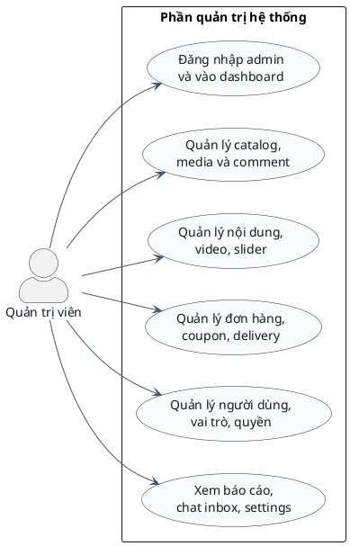

**Mô tả dưới hình:**  
Biểu đồ use case phần quản trị viên cho thấy khu vực admin là một phân hệ đầy đủ chứ không chỉ là nơi thêm hoặc sửa sản phẩm. Ngoài catalog, quản trị viên còn phải xử lý nội dung, đơn hàng, phân quyền, báo cáo và các công cụ vận hành nội bộ.

---

## Hình 3.11. Biểu đồ use case module tìm kiếm và khám phá sản phẩm

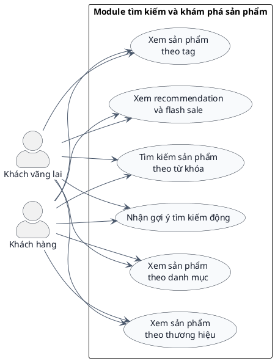

**Mô tả dưới hình:**  
Module tìm kiếm và khám phá sản phẩm là vùng dùng công khai của website nên cả khách vãng lai và khách hàng đều có thể truy cập. Biểu đồ này bám các route như `/tim-kiem`, `/autocomplete-ajax`, `/goi-y-san-pham`, `/danh-muc/{slug_category_product}`, `/thuong-hieu/{brandSlug}` và `/tag/{product_tag}`.

---

## Hình 3.12. Biểu đồ use case module chi tiết sản phẩm và tương tác

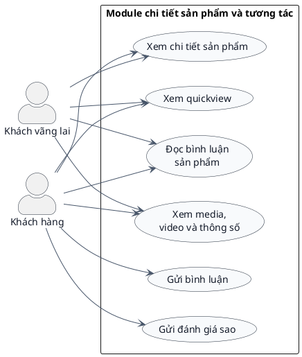

**Mô tả dưới hình:**  
Biểu đồ này tách rõ hai lớp thao tác: khách vãng lai chỉ đọc và xem thông tin, trong khi khách hàng đã xác thực có thể gửi bình luận và đánh giá. Cách phân tách này bám tốt hơn với các route như `/chi-tiet/{product_slug}`, `/quickview`, `/load-comment`, `/send-comment`, `/insert-rating`.

---

## Hình 3.13. Biểu đồ use case module so sánh sản phẩm

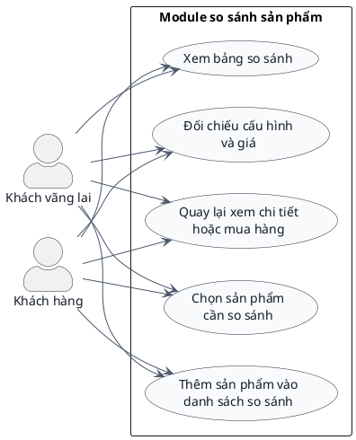

**Mô tả dưới hình:**  
So sánh sản phẩm là nghiệp vụ phù hợp với cả khách vãng lai lẫn khách hàng vì đây là bước tiền quyết định mua. Biểu đồ bám module và route `/so-sanh` cùng `CompareController`.

---

## Hình 3.14. Biểu đồ use case module giỏ hàng và coupon

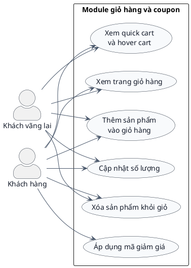

**Mô tả dưới hình:**  
Biểu đồ này thể hiện rõ rằng giỏ hàng có thể bắt đầu từ khách vãng lai, nhưng các thao tác sâu hơn như coupon thường gắn chặt hơn với bước mua hàng của khách đã xác thực. Các route chính liên quan là `/add-cart-ajax`, `/update-cart-quantity`, `/update-quick-cart`, `/gio-hang`, `/show_quick_cart`, `/hover-cart`, `/check-coupon`.

---

## Hình 3.15. Biểu đồ use case module tài khoản khách hàng

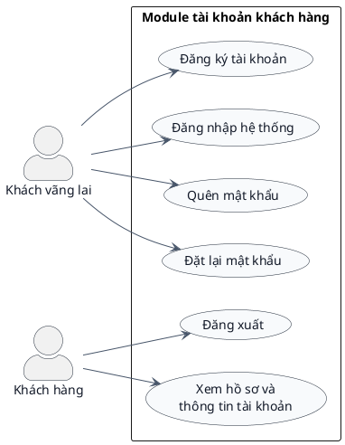

**Mô tả dưới hình:**  
Module tài khoản là nơi ranh giới giữa khách vãng lai và khách hàng thể hiện rõ nhất. Khách vãng lai khởi tạo đăng ký hoặc đăng nhập, còn khách hàng sau xác thực tiếp tục với hồ sơ và đăng xuất. Biểu đồ này bám các route như `/add-customer`, `/login-customer`, `/dang-nhap`, `/dang-xuat-khach-hang`, `/quen-mat-khau`, `/recover-pass`, `/reset-new-pass`.

---

## Hình 3.16. Biểu đồ use case module checkout, thanh toán và đơn hàng

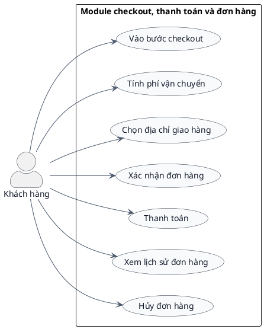

**Mô tả dưới hình:**  
Do hệ thống thực tế yêu cầu đăng nhập trước checkout, module này chỉ còn gắn với tác nhân khách hàng. Các route tiêu biểu là `/checkout`, `/payment`, `/calculate-fee`, `/select-delivery-home`, `/confirm-order`, `/history`, `/huy-don-hang`.

---

## Hình 3.17. Biểu đồ use case module chat hỗ trợ khách hàng

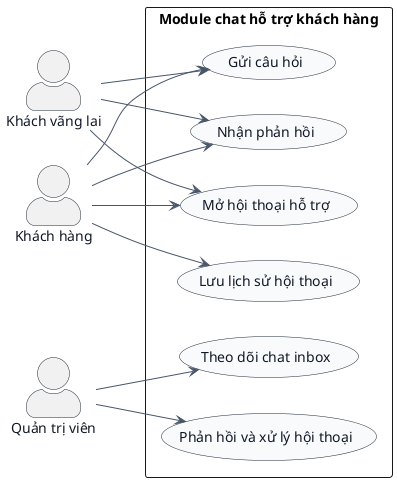

**Mô tả dưới hình:**  
Trong bản chỉnh này, tác nhân hỗ trợ ngoài hệ thống đã bị loại bỏ; thay vào đó, sơ đồ chỉ giữ khách vãng lai, khách hàng và quản trị viên. Cách biểu diễn này bám hơn với góc nhìn phân tích hệ thống và các route `/chatbot/conversation`, `/chatbot/messages`, `/chat-inbox`, `/chat-inbox/conversations/{conversation}`.

---

## Hình 3.18. Biểu đồ use case module xác thực và workspace quản trị

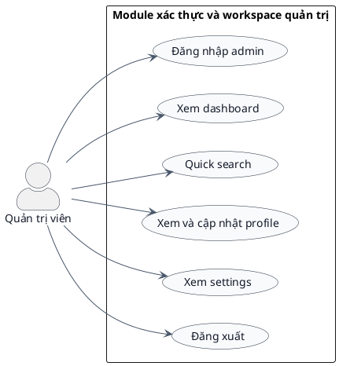

**Mô tả dưới hình:**  
Biểu đồ này giữ nguyên bản chất của module workspace admin nhưng làm gọn actor còn đúng một tác nhân là quản trị viên. Các route tiêu biểu gồm `/admin`, `/auth-login`, `/dashboard`, `/admin/quick-search`, `/admin/profile`, `/admin/settings`, `/logout-auth`.

---

## Hình 3.19. Biểu đồ use case module quản lý catalog

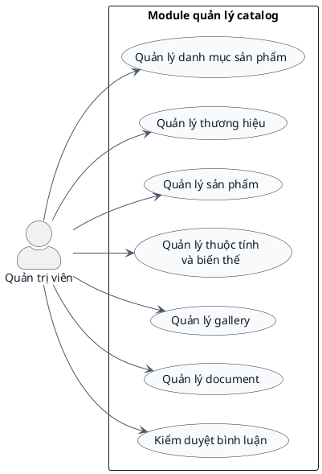

**Mô tả dưới hình:**  
Module quản lý catalog bám các route `catalog/categories`, `catalog/brands`, `/add-product`, `/all-product`, `/update-product/{product_id}`, `/product-attribute`, `/add-gallery/{product_id}`, `/delete-document`, `/comment`. Đây là nhóm chức năng lớn nhất trong khu vực quản trị.

---

## Hình 3.20. Biểu đồ use case module quản lý nội dung

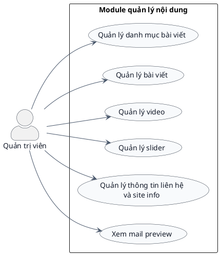

**Mô tả dưới hình:**  
Biểu đồ use case module quản lý nội dung tiếp tục chỉ dùng một actor lõi là quản trị viên. Nhóm route tiêu biểu gồm `/add-category-post`, `/all-category-post`, `/add-post`, `/all-post`, `/video`, `/manage-slider`, `/information`, `/mail-preview`.

---

## Hình 3.21. Biểu đồ use case module vận hành đơn hàng và khuyến mãi

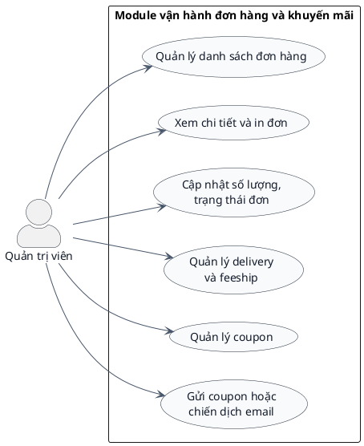

**Mô tả dưới hình:**  
Biểu đồ này mô tả phần vận hành hậu bán hàng trong admin, bám các route `/manage-order`, `/print-order/{checkout_code}`, `/view-order/{order_code}`, `/update-order-qty`, `/delivery`, `/insert-coupon`, `/send-coupon`, `/send-coupon-vip`.

---

## Hình 3.22. Biểu đồ use case module người dùng, phân quyền và báo cáo

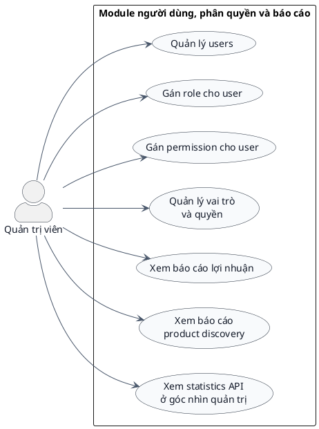

**Mô tả dưới hình:**  
Tác nhân `Admin API Client` đã được loại bỏ trong bản chỉnh này để sơ đồ tập trung vào góc nhìn use case của người vận hành hệ thống. Module vẫn bám các route `users`, `/assign-role/{admin_id}`, `/assign-permission/{admin_id}`, `/index-spatie`, `/product-profit`, `/product-discovery-report`, `/api/v1/admin/statistics`.

---

## Kết luận cho bộ use case đã chỉnh lại

Phiên bản use case này phù hợp hơn với phong cách báo cáo đồ án vì nó tập trung vào các tác nhân nghiệp vụ chính thay vì đưa quá nhiều tác nhân kỹ thuật hoặc tác nhân hỗ trợ vào cùng một hình. Việc bổ sung khách vãng lai đồng thời làm cho phần phân tích hệ thống sát với hành vi thực tế của người dùng hơn, đặc biệt ở các luồng tìm kiếm, xem sản phẩm, so sánh và điều hướng sang đăng nhập trước checkout.

Nếu dùng file này thay cho bản use case cũ, Chương 3 sẽ có bộ sơ đồ rõ hơn về mặt phân quyền và dễ giải thích hơn khi bảo vệ.
